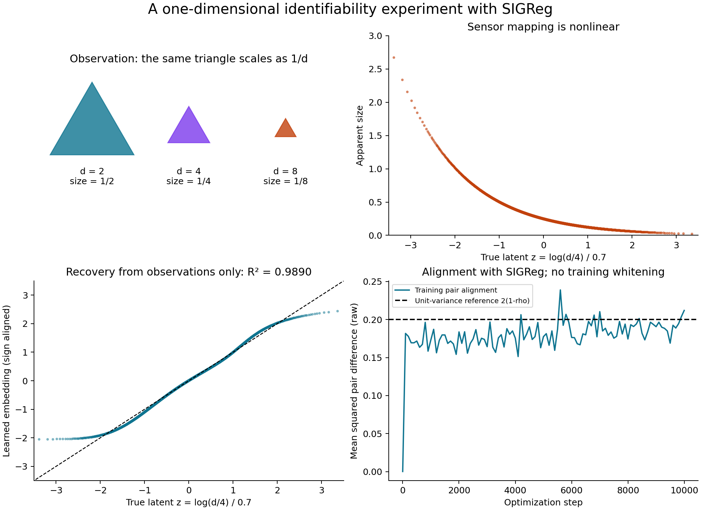

# JEPA Identifiability and Predictive Subspaces

A minimal unsupervised experiment studying identifiability from an object whose apparent size scales as **1/distance**. The current experiment adapts Theorem 1 of [*When Does LeJEPA Learn a World Model?*](https://arxiv.org/abs/2605.26379), by David Klindt, Yann LeCun and Randall Balestriero.

An agent observes the projected vertices of a fixed triangle. A neural encoder learns from pairs of observations using alignment and **SIGReg**, without distance labels. With stationary Gaussian dynamics in log-distance, the ideal representation recovers log-distance up to sign.

This is a one-dimensional toy adaptation, not the authors' full experimental pipeline. It uses continuous vertex coordinates rather than raster images. Predictive subspaces beyond this scalar setting are future work.



## Quick start

Use Python 3.12 (the pinned PyTorch version supports Python 3.8–3.12):

```sh
python3.12 -m venv .venv
source .venv/bin/activate
python -m pip install -r requirements.txt
python identifiability/reproduce.py
```

The default run trains three seeds for 10,000 steps each on CPU and writes metrics, a figure and checkpoints under `identifiability/output/`. Training generates fresh data locally; it does not download datasets or pretrained models.

For a quick smoke run that preserves the checked-in results:

```sh
python identifiability/reproduce.py --steps 20 --seeds 0 --output /tmp/jepa-smoke
```

Run the numerical checks:

```sh
python -m unittest discover -s identifiability -p 'test_*.py' -v
```

## Results

Across three seeds, a held-out linear probe recovers the Gaussian log-distance coordinate with **R² = 0.9890–0.9906**. A probe directly from apparent size reaches R² = 0.7661–0.7776. The learned raw embedding variance is 0.9250–0.9401, so Gaussianity and recovery remain approximate.

The encoder observes only triangle vertices during optimization. Latent coordinates are used for evaluation and resolving the unavoidable global sign. Raw and independently calibrated metrics are both reported.

## Files

- [Derivation and experimental details](identifiability/README.md): assumptions, Hermite proof, SIGReg formula and limitations.
- [Experiment](identifiability/reproduce.py): renderer, encoder, SIGReg and evaluation.
- [Numerical checks](identifiability/test_reproduce.py): reference-loss equivalence, gradients and sensor geometry.
- [Recorded metrics](identifiability/output/metrics.json) and [figure](identifiability/output/reproduction.png).
- `identifiability/output/encoder_seed{0,1,2}.pt`: model state, calibration, configuration and training history.

## Scope and assumptions

Distance is positive, so the Gaussian coordinate is **log-distance**, not physical distance. Paired states follow a stationary Ornstein–Uhlenbeck transition in that coordinate. The object has fixed physical size and remains visible with unchanged orientation. Unknown variable physical size introduces a size–distance ambiguity. Ordinary walking policies and finite raster images require additional analysis.

The numerical implementation uses the scalar specialization of the [authors' SIGReg code](https://github.com/klindtlab/lejepa-identifiability/blob/main/experiments/lejepa_id/losses.py). See [third-party notices](THIRD_PARTY_NOTICES.md) for attribution and its MIT license. This repository's license is [MIT](LICENSE).
