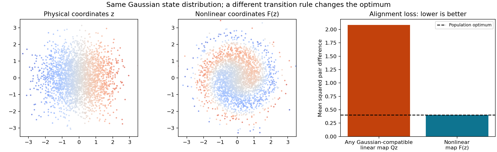

# Why does the movement rule change what the agent learns?

**ICM→OU and ICM→OU with entropy-bonus decay were tied for best in our three runs.** Their average distance-recovery scores were both about 0.9991, compared with 0.9946 for fixed OU and 0.8832 for ICM alone. The [full comparison](../schedules/output/RESULTS.md) includes individual runs and tests on a broader distance distribution.

**Follow-up:** the [larger control study](../curriculum-controls/INTERPRETATION.md) finds serious failures on two of five new seeds. The earlier three-run ranking is not a reliable general conclusion.

The original result was encouraging evidence for the handover in this small world. It does not yet tell us whether curiosity specifically is responsible, or whether another starting policy would help just as much.

## Why ICM alone did worse

A movement rule affects three different things:

1. **Which distances the agent sees.** Two curiosity agents concentrated near the object. Their bounded, uneven distance distributions also differ from the Gaussian log-distance assumed by the paper. Requiring Gaussian outputs can then favor a curved mapping of the physical coordinate.
2. **Which views are paired.** Even the same distribution of distances can be paired in different ways. The objective rewards features that change slowly across these pairs. Under the paper's OU rule, those features are the true Gaussian coordinates. An arbitrary learned policy need not preserve that property.
3. **How well training succeeds.** Some ICM models had output variances near 18 or 14 when the target was 1. They had not met the intended regularization goal. We cannot explain all of their poor recovery as a consequence of a different mathematical optimum.

Action entropy alone cannot summarize these differences. An agent that usually moves closer and one that usually moves farther away can have exactly the same action entropy.

Both handover and fixed-OU training finish with the same ideal OU objective. The handover's higher score therefore calls for an explanation about the training path, such as a helpful starting representation. It does not imply a better ideal final optimum. That explanation remains a hypothesis to test.

## A controlled example: identical state distributions, different answers

We added a separate two-dimensional example to isolate the second effect. Both states have exactly the same standard Gaussian distribution. We change only the transition rule, using a reversible nonlinear rotation. The optimal learned coordinates then become a nonlinear warp of the original coordinates.

In the saved numerical check, any Gaussian-compatible linear map has alignment loss about **2.084**, while the nonlinear map has loss **0.400**, matching its theoretical optimum. Lower is better. This is a mathematical construction, not a trained ICM policy or another triangle run.



The colors track the same points through the warp. Both clouds have the same Gaussian distribution despite the changed point correspondence.

Run it from the repository root:

```sh
python behavior-policy-experiments/analysis/check_policy_effects.py
python -m unittest discover -s behavior-policy-experiments/analysis -p 'test_*.py' -v
```

The first command replaces the saved [numbers](output/policy_counterexample.json) and figure. Add `--output /tmp/policy-check` to save a separate copy. It does not train a network.

## The most useful next experiments

| Next step | What it would tell us |
| --- | --- |
| Compare random→OU, ICM→OU and OU→OU, with matched OU exposure and optimizer settings | Whether the handover helps because of curiosity, a change in data, or the timing of training |
| Train encoders on ordinary OU and the nonlinear example above | Whether changing transitions alone changes the coordinates recovered in practice |
| Add sideways position as well as distance, with separate action controls | Whether action information can anchor two physical coordinates and rule out nonlinear mixing |
| Perturb OU gradually while measuring coverage and pair correlations | How far the policy can change before approximate linear recovery fails |
| Try non-Gaussian physical factors with a compatible output constraint | Which nonlinear coordinate transformations can still be identified |

The paper already permits nonlinear observations, so a more complicated renderer alone is not a new theoretical result. Nonlinear dynamics and learned actions are the more substantive extensions.

The [research notes](RESEARCH_NOTES.md) give the precise pair-distribution argument, a proof of the controlled example, a limited policy-mixture bound, and assumptions needed for these extensions. They also distinguish existing ideas in the paper and related work from possible new research.

For the regularizer itself, see the [SIGReg guide](../identifiability/SIGREG.md) and [readable code](../identifiability/sigreg.py).
