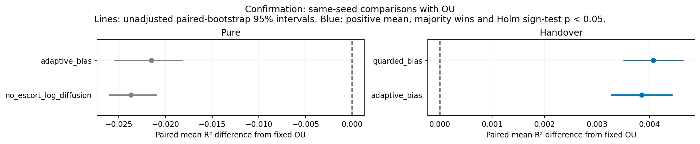

# Broader early coverage: two curricula beat fixed OU

**Guarded bias and size-feedback bias, followed by OU training, beat fixed OU in all 20 fresh trials.** Neither establishes an improvement over the strongest old biased-policy curriculum. Their own data alone do not beat OU.

This follow-up was designed after the [Gaussian-targeted discovery](../targeted-policies/README.md), then tested on a separate fresh seed block. It is an empirical extension [outside Klindt's exact Gaussian-OU setting](../ASSUMPTION_BOUNDARY.md), not a new identifiability theorem.

## The six additions

| Controller | What it does |
| --- | --- |
| Guarded bias | Mildly prefer approaching; stay if a proposed move would cross a wall |
| Gentle bias | Weaker approach preference with the same boundary guard |
| Size-feedback bias | Gently change action probabilities toward apparent size 1/4 |
| Guarded sweeps | Move back and forth across the range, with 15% random actions |
| Sweep/bias mixture | Alternate stochastically between sweeping and biased actions |
| No-escort log diffusion | The earlier Gaussian walker without its initial target-approach phase |

All use the same world, three physical actions, uniform reset, 128 burn-in steps and 64 recorded steps. The encoder still gets observation pairs only. There are no added world coordinates or interactions. The handover is a **training-data curriculum**: encoder batches gradually switch to the legacy Gaussian OU pair source.

## Fresh results: seeds 48–67

The top two candidates per training protocol were chosen using discovery means on seeds 8–27. All four were then tested with fresh OU, random, count, old-biased and previous-addition baselines.

| Condition | Mean R² | Folds |
| --- | ---: | ---: |
| Old approach-biased → OU | 0.998043 | 0/20 |
| **New guarded bias → OU** | **0.998042** | **0/20** |
| **New size-feedback bias → OU** | **0.997820** | **0/20** |
| Fixed OU | 0.993970 | 0/20 |
| Old count, pure | 0.986309 | 0/20 |
| New size-feedback bias, pure | 0.972459 | 0/20 |
| New no-escort log diffusion, pure | 0.970257 | 0/20 |

Both new handovers win **20/20** paired comparisons against OU. Their adjusted sign-test p-values remain **<0.0001** after correcting across all eight fresh OU comparisons from both new-policy studies. The tests concern win probability; [paired mean intervals](output/CONFIRMATION_RESULTS.md) describe effect size separately.

Guarded bias and old approach-bias have nearly identical sample means: difference −0.0000016, combined adjusted p = 0.5034. This does not prove equivalence. The feedback curriculum is slightly worse than the old best: difference −0.000223, combined p = 0.0024. Thus the old biased controller remains a strong baseline.



## Why the broader follow-up helped

The Gaussian-targeted family made visits more Gaussian but concentrated them during collection. Removing its initial steering made the same controller **worse with pure data** but **better with OU handover** in discovery: differences −0.0194 and +0.0039 R², respectively. The effect of a source depends on the rest of training.

This supports keeping broad early observations when a later OU phase will reshape the representation. It does not isolate coverage width from pair dynamics or prove a universal best exploration distribution. The [actual collected distributions](output/figures/collected_distributions.png) and [three fixed-agent trajectories](output/figures/physical_trajectories.png) show the differences directly.

## Inspect and reproduce

- [Short comparison of all 13 additions](../new-policy-results/README.md)
- [All discovery conditions, including earlier additions](output/DISCOVERY_RESULTS.md)
- [Fresh confirmation and all reference tests](output/CONFIRMATION_RESULTS.md)
- [Protocol](PROTOCOL.md) · [Frozen selection](output/selection.json)
- [Verification](output/verification.json): all 460 scores/curves/folds and source fingerprints; source regeneration and 10 representative full training replays are exact.

Install this folder's `requirements.txt`, then from repository root:

```bash
OPENBLAS_NUM_THREADS=1 python behavior-policy-experiments/policy-zoo/broad-policies/run_broad.py --workers 4
OPENBLAS_NUM_THREADS=1 python behavior-policy-experiments/policy-zoo/broad-policies/analyze_broad.py
OPENBLAS_NUM_THREADS=1 python behavior-policy-experiments/policy-zoo/broad-policies/plot_behavior.py
OPENBLAS_NUM_THREADS=1 python behavior-policy-experiments/policy-zoo/verify_new_policies.py --study broad-policies --workers 4
OPENBLAS_NUM_THREADS=1 python behavior-policy-experiments/policy-zoo/compare_new_policies.py
```

Keep the preceding Gaussian-targeted study's discovery records: the runner freezes its best controllers as references before this follow-up's confirmation. Training resumes partial checkpoints every 1,000 updates. All figures have PNG and PDF versions. These are representation tests, with no new planning evaluation.
