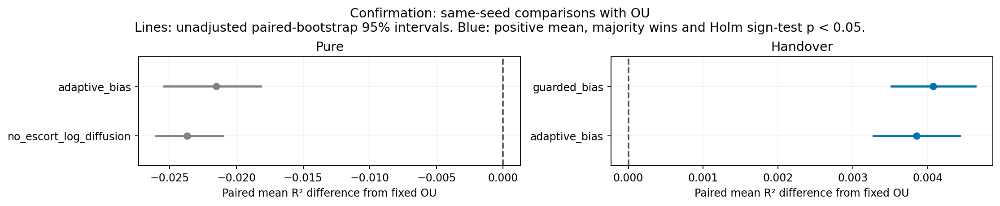

# Confirmation results

Seeds 48–67, paired by seed. R² measures representation recovery, not goal-reaching. Every candidate is retained.

## Matched comparisons with fixed OU

| Protocol | Policy | Mean Δ R² [paired 95% CI] | Wins / losses | Holm sign p | Pass fixed rule? |
| --- | --- | ---: | ---: | ---: | --- |
| handover | guarded_bias | +0.004072 [+0.003516, +0.004638] | 20 / 0 | <0.0001 | Yes |
| handover | adaptive_bias | +0.003850 [+0.003276, +0.004429] | 20 / 0 | <0.0001 | Yes |
| pure | adaptive_bias | -0.021511 [-0.025418, -0.018184] | 0 / 20 | <0.0001 | No |
| pure | no_escort_log_diffusion | -0.023713 [-0.026034, -0.021018] | 0 / 20 | <0.0001 | No |

## Pure rankings

| Policy | Mean R² [95% CI] | SD | Folds | Broader OU R² | Stay fraction | Gaussian discrepancy |
| --- | ---: | ---: | ---: | ---: | ---: | ---: |
| ou | 0.993970 [0.993360, 0.994614] | 0.001485 | 0/20 | 0.979085 | 0.000 | 0.0051 |
| gaussian_wide_diffusion | 0.990585 [0.989967, 0.991249] | 0.001518 | 0/20 | 0.973116 | 0.638 | 0.0320 |
| count | 0.986309 [0.982535, 0.989565] | 0.008279 | 0/20 | 0.969677 | 0.329 | 0.1165 |
| adaptive_bias (new) | 0.972459 [0.968519, 0.975911] | 0.008625 | 0/20 | 0.954257 | 0.334 | 0.0729 |
| no_escort_log_diffusion (new) | 0.970257 [0.968052, 0.972841] | 0.005598 | 0/20 | 0.946847 | 0.368 | 0.0838 |
| random | 0.955495 [0.949654, 0.960165] | 0.012371 | 0/20 | 0.906276 | 0.334 | 0.1175 |

## Handover rankings

| Policy | Mean R² [95% CI] | SD | Folds | Broader OU R² | Stay fraction | Gaussian discrepancy |
| --- | ---: | ---: | ---: | ---: | ---: | ---: |
| biased | 0.998043 [0.997657, 0.998369] | 0.000851 | 0/20 | 0.989625 | 0.330 | 0.1086 |
| guarded_bias (new) | 0.998042 [0.997652, 0.998369] | 0.000856 | 0/20 | 0.989619 | 0.350 | 0.1087 |
| adaptive_bias (new) | 0.997820 [0.997611, 0.998018] | 0.000475 | 0/20 | 0.989633 | 0.334 | 0.0729 |
| random | 0.996485 [0.996213, 0.996734] | 0.000614 | 0/20 | 0.987416 | 0.334 | 0.1175 |
| gaussian_start_random | 0.994437 [0.993581, 0.995340] | 0.002093 | 0/20 | 0.980155 | 0.337 | 0.0444 |

All per-seed differences, comparisons against random and the best old source, and source diagnostics are in the stage summary JSON.

Confidence intervals are unadjusted mean summaries. Sign tests concern win probability; they are a different null. Discovery uses old seeds. Confirmation uses fresh seeds and four selection-frozen comparisons.

