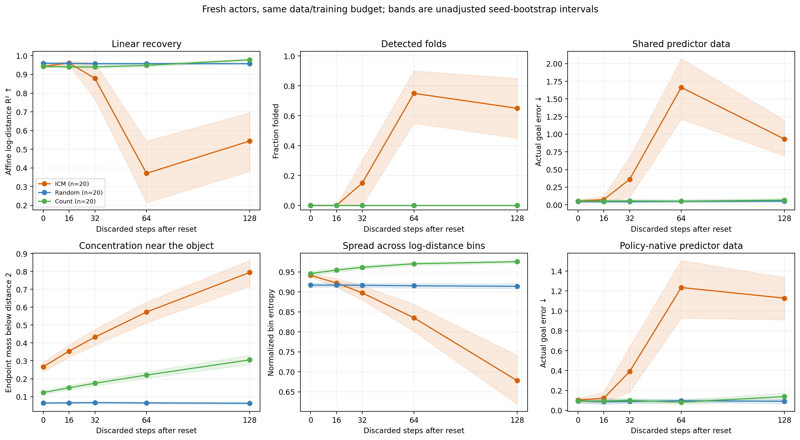
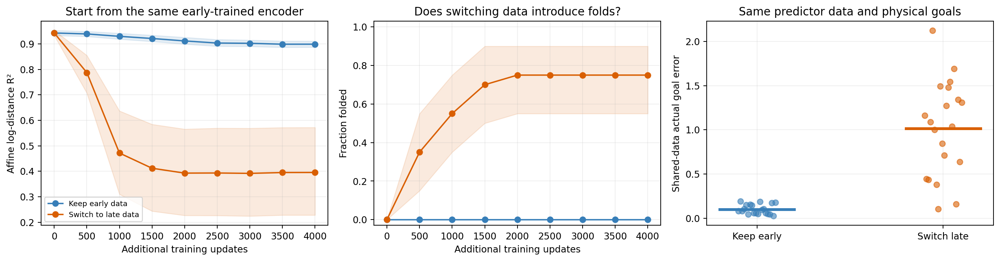

# Early ICM avoids late-data damage; it does not establish superiority

**Mechanism follow-up:** [Separate loss sources and matched original-policy exposure](../geometry-and-coverage/README.md). Late observations sent to SIGReg are the larger geometric lever in the new factorial; update-level interventions identify the first fold-producing contribution. The original fresh-seed study below is retained.

**Fresh replication:** 20 new seeds, five collection ages, 360 encoder conditions and 700 planning evaluations. Same distance-only world, original frozen behavior policies and unchanged SIGReg.

[Full results and all 19 tests](output/RESULTS.md) · [What this can prove](EXPLANATION.md) · [Protocol fixed before training](PROTOCOL.md)

## What the new experiment establishes

**Earlier ICM data are substantially more useful than late ICM data in this setup.** The same actor, trained for the fixed 600-update budget, is frozen across windows; “age” means discarded actions after a reset, not ICM policy-training epochs.

| Training source | Recovery R² ↑ | Folds / 20 | Shared-data goal error ↓ |
| --- | ---: | ---: | ---: |
| ICM, age 0 | 0.9426 | 0 | 0.0535 |
| ICM, age 128 | 0.5439 | 13 | 0.9301 |
| Random, age 0 | 0.9598 | 0 | 0.0469 |
| Count, age 0 | 0.9432 | 0 | 0.0539 |
| Ideal Gaussian OU pairs | 0.9940 | 0 | 0.0752 |

Early versus late ICM improves recovery in 18/20 seeds (Holm p = 0.0044), avoids all 13 late-window folds (p = 0.0029), and improves physical reaching in all 20 seeds (p < 0.0001). All 19 planned tests share one correction; no successful-run subset is used.

**Early ICM does not establish an advantage over random or count.** It has lower affine recovery than OU in every seed; its mean reaching advantage over OU is not significant. A consistent affine-recovery gain over the untouched encoder was not established either, despite a higher mean. These are different claims from rescuing ICM's late-data failure.

The age effect is not strictly monotonic: age 64 has 15 folds and worse mean reaching than age 128. Intermediate ages and every seed are shown, rather than choosing a best-looking age.



## Does later data create a fold in the same encoder?

Yes, in many fresh runs under the tested continuation schedule. Start both branches from each early ICM encoder **and its saved Adam state**. Give both 4,000 more updates with the same learning-rate restart and minibatch indices; only the data window changes.

| Continuation | Final R² | New folds / 20 | Shared-data goal error |
| --- | ---: | ---: | ---: |
| Keep early data | 0.8987 | 0 | 0.1012 |
| Switch to late data | 0.3951 | 15 | 1.0133 |

The paired continuation differences survive correction: recovery p = 0.0044, folds p = 0.00079, reaching p = 0.00056. This is stronger than comparing separately trained encoders: late data can damage the same initially shared representation, relative to equal additional early-data training. It is not inevitable in every seed or under every optimizer schedule.



## What remains unproven

Late ICM puts about 79.5% of observations below distance 2, versus 26.7% early. This supports investigating concentration, but collection age also changes actions, reflections and pair correlations. The experiment does not isolate a single cause, change SIGReg, or prove a population identifiability theorem. Early samples are transient; this is not a stationary matched-marginal test. Planning scores apply to the fixed predictor/planner and goals in the protocol.

The remaining mechanism question is why late data damages geometry: concentration itself, transition statistics, or their interaction with finite-network training. A claim that early curiosity uniquely helps would need an advantage over the direct random/count controls, which this study does not establish.

## Reproduce and resume

From the repository root, using the existing environment plus SciPy:

```sh
python3 -m unittest discover -s behavior-policy-experiments/policy-zoo/collection-age-replication -p 'test_*.py' -v
python3 behavior-policy-experiments/policy-zoo/collection-age-replication/run_replication.py --workers 6
python3 behavior-policy-experiments/policy-zoo/collection-age-replication/analyze_replication.py
python3 behavior-policy-experiments/policy-zoo/collection-age-replication/verify_replication.py --require-complete
```

Completed fits are reused. Encoder/Adam state resumes every 1,000 updates, or 500 in continuations. Interrupted actor/predictor fits restart that fit. Frozen actors and final models are retained; large regenerable source rollouts are ignored by Git. [Verification](output/VERIFICATION.json). Full training and interrupted-fit replay gates are produced by `replay_training.py`.

Verification passed: all 60 source rollouts were recreated; all 360 geometries, 700 physical planning evaluations and 19 exact statistical tests reproduced. Five full/interrupted training gates reproduce model, Adam and predictor states exactly; four controlled tests pass.
