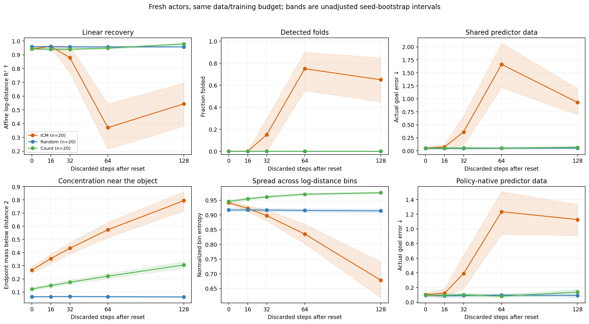
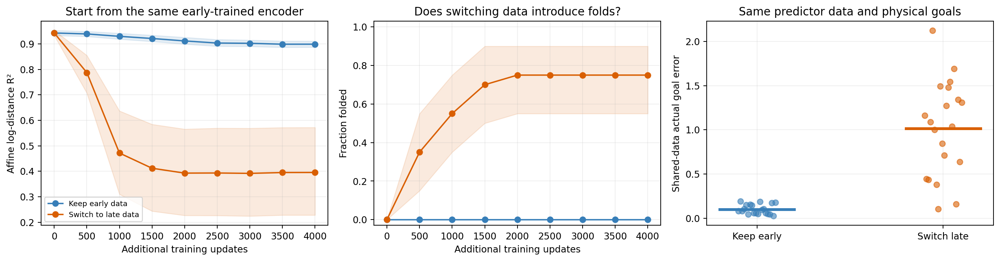

# Does early ICM help, and does later data create folds?

**Status:** 360/360 fitted encoder conditions; 700/700 predictor evaluations. Fresh seeds 200–219. [Fixed protocol](../PROTOCOL.md).

**Early means trajectory steps after a reset, with an already trained and frozen behavior actor.** It does not mean early ICM policy-training epochs. Separate-window fits test data usefulness; the continuation experiment tests changing data for the same encoder.

## Answers on the fresh cohort

- **Early vs late ICM: recovery:** consistent gain in planned direction; mean oriented effect +0.3987, wins/losses 18/2, Holm p=0.004427.
- **Early vs late ICM: fewer folds:** consistent gain in planned direction; mean oriented effect +0.65, wins/losses 13/0, Holm p=0.00293.
- **Early vs late ICM: reaching:** consistent gain in planned direction; mean oriented effect +0.8766, wins/losses 20/0, Holm p=3.624e-05.
- **Early ICM vs early random: recovery:** not established; mean oriented effect -0.01717, wins/losses 4/16, Holm p=0.07091.
- **Early ICM vs early random: reaching:** not established; mean oriented effect -0.006641, wins/losses 8/11, Holm p=1.
- **Early ICM vs early count: recovery:** not established; mean oriented effect -0.0006205, wins/losses 10/10, Holm p=1.
- **Early ICM vs early count: reaching:** not established; mean oriented effect +0.0003906, wins/losses 9/9, Holm p=1.
- **Early ICM vs ideal OU: recovery:** consistent effect in opposite direction; mean oriented effect -0.05134, wins/losses 0/20, Holm p=3.624e-05.
- **Early ICM vs ideal OU: reaching:** not established; mean oriented effect +0.02168, wins/losses 13/6, Holm p=0.8353.
- **Early ICM vs untouched encoder: recovery:** not established; mean oriented effect +0.07327, wins/losses 10/10, Holm p=1.
- **Early→early vs early→late: recovery:** consistent gain in planned direction; mean oriented effect +0.5036, wins/losses 18/2, Holm p=0.004427.
- **Early→early vs early→late: fewer folds:** consistent gain in planned direction; mean oriented effect +0.75, wins/losses 15/0, Holm p=0.0007935.
- **Early→early vs early→late: reaching:** consistent gain in planned direction; mean oriented effect +0.9121, wins/losses 19/1, Holm p=0.0005608.

## Same-budget policy and age comparison

| Policy | Age | Seeds | Affine log-distance R² ↑ | Folds | Rank correlation ↑ | Shared goal error ↓ | Native goal error ↓ | Near-object mass |
| --- | ---: | ---: | ---: | ---: | ---: | ---: | ---: | ---: |
| ICM | 0 | 20 | 0.9426 | 0/20 | 1.0000 | 0.0535 | 0.1033 | 0.267 |
| ICM | 16 | 20 | 0.9612 | 0/20 | 1.0000 | 0.0746 | 0.1234 | 0.354 |
| ICM | 32 | 20 | 0.8790 | 3/20 | 0.9194 | 0.3617 | 0.3910 | 0.433 |
| ICM | 64 | 20 | 0.3711 | 15/20 | 0.4374 | 1.6633 | 1.2350 | 0.573 |
| ICM | 128 | 20 | 0.5439 | 13/20 | 0.6856 | 0.9301 | 1.1279 | 0.795 |
| Random | 0 | 20 | 0.9598 | 0/20 | 1.0000 | 0.0469 | 0.0961 | 0.064 |
| Random | 16 | 20 | 0.9587 | 0/20 | 1.0000 | 0.0461 | 0.0873 | 0.065 |
| Random | 32 | 20 | 0.9575 | 0/20 | 1.0000 | 0.0457 | 0.0902 | 0.066 |
| Random | 64 | 20 | 0.9578 | 0/20 | 1.0000 | 0.0494 | 0.0975 | 0.065 |
| Random | 128 | 20 | 0.9574 | 0/20 | 1.0000 | 0.0521 | 0.0916 | 0.063 |
| Count | 0 | 20 | 0.9432 | 0/20 | 1.0000 | 0.0539 | 0.0961 | 0.123 |
| Count | 16 | 20 | 0.9402 | 0/20 | 1.0000 | 0.0533 | 0.0945 | 0.150 |
| Count | 32 | 20 | 0.9403 | 0/20 | 1.0000 | 0.0553 | 0.1016 | 0.175 |
| Count | 64 | 20 | 0.9482 | 0/20 | 1.0000 | 0.0508 | 0.0824 | 0.221 |
| Count | 128 | 20 | 0.9782 | 0/20 | 1.0000 | 0.0676 | 0.1395 | 0.306 |
| Ideal OU | — | 20 | 0.9940 | 0/20 | 1.0000 | 0.0752 | — | — |

Untouched encoders: mean recovery R² 0.8694; folds 10/20. The initial architecture can already provide substantial recovery; learning gains must be assessed relative to it.

Near-object mass is pooled endpoint fraction below physical distance 2. Early data are transient and different policies retain their real occupancy differences. No stationary matched-marginal claim is made. Same 16,384 pairs, 4,000 representation updates and fixed SIGReg for every main condition.

[ICM curves, seeds 200–209](icm_age_gallery_1.png) · [Seeds 210–219](icm_age_gallery_2.png). Every fresh seed is displayed; these galleries are not selected by success.

## Does later data introduce folds in the same encoder?

Both branches start from each seed’s age-0 ICM encoder and the exact same saved Adam state. Both restart the learning-rate clock and receive 4,000 more updates. Only the continuation dataset changes. No initial-success subset is used.

| Continuation | Seeds | Final R² | Final folds | New folds among all seeds | Shared goal error | Native goal error |
| --- | ---: | ---: | ---: | ---: | ---: | ---: |
| Keep early data | 20 | 0.8987 | 0/20 | 0/20 | 0.1012 | 0.1906 |
| Switch to late data | 20 | 0.3951 | 15/20 | 15/20 | 1.0133 | 1.1691 |

New-fold counts are descriptive; primary paired tests retain all 20 seeds. History records locate fold onset only to 500-update intervals.

[Every continuation representation](continuation_gallery.png).

## One family of 19 planned tests

Positive effects mean the direction written in the test label. For reaching they mean lower actual physical goal error, not lower latent predictor error. Sign tests concern consistent seed-wise direction; intervals concern mean effects and are unadjusted. Fold tests use discordant pairs. All tests share one Holm correction.

| Test | Seeds | Mean effect [95% interval] | Positive / negative | Holm p |
| --- | ---: | ---: | ---: | ---: |
| Early vs late ICM: recovery | 20 | +0.3987 [+0.2515, +0.5549] | 18 / 2 | 0.004427 |
| Early vs late ICM: fewer folds | 20 | +0.65 [+0.45, +0.85] | 13 / 0 | 0.00293 |
| Early vs late ICM: reaching | 20 | +0.8766 [+0.6348, +1.147] | 20 / 0 | 3.624e-05 |
| Early ICM vs early random: recovery | 20 | -0.01717 [-0.0244, -0.009624] | 4 / 16 | 0.07091 |
| Early ICM vs early random: reaching | 20 | -0.006641 [-0.0209, +0.007422] | 8 / 11 | 1 |
| Early ICM vs early count: recovery | 20 | -0.0006205 [-0.007031, +0.005585] | 10 / 10 | 1 |
| Early ICM vs early count: reaching | 20 | +0.0003906 [-0.0166, +0.01777] | 9 / 9 | 1 |
| Early ICM vs ideal OU: recovery | 20 | -0.05134 [-0.06095, -0.04156] | 0 / 20 | 3.624e-05 |
| Early ICM vs ideal OU: reaching | 20 | +0.02168 [-0.0001953, +0.04453] | 13 / 6 | 0.8353 |
| Early ICM vs untouched encoder: recovery | 20 | +0.07327 [+0.006309, +0.1549] | 10 / 10 | 1 |
| ICM recovery decreases with collection age | 20 | +0.415 [+0.205, +0.585] | 17 / 2 | 0.0051 |
| ICM goal error increases with collection age | 20 | +0.7083 [+0.6033, +0.8017] | 20 / 0 | 3.624e-05 |
| ICM early/late recovery gain minus random gain | 20 | +0.3964 [+0.2475, +0.5544] | 18 / 2 | 0.004427 |
| ICM early/late reaching gain minus random gain | 20 | +0.8713 [+0.6299, +1.143] | 20 / 0 | 3.624e-05 |
| ICM early/late recovery gain minus count gain | 20 | +0.4337 [+0.2839, +0.5928] | 18 / 2 | 0.004427 |
| ICM early/late reaching gain minus count gain | 20 | +0.8629 [+0.6133, +1.145] | 20 / 0 | 3.624e-05 |
| Early→early vs early→late: recovery | 20 | +0.5036 [+0.3331, +0.6653] | 18 / 2 | 0.004427 |
| Early→early vs early→late: fewer folds | 20 | +0.75 [+0.55, +0.9] | 15 / 0 | 0.0007935 |
| Early→early vs early→late: reaching | 20 | +0.9121 [+0.6773, +1.143] | 19 / 1 | 0.0005608 |

[All seed effects and exact p-values](INFERENCE.json).

## What these experiments can establish

- A fresh early-versus-late improvement supports a collection-phase rescue. It does not establish that early ICM beats random, count or OU; those have separate planned comparisons.
- Late-window fits from scratch are not evidence that a single encoder deteriorated over time. The equal-budget continuation tests address that stronger question.
- Collection age changes occupancy, actions, reflections and empirical transition statistics together. Concentration is measured, not separately randomized as the sole cause.
- Common predictor data and goals hold task evaluation fixed. Native data additionally changes state/action exposure. Every physical goal has zero oracle error. The inherited common source omits outward reflected actions at the two endpoints; scores remain conditional on this predictor/planner and its training coverage.
- Affine recovery, order preservation and loss of information are distinct. Absence of a grid fold is not a proof of injectivity; a high R² is not a population identification theorem.
- The ideal OU reference satisfies a different data law from the bounded physical policies. This is an empirical same-budget comparison in the existing distance-only setup.
