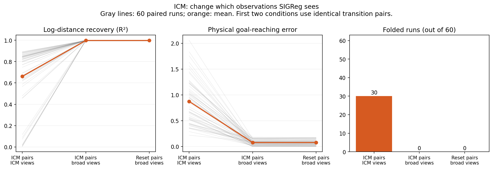

# Fresh confirmation: similar recovery, but exposure matters

**The prospective equivalence test passes.** The plan, tolerances and code lock were published before training 60 fresh seed blocks, including 240 new exploration actors. All seven policies pass together for whole-range/near/far recovery and shared-data physical goal error. No old seeds are pooled in.

Fixed tolerances: **±0.001 R²** and **±0.005 goal error** (2% of an action step). The joint test passes after correcting the four planned claims: **Holm-adjusted p = 1.08e-19**. This is practical equivalence under the tested conditions and paired-mean assumptions, not exact equality or a new identifiability theorem.

## The more useful finding: exposure changes ICM’s training outcome

Keep the ICM actor and its native transition pairs fixed. Both training conditions start from identical encoder weights. Change only the observation pool used by SIGReg; its formula and weight stay fixed. Both conditions independently sample regularizer observations.

| ICM training | Mean recovery R² | Folds / 60 | Shared-data goal error |
| --- | ---: | ---: | ---: |
| Native SIGReg observations | 0.6611 | 30 | 0.8739 |
| Broad common SIGReg observations | 0.9975 | 0 | 0.0760 |

Recovery and reaching improve in **all 60 seeds**; all 30 native-exposure folds disappear. All three planned directional mechanism tests pass the same Holm correction. This identifies an observation-exposure mechanism under finite training, rather than an unavoidable failure of the ICM action rule.

The broad pool provides additional real observations from controlled resets. This is not a free improvement to autonomous ICM exploration, and it does not identify which exposure feature matters most.

## Does training improve on the initial encoder?

The separate, post-start baseline freezes each exact initial encoder and trains only the shared-data predictor. Its mean recovery is **0.8421**, with **26/60** folds and mean physical goal error **0.4479**.

An additional descriptive check shows that native ICM exposure creates 14 new folds and removes 10 initial folds. Broad exposure ends with no folds. Initialization matters, but does not by itself determine the final outcome. No additional hypothesis test is claimed.

Matched trained encoders have recovery **0.997563–0.997565**, zero folds and shared-data goal error **0.076237–0.076693**. [All paired baseline effects and descriptive intervals](untrained_baseline/RESULTS.md). The baseline is secondary; it does not add confirmatory p-values.

## What this adds beyond the paper

The useful result is the controlled finite-training exposure effect and its impact on actual reaching. The policy tie is a control, not the main theoretical advance. In one dimension, a common observation marginal already strongly restricts an unfolded Gaussianizing map. High log-distance R² also does not certify exact Gaussianization.

Policy-specific predictor-data equivalence is **not established** at the same goal-error tolerance (secondary unadjusted p = 0.952). Similar recovery therefore does not settle planning with each policy’s own action data. The next discriminating experiment is one common frozen encoder with different predictor datasets, followed by targeted state/action coverage interventions.

Limits: starts and SIGReg exposure match, not successor distributions or stationarity. The same one-distance environment and reflected physical actions are retained. These empirical results do not prove identifiability for general nonlinear systems. TOST uses a t approximation, and no distribution-free rare-failure guarantee follows. The fold-risk diagnostic remains secondary and its unadjusted p=0.0461 is fragile.

**Verified:** 240 fresh actors; 420 recreated sources; 540 encoder geometries; 1,080 main and 60 baseline physical-planning replays; exact full/resumed training gates. The three frozen scientific files still match the pre-cohort Git commit.

[Fixed protocol](../PROTOCOL.md) · [Code/time lock](LOCK.json) · [Detailed tests](RESULTS.md) · [All figures](FIGURES.md) · [Main verification](VERIFICATION.json) · [Research value](../RESEARCH_VALUE.md)
