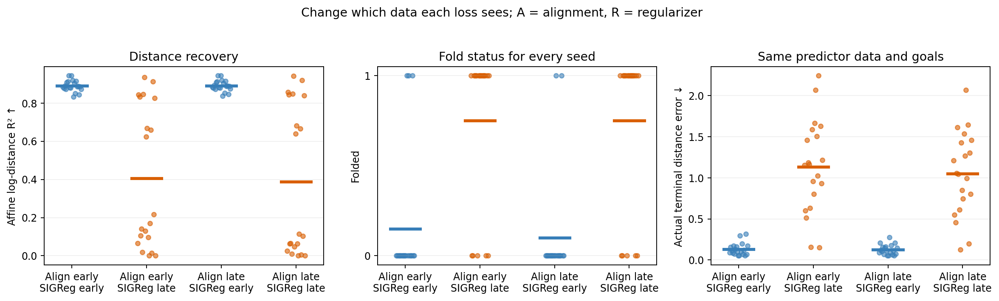
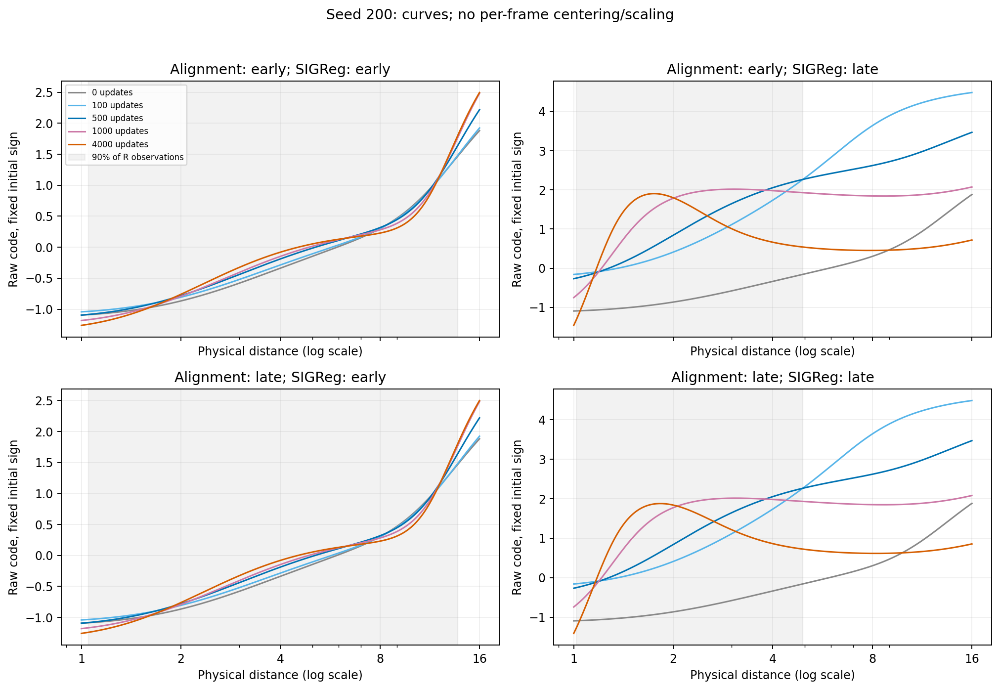
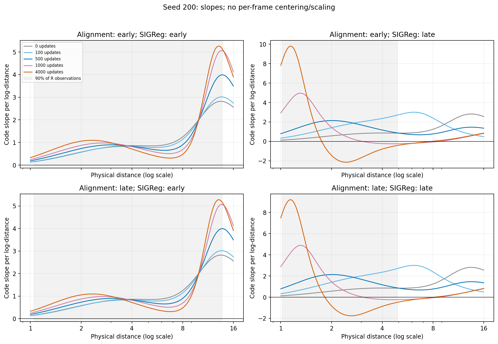
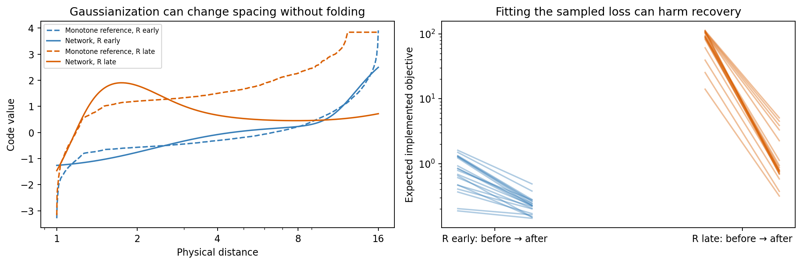
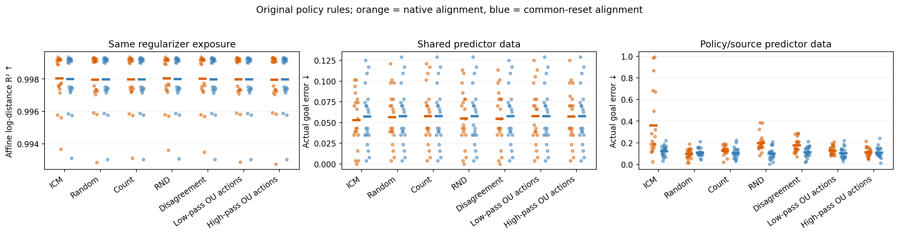
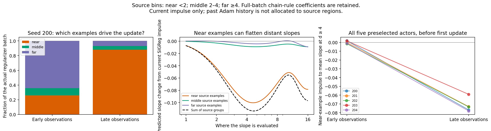
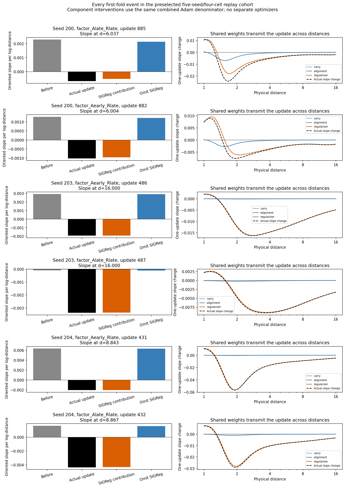

# Geometry, exposure and original behavior policies

Completed 360/360 encoders and 640/640 planning evaluations. [Protocol](../PROTOCOL.md) · [Zoo recap](../ZOO_RECAP.md) · [Mathematics](../MATH.md).

## Which loss source changes geometry?

All factorial cells start from the same early encoder/Adam state within each seed. A is the alignment-pair source; R is independently sampled pooled regularizer observations. The SIGReg formula/weight is unchanged.

| A source | R source | Seeds | Recovery R² | Folds | Shared-data goal error |
| --- | --- | ---: | ---: | ---: | ---: |
| early | early | 20 | 0.8894 | 3/20 | 0.1289 |
| early | late | 20 | 0.4053 | 15/20 | 1.1332 |
| late | early | 20 | 0.8905 | 2/20 | 0.1232 |
| late | late | 20 | 0.3868 | 15/20 | 1.0486 |

Early R does not guarantee no folds: the independent-observation sampling protocol can differ from the original coupled-batch controls. These differences are included in the planned tests.

The monotone Gaussian-quantile reference shows that distribution matching can change spacing without requiring a fold. Finite-network optimization and parameter sharing must explain the actual reversal; the quantile reference is not asserted to be the full-loss optimizer.

## Original zoo policies with common exposure

The same reset-state observations and regularizer input multiset are supplied to every policy/source condition within a seed. Original actors and colored-action streams are retained. Successors, actions and stationarity are not forced to match. Native alignment keeps the original hash-verified trajectory pairs. The broad R pool supplies real observations beyond native gaps; this is not pure reweighting.

| Policy | A source | Seeds | Recovery R² | Folds | Shared-data error | Native-data error |
| --- | --- | ---: | ---: | ---: | ---: | ---: |
| ICM | native | 20 | 0.9980 | 0/20 | 0.0529 | 0.3611 |
| ICM | reset | 20 | 0.9980 | 0/20 | 0.0576 | 0.1230 |
| Random | native | 20 | 0.9980 | 0/20 | 0.0566 | 0.0971 |
| Random | reset | 20 | 0.9980 | 0/20 | 0.0580 | 0.1107 |
| Count | native | 20 | 0.9980 | 0/20 | 0.0580 | 0.1295 |
| Count | reset | 20 | 0.9980 | 0/20 | 0.0580 | 0.1082 |
| RND | native | 20 | 0.9980 | 0/20 | 0.0549 | 0.2002 |
| RND | reset | 20 | 0.9980 | 0/20 | 0.0580 | 0.0992 |
| Disagreement | native | 20 | 0.9980 | 0/20 | 0.0545 | 0.1758 |
| Disagreement | reset | 20 | 0.9980 | 0/20 | 0.0578 | 0.1139 |
| Low-pass OU actions | native | 20 | 0.9980 | 0/20 | 0.0580 | 0.1297 |
| Low-pass OU actions | reset | 20 | 0.9980 | 0/20 | 0.0578 | 0.1039 |
| High-pass OU actions | native | 20 | 0.9980 | 0/20 | 0.0574 | 0.1121 |
| High-pass OU actions | reset | 20 | 0.9980 | 0/20 | 0.0580 | 0.1107 |

## Local explanation of a fold

The regional diagnostic keeps the full batch’s SIGReg coefficients and splits their parameter gradient by source distance. It does not apply separate losses to bins. These are current-gradient impulses, not all past regularizer momentum. All five preselected first-update cases are shown, including actors that never develop a fold.

The attribution splits carried momentum and post-switch alignment/regularizer moment histories with the same actual Adam denominator. The component-only update is a one-step intervention, not a claim about separately trained optimizers. Every preselected case, including no-fold controls, is retained.

All 20 preselected fits reproduce final model and optimizer states exactly. There are 6 first-fold events. The R contribution alone creates the detected fold in 6/6 events; omitting R prevents it in 6/6. This local cohort is not a new population significance test.

## Planned statistical comparisons

One Holm family covers all 54 tests. Positive simple-source effects mean a benefit from the earlier source or from common-reset alignment. Interactions are signed differences of effects and are not automatically beneficial. Intervals concern unadjusted paired means; sign tests concern seed-wise direction. All cases/seeds are retained.

Complete factor seed blocks: 20/20; zoo blocks: 20/20.

| Test | Seeds | Mean gain [95% interval] | Positive / negative | Holm p |
| --- | ---: | ---: | ---: | ---: |
| factor_R_at_early_recovery | 20 | +0.4841 [+0.3253, +0.6383] | 18 / 2 | 0.02012 |
| factor_R_at_early_folds | 20 | +0.6 [+0.4, +0.8] | 12 / 0 | 0.02344 |
| factor_R_at_early_planning | 20 | +1.004 [+0.7687, +1.244] | 19 / 1 | 0.002163 |
| factor_R_at_late_recovery | 20 | +0.5037 [+0.335, +0.6666] | 18 / 2 | 0.02012 |
| factor_R_at_late_folds | 20 | +0.65 [+0.45, +0.85] | 13 / 0 | 0.01245 |
| factor_R_at_late_planning | 20 | +0.9254 [+0.7086, +1.136] | 19 / 1 | 0.002163 |
| factor_A_at_early_recovery | 20 | -0.001153 [-0.00168, -0.0006883] | 3 / 17 | 0.1211 |
| factor_A_at_early_folds | 20 | -0.05 [-0.15, +0] | 0 / 1 | 1 |
| factor_A_at_early_planning | 20 | -0.005664 [-0.01953, +0.005664] | 7 / 9 | 1 |
| factor_A_at_late_recovery | 20 | +0.01847 [+0.003398, +0.03557] | 10 / 10 | 1 |
| factor_A_at_late_folds | 20 | +0 [+0, +0] | 0 / 0 | 1 |
| factor_A_at_late_planning | 20 | -0.08457 [-0.2199, +0.04531] | 5 / 15 | 1 |
| factor_interaction_recovery | 20 | -0.01963 [-0.03694, -0.004421] | 9 / 11 | 1 |
| factor_interaction_folds | 20 | -0.05 [-0.15, +0] | 0 / 1 | 1 |
| factor_interaction_planning | 20 | +0.07891 [-0.05312, +0.2139] | 15 / 5 | 1 |
| independent_vs_coupled_early_recovery | 20 | -0.009329 [-0.01631, -0.003956] | 1 / 19 | 0.002163 |
| independent_vs_coupled_early_folds | 20 | -0.15 [-0.3, +0] | 0 / 3 | 1 |
| independent_vs_coupled_early_planning | 20 | -0.02773 [-0.04863, -0.00918] | 5 / 14 | 1 |
| independent_vs_coupled_late_recovery | 20 | -0.008276 [-0.01557, -0.001887] | 7 / 13 | 1 |
| independent_vs_coupled_late_folds | 20 | +0 [+0, +0] | 0 / 0 | 1 |
| independent_vs_coupled_late_planning | 20 | -0.03535 [-0.1201, +0.05157] | 7 / 13 | 1 |
| zoo_icm_vs_random_recovery | 20 | +5.347e-06 [-2.236e-06, +1.445e-05] | 8 / 12 | 1 |
| zoo_icm_vs_random_planning | 20 | +0.0003906 [+0, +0.0009766] | 2 / 0 | 1 |
| zoo_icm_reset_vs_native_recovery | 20 | -4.449e-05 [-0.0001262, +2.596e-05] | 11 / 9 | 1 |
| zoo_icm_reset_vs_native_folds | 20 | +0 [+0, +0] | 0 / 0 | 1 |
| zoo_icm_reset_vs_native_planning | 20 | -0.004687 [-0.01094, +0.0005859] | 4 / 8 | 1 |
| zoo_random_reset_vs_native_recovery | 20 | +2.185e-05 [-7.671e-06, +5.483e-05] | 8 / 12 | 1 |
| zoo_random_reset_vs_native_folds | 20 | +0 [+0, +0] | 0 / 0 | 1 |
| zoo_random_reset_vs_native_planning | 20 | -0.001367 [-0.003906, +0.0005908] | 2 / 4 | 1 |
| zoo_count_vs_random_recovery | 20 | -6.825e-07 [-1.162e-06, -1.593e-07] | 5 / 15 | 1 |
| zoo_count_vs_random_planning | 20 | +0 [+0, +0] | 0 / 0 | 1 |
| zoo_count_reset_vs_native_recovery | 20 | -1.507e-06 [-1.414e-05, +1.012e-05] | 11 / 9 | 1 |
| zoo_count_reset_vs_native_folds | 20 | +0 [+0, +0] | 0 / 0 | 1 |
| zoo_count_reset_vs_native_planning | 20 | +0 [-0.0009766, +0.0007813] | 2 / 1 | 1 |
| zoo_rnd_vs_random_recovery | 20 | +2.481e-06 [-4.357e-07, +6.235e-06] | 11 / 9 | 1 |
| zoo_rnd_vs_random_planning | 20 | +0 [-0.0005859, +0.0005859] | 1 / 1 | 1 |
| zoo_rnd_reset_vs_native_recovery | 20 | -3.987e-05 [-0.0001153, +2.318e-05] | 12 / 8 | 1 |
| zoo_rnd_reset_vs_native_folds | 20 | +0 [+0, +0] | 0 / 0 | 1 |
| zoo_rnd_reset_vs_native_planning | 20 | -0.003125 [-0.008594, +0.001367] | 3 / 6 | 1 |
| zoo_disagreement_vs_random_recovery | 20 | -1.115e-06 [-3.626e-06, +1.858e-06] | 6 / 14 | 1 |
| zoo_disagreement_vs_random_planning | 20 | +0.0001953 [+0, +0.0005859] | 1 / 0 | 1 |
| zoo_disagreement_reset_vs_native_recovery | 20 | -3.339e-05 [-9.94e-05, +2.333e-05] | 12 / 8 | 1 |
| zoo_disagreement_reset_vs_native_folds | 20 | +0 [+0, +0] | 0 / 0 | 1 |
| zoo_disagreement_reset_vs_native_planning | 20 | -0.00332 [-0.008594, +0.0009766] | 3 / 6 | 1 |
| zoo_ou_actions_lp_w0.1_vs_random_recovery | 20 | -8.521e-07 [-2.13e-06, +1.248e-07] | 10 / 10 | 1 |
| zoo_ou_actions_lp_w0.1_vs_random_planning | 20 | +0.0001953 [+0, +0.0005859] | 1 / 0 | 1 |
| zoo_ou_actions_lp_w0.1_reset_vs_native_recovery | 20 | +1.412e-05 [-7.24e-06, +3.928e-05] | 8 / 12 | 1 |
| zoo_ou_actions_lp_w0.1_reset_vs_native_folds | 20 | +0 [+0, +0] | 0 / 0 | 1 |
| zoo_ou_actions_lp_w0.1_reset_vs_native_planning | 20 | +0.0001953 [-0.0009766, +0.001563] | 4 / 4 | 1 |
| zoo_ou_actions_hp_w0.3_vs_random_recovery | 20 | -4.791e-07 [-9.808e-07, -4.107e-08] | 6 / 14 | 1 |
| zoo_ou_actions_hp_w0.3_vs_random_planning | 20 | +0 [+0, +0] | 0 / 0 | 1 |
| zoo_ou_actions_hp_w0.3_reset_vs_native_recovery | 20 | +2.585e-05 [-1.153e-05, +6.898e-05] | 8 / 12 | 1 |
| zoo_ou_actions_hp_w0.3_reset_vs_native_folds | 20 | +0 [+0, +0] | 0 / 0 | 1 |
| zoo_ou_actions_hp_w0.3_reset_vs_native_planning | 20 | -0.0005859 [-0.00332, +0.001953] | 3 / 5 | 1 |

[Definitions and every seed effect](INFERENCE.json).

## Requested test: do matched policies differ?

The requested [equivalence analysis](EQUIVALENCE_SUMMARY.md) uses paired TOST and requires every policy pair to pass. At exploratory tolerances ±0.001 R² and ±0.005 physical goal error, recovery and shared-data planning pass in both matched studies; policy-specific-data planning does not. [Full tolerance sensitivity](MATCHED_EQUIVALENCE.md). [Complementary difference tests](MATCHED_OMNIBUS.md) detect no systematic policy effect, but nonsignificance alone is not equivalence. These post hoc analyses do not replace the 54 planned comparisons.

## Limits

- Factorial sampling differs from the original paired finite-batch regularizer. Matching-source comparisons with old coupled controls quantify this protocol change; source-swap effects are conditional on the new sampler.
- Common exposure adds broad real observations; it does not prove that late data can be repaired solely by resampling its existing support.
- Fixed-start controls retain actor weights/action rules but change data collection. They are neither stationary trajectory comparisons nor exact matches of both endpoint marginals.
- Shared predictor data better isolates representation effects for this predictor/planner. Native-data differences also include action/state support. The inherited shared source omits outward reflected actions at grid endpoints.
- Numerical alias witnesses, dense-grid folds and affine recovery are separate empirical diagnostics. No population identifiability or global-convergence theorem is claimed.
