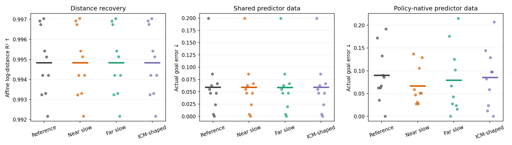
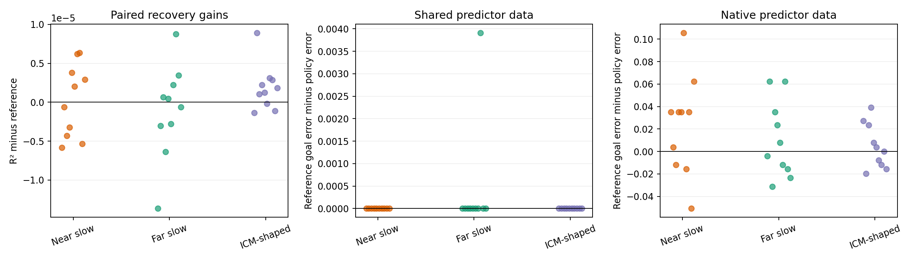
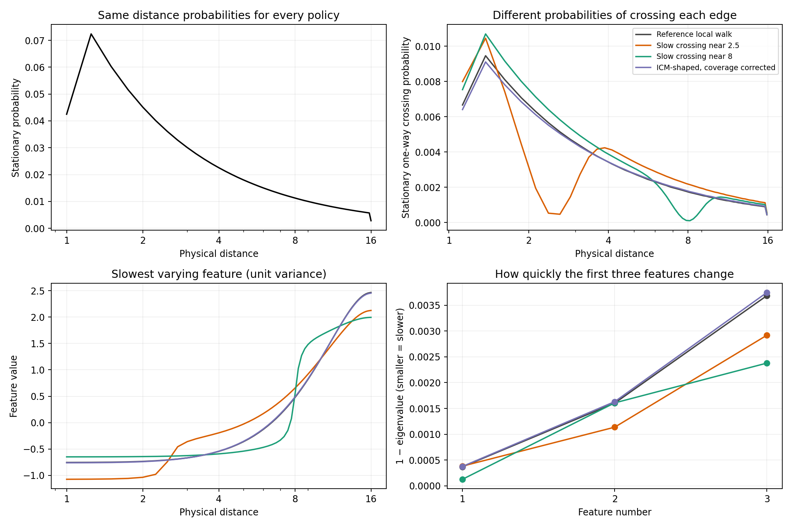
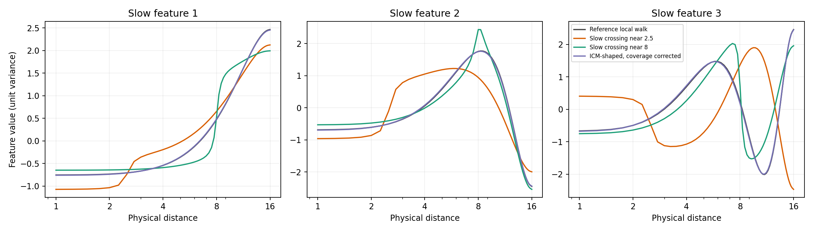
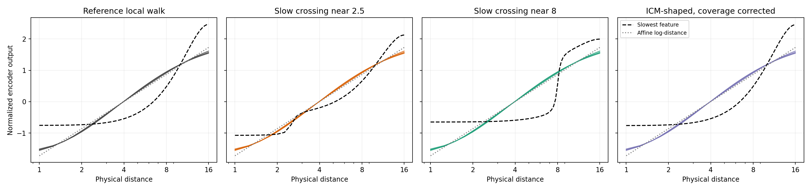
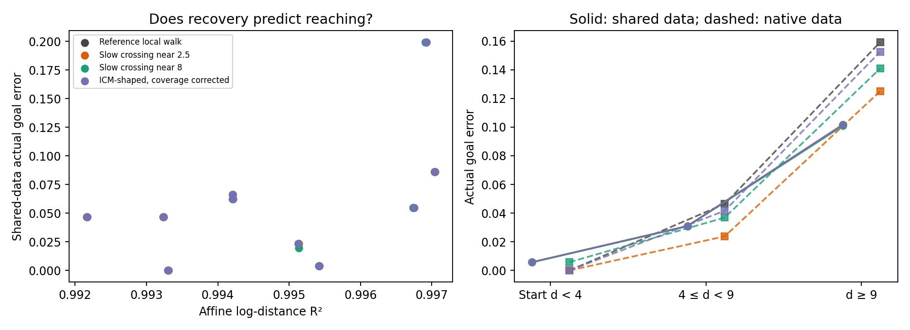

# Same coverage, different movement: results

**Question:** With the same visited-distance distribution, do movement rules change distance recovery and planning?

Completed 40 / 40 encoder fits, each with shared and native predictor evaluations. See [fixed protocol](../PROTOCOL.md).

Both training endpoints have exactly the same 65,536-state counts across policies. The stationary law, global action counts and mean physical movement also match. This isolates transition rules at a fixed marginal, including their effects on training noise. SIGReg is unchanged.

**First result:** all four policies recover log-distance similarly (mean R² ≈ 0.99484), with no detected folds. Shared-data planning errors are nearly identical. Native-data errors vary more, but no comparison is significant after the specified correction. This does not establish equivalence or explain the original ICM–OU gap.

| Policy | Seeds | Log-distance R² ↑ | Dense-grid folds | Shared-data goal error ↓ | Native-data goal error ↓ | Shared success ↑ |
| --- | ---: | ---: | ---: | ---: | ---: | ---: |
| Reference local walk | 10 | 0.9948 | 0/10 | 0.0590 | 0.0898 | 0.981 |
| Slow crossing near 2.5 | 10 | 0.9948 | 0/10 | 0.0590 | 0.0664 | 0.981 |
| Slow crossing near 8 | 10 | 0.9948 | 0/10 | 0.0586 | 0.0793 | 0.981 |
| ICM-shaped, coverage corrected | 10 | 0.9948 | 0/10 | 0.0590 | 0.0852 | 0.981 |

Goal error is actual terminal physical-distance error after 12 actions, not latent prediction error. Success means within 0.25. Every test goal has zero oracle error. Near/middle/far results use starting distance; trajectories can cross regions.

## Comparisons with the reference

Positive gain means higher R² or lower goal error. Tests use seed-wise signs, not goal cases. Bootstrap mean-difference intervals are unadjusted. Primary Holm family: six tests (three policies × recovery/shared planning). Native planning: separate secondary family.

| Policy | Endpoint | Mean gain [95% interval] | Wins / seeds | Holm p |
| --- | --- | ---: | ---: | ---: |
| Slow crossing near 2.5 | log_distance_r2 | +1.95e-07 [-2.61e-06, +2.98e-06] | 5/10 | 1.0000 |
| Slow crossing near 2.5 | shared_goal_error | +0 [+0, +0] | 0/10 | 1.0000 |
| Slow crossing near 2.5 | native_goal_error | +0.0234 [-0.00235, +0.0496] | 7/10 | 1.0000 |
| Slow crossing near 8 | log_distance_r2 | -1.09e-06 [-4.8e-06, +2.26e-06] | 5/10 | 1.0000 |
| Slow crossing near 8 | shared_goal_error | +0.000391 [+0, +0.00117] | 1/10 | 1.0000 |
| Slow crossing near 8 | native_goal_error | +0.0105 [-0.00859, +0.0309] | 5/10 | 1.0000 |
| ICM-shaped, coverage corrected | log_distance_r2 | +1.87e-06 [+3.41e-07, +3.74e-06] | 7/10 | 1.0000 |
| ICM-shaped, coverage corrected | shared_goal_error | +0 [+0, +0] | 0/10 | 1.0000 |
| ICM-shaped, coverage corrected | native_goal_error | +0.00469 [-0.00625, +0.0168] | 5/10 | 1.0000 |

## What the slow features mean

A slow feature changes little under a particular policy while varying across distances. We calculate it directly from that policy’s exact transition matrix; no encoder training is needed. The dashed feature is the best alignment coordinate under centering/unit-variance constraints. Because our unchanged training also uses SIGReg, it is a mechanistic benchmark, not an exact prediction of the trained network.

## Limits

- These four stationary, memoryless local policies are controlled follow-ups, not the original ICM/OU comparison. The ICM-shaped rule uses one frozen old actor and corrects its occupancy; it does not retain original ICM dynamics.
- A nearest-neighbor reversible chain has a monotone first nonconstant feature. This experiment can reveal stretching/compression and planning effects; it does not imply a spectral explanation for original ICM folds.
- Ten seeds quantify training variation conditional on fixed kernels, one actor and this finite lattice. They do not test variation across learned behavior policies or all continuous-world starts.
- Stationary one-step pair datasets remove trajectory collection/mixing efficiency as a confound. They do not claim equally rapid coverage in actual rollouts.
- Good affine recovery and low goal error are distinct outcomes. Shared predictor data better isolates the learned representation; native data additionally tests policy-specific state/action support.
- Dense interpolation between observed lattice states is checked for folds, but the principal recovery and reaching scores are on reachable lattice states.
- Same marginal plus unchanged SIGReg fixes its population marginal objective. Finite paired batches can still change its stochastic estimates; this is not a regularizer ablation.
