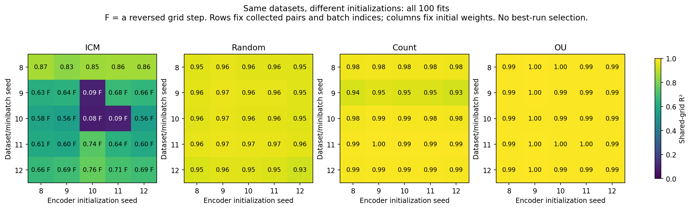
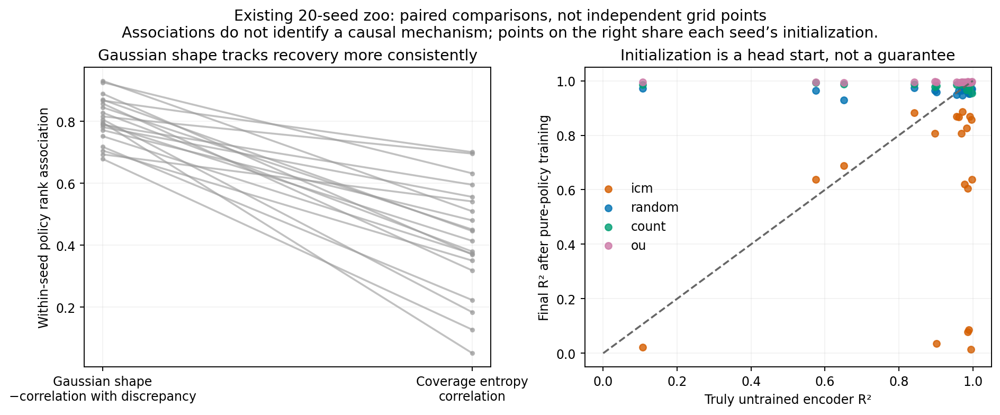

# Why some policies preserve distance and others fold it

[Start with the short explanation](SUMMARY.md).

**The data, initial network and training path all matter. Coverage alone does not explain the ranking, and a good final readout does not prove that the loss identifies distance.** We added targeted statistical tests, 100 crossed fits and 50 alignment-removal controls to separate these issues. The original zoo results remain unchanged.

These are **exploratory follow-ups** to results we had already seen. The [test plan](PROTOCOL.md) and [reflection-control plan](REFLECTION_PROTOCOL.md) state the comparisons and limits.

## What explains different fold histories?

We trained ICM, random, count and OU data with **every combination of five datasets and five initializations**. Rows below hold the observations and batch indices fixed; columns hold the initial weights fixed. F marks a reversed grid step.



For ICM, dataset 8 ends unfolded under **all five** initializations; datasets 9–12 end folded under **all five**. Two initial functions are already folded, but dataset 8 repairs them. Three initial functions are monotone, yet the other datasets create folds. **An initial fold is neither necessary nor sufficient for the final fold.**

Initialization still changes severity: on ICM dataset 9, the same data produce R² ≈ 0.09 with initialization 10 and ≈ 0.63–0.68 with the others. In this finite table, dataset effects account for 54% of squared R² variation, initialization 9%, and their interaction 37%. These are descriptive shares across five levels, not population variance estimates or 25 independent trials. OU's absolute variation is much smaller: SD 0.0014 versus ICM's 0.224.

[See all 25 untrained/final ICM curves](output/figures/icm_initial_and_final_curves.png). Random, count and OU finish unfolded in all 25 combinations each.

The untouched zoo encoder has mean R² **0.886**, with **5/20** initial folds. The old 0.934 baseline was **after one OU update**. ICM worsens the true baseline in 17/20 seeds (Holm-adjusted sign-test p = 0.0387).

## Which policy differences survive statistical checks?

Each comparison pairs the existing **20 seeds**. The p-values below are exact two-sided **sign tests**, Holm-corrected within the specified families; they test how consistently a policy wins, not whether its mean difference is zero. Full paired mean intervals and every result are in [targeted-tests.json](output/targeted-tests.json).

| Comparison | Mean R² difference | Wins / 20 | Adjusted p |
| --- | ---: | ---: | ---: |
| Count − random, pure | +0.0236 | 19 | 0.000080 |
| ICM − random, pure | −0.3575 | 0 | <0.00001 |
| High-pass − low-pass OU actions, pure | +0.1074 | 19 | 0.000120 |
| High-pass − unfiltered OU actions, pure | +0.0289 | 20 | <0.00001 |
| Change in high-pass advantage after handover | −0.1094 | 1 | 0.000120 |

The last row is a **direct interaction test**: subtract the pure high-pass advantage from its handover advantage within each seed. It supports the observed reversal across protocols; comparing two separate significance decisions would not test that reversal.

Gaussian-shaped visited log-distances track recovery more consistently than coverage entropy in **all 20** seed-wise policy rankings. Mean rank association is 0.806 for Gaussian similarity versus 0.420 for entropy; their paired advantage is 0.386, with bootstrap 95% interval [0.315, 0.457] and adjusted sign-test p < 0.00001. This is an association, not causal mediation. RND and disagreement perform worse than ICM despite smaller mean Gaussian discrepancy, so this cannot be the whole explanation.

Even within ICM, dataset 8 has Gaussian discrepancy 0.289 versus dataset 9's 0.280, yet only dataset 8 remains unfolded across all five initializations. That scalar statistic cannot predict each dataset's outcome.

The eight filtered-OU/matched-pair comparisons also pass **paired equivalence tests within ±0.001 R²**, after Holm correction (largest adjusted p ≈ 0.0010). This is stronger than failing to detect a difference, but uses a post hoc tolerance and paired t assumptions. It concerns this readout metric and training protocol, not equivalent planning or universal dynamics.



## A boundary mechanism—and a control that limits the explanation

An approach that reflects at the near wall maps $d$ to $2.25-d$. A code symmetric around **1.125** can give the same value before and after that bounce. Thus alignment can reward a folded distinction. Near-wall reflections constitute **48.5%** of these five ICM datasets, versus **0.51%** for random and **4.29%** for count.

But a plausible low-loss code is not a causal explanation of the trained network. We tested that by removing reflection pairs' alignment contribution while keeping **every SIGReg endpoint unchanged**, versus removing an equally large random subset of alignment contributions:

| ICM alignment condition | Mean R², 25 combinations | Folded combinations |
| --- | ---: | ---: |
| Original | 0.6214 | 20/25 |
| Remove reflection alignment | 0.6927 | 20/25 |
| Remove equal random alignment | 0.6892 | 20/25 |

Most of the observed mean improvement is shared by both removal conditions. Selective reflection removal adds only **0.00354** over random removal and repairs **none of the 20 folds**. Its dataset-averaged advantage is positive in 5/5 datasets, but the two-sided sign-test p is **0.0625**, with only five data levels. This does not establish equivalence or no effect; it does show that selectively removing this alignment pressure is insufficient to explain or repair the folds here.

[All removal-control results](output/figures/reflection_alignment_control.png) · [Numerical summary](output/reflection-control-summary.json)

## Why we still cannot predict an exact final turn

The data-only [rank-code proxy](output/figures/pair_objective_proxy.png) favors an ICM fold near **1.11**, while the network usually turns farther out—and dataset 8 trains to an unfolded curve. The proxy therefore **fails as a predictor of the network's final turning location**. It tests a different function family, not Adam's path through this architecture.

More generally, the policy changes both **which views SIGReg weights** and **which transitions alignment encourages the representation to ignore**. The network's initial function and shared weights determine how those pressures reshape the curve. The earlier [SIGReg-sampling intervention](../../qualitative-study/fold-location/training-mechanism/README.md) supports a role for regularizer sampling; the reflection control above rules out a simple reflection-alignment-only account for this cohort.

An exact training replay specifies the answer given the full optimizer, batch stream and schedule. An analytic prediction must also explain changing gradients and the appearance/disappearance of turns. The [continuation experiment](../../qualitative-study/fold-location/training-mechanism/stopping-point/README.md) already showed that 2.4 was a training endpoint, not an established equilibrium.

There is a further warning: for negative-correlation Gaussian pairs, a Gaussianized folded comparator has expected implemented loss **1.648**, below the best rescaled linear code's **2.568**, even though the trained network stays nearly linear. That comparison does not prove the fixed network can represent the comparator exactly. It demonstrates why **loss preference, model capacity and finite optimization must be distinguished**. [MATH.md](MATH.md) derives the paired-batch loss and a transition-operator framework for nonlinear dynamics.

These tests assess representation recovery. Choosing a planning policy still requires actual goal-reaching errors; R² alone cannot settle that ranking.

## Reproduce and inspect

The [verification](output/verification.json) checks all 100 crossed models, curves, scores, fold matrices and index-stream invariants; 20 diagonal fits reproduce original weights exactly, and four off-diagonal fits are replayed fully. The [control verification](output/reflection-control-verification.json) covers the additional removal fits. Formula checks accompany the [population-loss calculation](output/loss-theory.json) and [finite-data proxy](output/pair-objective.json). Bootstrap intervals are exploratory, unadjusted intervals, not simultaneous confidence bounds.

From repository root, install `behavior-policy-experiments/policy-zoo/mechanism-tests/requirements.txt`, then run:

```bash
OPENBLAS_NUM_THREADS=1 python behavior-policy-experiments/policy-zoo/mechanism-tests/analyze_tests.py
OPENBLAS_NUM_THREADS=1 python behavior-policy-experiments/policy-zoo/mechanism-tests/run_crossed.py --workers 4
OPENBLAS_NUM_THREADS=1 python behavior-policy-experiments/policy-zoo/mechanism-tests/report_crossed.py
OPENBLAS_NUM_THREADS=1 python behavior-policy-experiments/policy-zoo/mechanism-tests/verify_results.py
OPENBLAS_NUM_THREADS=1 python behavior-policy-experiments/policy-zoo/mechanism-tests/loss_theory.py
OPENBLAS_NUM_THREADS=1 python behavior-policy-experiments/policy-zoo/mechanism-tests/pair_objective.py
OPENBLAS_NUM_THREADS=1 python behavior-policy-experiments/policy-zoo/mechanism-tests/reflection_diagnostic.py
OPENBLAS_NUM_THREADS=1 python behavior-policy-experiments/policy-zoo/mechanism-tests/run_reflection_control.py --workers 4
OPENBLAS_NUM_THREADS=1 python behavior-policy-experiments/policy-zoo/mechanism-tests/report_reflection_control.py
OPENBLAS_NUM_THREADS=1 python behavior-policy-experiments/policy-zoo/mechanism-tests/verify_reflection_control.py
```

Training resumes saved models/partial checkpoints. The 20 exact source-pair pools are published so these controls can be reproduced without retraining policies; their hashes must match the zoo before fitting. All PNG plots have PDF versions. The [post hoc proxy plan](PROXY_PROTOCOL.md) explicitly records that it was proposed after inspecting the crossed results.
