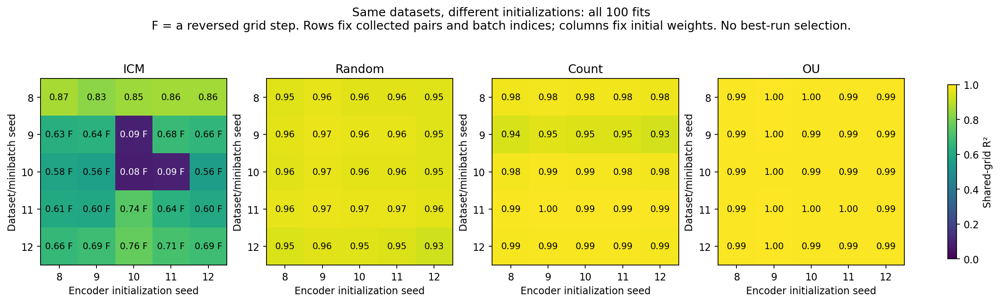

# Short explanation of the policy differences

**The policy changes the examples and transitions the encoder learns from. The initial network and optimizer determine how it responds.** There is no evidence of a universal preferred fold at distance 2.4: continued training moves that turn.

We added **100 fits crossing fixed datasets with different initializations**, plus **50 alignment-removal controls**, and tested the existing 20-seed policy zoo.

- **Data matter more than an initial fold alone.** One ICM dataset ends unfolded under all five initializations; four others end folded under all five. Initial folds can be removed, and monotone initial functions can develop folds. Initialization changes how severe the distortion becomes.
- **Count beats random consistently:** 19/20 matched seeds, adjusted sign-test p = 0.000080. High-pass OU actions beat low-pass actions in 19/20 pure runs, p = 0.000120. Their ordering changes after OU handover, supported by a direct interaction test.
- **Coverage is insufficient.** Gaussian-shaped visited log-distances track recovery more consistently than coverage entropy in all 20 seed-wise comparisons. SIGReg encourages Gaussian outputs, so a very non-Gaussian visitation distribution pressures it to change an affine distance code. Pair dynamics still matter; this association is not the whole cause.
- **Reflections are a real ambiguity, but not a sufficient explanation.** A symmetric code can ignore a boundary bounce. Yet selectively removing reflection alignment, while keeping SIGReg unchanged, repairs none of the folds and adds only 0.0035 R² over equal random removal (five-dataset sign-test p = 0.0625).

**Good readout does not prove identification.** For negative-correlation Gaussian pairs, an information-losing comparator has lower expected loss than the best scaled linear code, while the trained network stays nearly linear. Population loss preference, finite-network capacity and optimization are different questions.

These are exploratory representation tests, not new planning results. [Full evidence and test assumptions](README.md) · [Mathematics](MATH.md) · [Numerical verification](output/verification.json)
