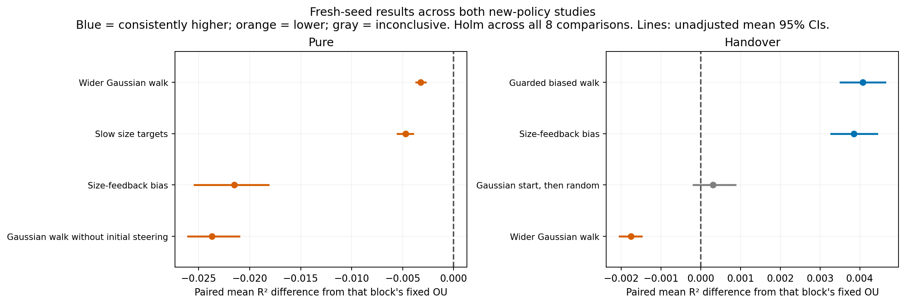

# New behavior policies: short results

**Scope:** these physical-policy extensions go beyond Klindt's exact Gaussian-OU assumptions. Gains below are finite-training representation results, not new identifiability guarantees. [Assumption boundary](../ASSUMPTION_BOUNDARY.md).

Added **13 controllers** to the distance-only zoo. Each uses the same physical actions and collection budget. We ran **520 discovery fits** and **400 fresh-seed fits**, plus four original-path reproduction gates. The original 17-policy catalog remains reproducible; the expanded catalog has 30 physical policies.

**Confirmed improvements over fixed OU:** Guarded biased walk → OU, Size-feedback bias → OU.

No selected policy beats fixed OU using its own data alone. A handover win includes the original final OU training phase.

**None shows a consistent improvement over the best old same-protocol reference** after the combined correction. Winning against OU alone does not establish a new best zoo policy.

## Fresh comparisons

| Policy | Training | Fresh seeds | Mean R² | Folds | Δ vs OU | Wins / 20 | Combined Holm p | Result |
| --- | --- | --- | ---: | ---: | ---: | ---: | ---: | --- |
| Guarded biased walk | handover | 48–67 | 0.998042 | 0/20 | +0.004072 | 20 | <0.0001 | higher |
| Size-feedback bias | handover | 48–67 | 0.997820 | 0/20 | +0.003850 | 20 | <0.0001 | higher |
| Gaussian start, then random | handover | 28–47 | 0.994752 | 0/20 | +0.000301 | 11 | 0.8238 | inconclusive |
| Wider Gaussian walk | handover | 28–47 | 0.992689 | 0/20 | -0.001762 | 0 | <0.0001 | lower |
| Wider Gaussian walk | pure | 28–47 | 0.991228 | 0/20 | -0.003223 | 0 | <0.0001 | lower |
| Slow size targets | pure | 28–47 | 0.989743 | 0/20 | -0.004708 | 0 | <0.0001 | lower |
| Size-feedback bias | pure | 48–67 | 0.972459 | 0/20 | -0.021511 | 0 | <0.0001 | lower |
| Gaussian walk without initial steering | pure | 48–67 | 0.970257 | 0/20 | -0.023713 | 0 | <0.0001 | lower |

### Do the OU winners beat the old best?

These p-values are corrected across all eight old-reference tests; the table highlights the OU winners.

| Candidate | Old reference | Paired mean difference | Combined Holm p | Result |
| --- | --- | ---: | ---: | --- |
| Guarded biased walk (handover) | Approach-biased → OU | -0.000002 | 0.5034 | inconclusive |
| Size-feedback bias (handover) | Approach-biased → OU | -0.000223 | 0.0024 | lower |

The two-sided sign tests concern consistent seed-wise wins, not a zero-mean null. Each confidence interval summarizes the paired mean and is unadjusted. Every fresh seed is included; there is no successful-run subset.

## All 13 additions

Discovery uses the same seeds 8–27 as the old zoo. These means are exploratory; selected candidates are tested above on fresh blocks.

| New policy | Pure mean R² | Handover mean R² |
| --- | ---: | ---: |
| Gaussian walk | 0.989444 | 0.992045 |
| Log-scaled Gaussian walk | 0.988682 | 0.992127 |
| Wider Gaussian walk | 0.991308 | 0.993732 |
| Fast size targets | 0.990168 | 0.992888 |
| Slow size targets | 0.990451 | 0.992667 |
| Gaussian-weighted coverage | 0.989928 | 0.992070 |
| Gaussian start, then random | 0.989109 | 0.995578 |
| Guarded biased walk | 0.957666 | 0.998259 |
| Gentle biased walk | 0.955620 | 0.997683 |
| Size-feedback bias | 0.975105 | 0.997945 |
| Guarded sweeps | 0.961246 | 0.996303 |
| Sweep/bias mixture | 0.961717 | 0.996286 |
| Gaussian walk without initial steering | 0.971930 | 0.997621 |

## What this comparison suggests

Removing the initial size-target steering from the same log-diffusion controller changes discovery R² by **-0.0194 with pure data** but **+0.0039 with OU handover**. The collection phase changes which views and transitions are sampled. A source's usefulness therefore depends on the later training protocol; matching a Gaussian-looking histogram alone is insufficient. This is an exploratory ablation, not a proof that width alone causes the difference.

Gaussian-targeted controllers use the known height=1/d relationship and Gaussian size goals. Broader controllers use guarded bias, sweeps, feedback, or remove the initial Gaussian steering. These are hand-coded priors; the encoder still receives only observation pairs.

The main OU reference generates Gaussian latent pairs directly. The old physically acting **OU-noise actions** controller is a separate baseline. Both appear in the full comparison. R² is representation recovery, not a planning score.

- [All old/new physical and Gaussian-source rankings](FULL_COMPARISON.md)
- [Gaussian-targeted study: methods, failures and verification](../targeted-policies/README.md)
- [Broader-coverage follow-up](../broad-policies/README.md)
- [Combined test results, including best-old comparisons](summary.json)
- [Inference rules across the two studies](../NEW_POLICY_INFERENCE.md)
