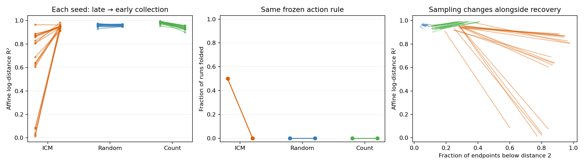
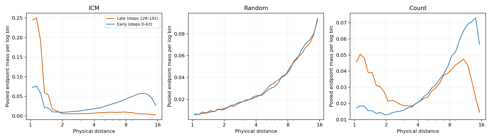
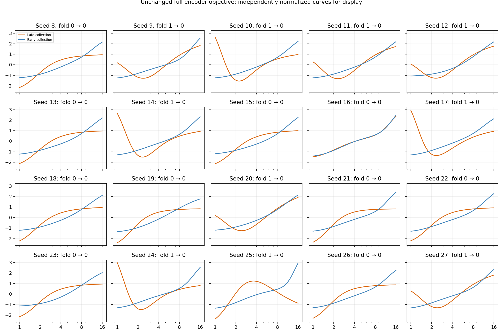
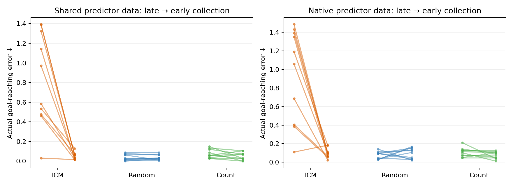

# Same ICM policy, different collection age

Completed 60/60 encoder fits. [Fixed follow-up protocol](../EARLY_COLLECTION_PROTOCOL.md).

The original frozen action rules are unchanged. Late data are steps 128–191; early data are steps 0–63 after the same uniform physical-distance resets. Both phases supply 16,384 real transitions. This intentionally changes the observed distribution and empirical pair law, not the encoder loss or SIGReg. Early data are transient, not stationary.

| Policy | Seeds | Late R² | Early R² | Late folds | Early folds | Endpoint mass below 2: late → early |
| --- | ---: | ---: | ---: | ---: | ---: | ---: |
| ICM | 20 | 0.6035 | 0.9457 | 10/20 | 0/20 | 0.841 → 0.278 |
| Random | 20 | 0.9609 | 0.9591 | 0/20 | 0/20 | 0.068 → 0.065 |
| Count | 20 | 0.9845 | 0.9385 | 0/20 | 0/20 | 0.311 → 0.126 |

| Policy | Endpoint | Mean improvement [unadjusted 95% interval] | Positive / negative seeds | Holm p |
| --- | --- | ---: | ---: | ---: |
| ICM | affine_log_r2 | +0.3422 [+0.2046, +0.4937] | 19 / 1 | 0.0002003 |
| ICM | fold_status | +0.5 [+0.3, +0.7] | 10 / 0 | 0.007812 |
| Random | affine_log_r2 | -0.001862 [-0.006233, +0.002225] | 12 / 8 | 1 |
| Random | fold_status | +0 [+0, +0] | 0 / 0 | 1 |
| Count | affine_log_r2 | -0.04596 [-0.0531, -0.03955] | 0 / 20 | 1.144e-05 |
| Count | fold_status | +0 [+0, +0] | 0 / 0 | 1 |

Recovery/fold tests share one Holm family of six. Sign tests assess seed-wise direction, not zero mean. Fold tests use discordant pairs. All 20 seeds are included.

## Does the change help actual goal-reaching?

| Policy | Seeds | Late/shared error | Early/shared error | Late/native error | Early/native error |
| --- | ---: | ---: | ---: | ---: | ---: |
| ICM | 10 | 0.8316 | 0.0516 | 0.9504 | 0.0973 |
| Random | 10 | 0.0387 | 0.0371 | 0.0773 | 0.0977 |
| Count | 10 | 0.0758 | 0.0504 | 0.1066 | 0.0773 |

Shared-data comparison changes the frozen encoder while holding predictor data and goals fixed. Native comparison changes both encoder and predictor data. Every goal has zero physical oracle error.

| Policy | Shared-data mean error reduction [95% interval] | Positive / negative seeds | Holm p |
| --- | ---: | ---: | ---: |
| ICM | +0.7801 [+0.5031, +1.057] | 10 / 0 | 0.005859 |
| Random | +0.001563 [-0.008984, +0.01484] | 2 / 4 | 0.6875 |
| Count | +0.02539 [-0.004687, +0.05665] | 7 / 3 | 0.6875 |

Planning has a separate Holm family of three. Goal cases are not independent seeds. These ten-seed task results do not establish a universal policy ranking.

## Conservative sensitivity check

The predeclared within-study corrections above support the ICM recovery, fold and shared-planning improvements. A stricter post hoc Holm correction across all 29 newly reported tests gives recovery p = 0.0011 and both fold repair and planning p = 0.0508. Thus the task/fold significance is sensitive to the correction scope. [All-test correction](GLOBAL_CORRECTION.json). Fresh actor/seed replication should precede stronger general claims.

## Interpretation limits

Together with the alignment-removal test, this checks whether the ICM fold pattern is sensitive to its sampled observations while retaining its actor. Earlier collection also changes action/state frequencies, boundary encounters and pair connections; it does not isolate a single histogram statistic. Curiosity reward learning was already frozen. This test concerns the data supplied to the JEPA encoder, not a claim that ICM’s internal curiosity model itself folds.
