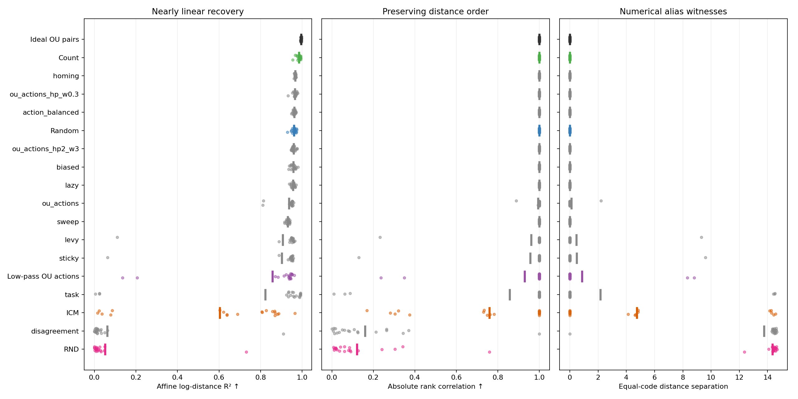
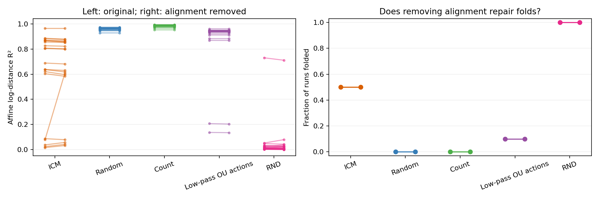
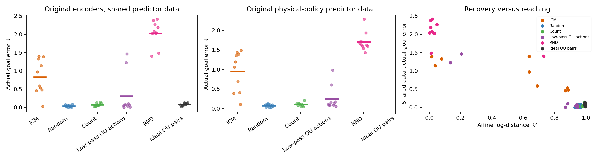

# Original policies: identifiability and planning

**The original zoo policies differ strongly.** The previous matched-coverage test used altered stationary policies; its null result did not establish that original ICM, random, count or OU are interchangeable.

Re-evaluated **700 saved original encoders**. Completed **100/100 alignment-removal fits** and **110/110 original-encoder planning evaluations**. [Protocol](../PROTOCOL.md) · [Hypothesis and exact loss symmetry](../MECHANISM.md).

## Original-policy identifiability

Same 20 paired zoo seeds, 8–27, and common evaluation range. Affine R² is the original saved metric. Rank and equal-code witnesses are new evaluations of those unchanged encoders. Handover is the old policy→OU curriculum, not training on that policy alone.

| Original policy | Pure R² ↑ | Pure folds | Rank correlation ↑ | Mean alias separation | Handover R² ↑ | Handover folds |
| --- | ---: | ---: | ---: | ---: | ---: | ---: |
| Ideal OU pairs | 0.9950 | 0/20 | 1.0000 | 0.000 | — | — |
| Count | 0.9845 | 0/20 | 1.0000 | 0.000 | 0.9961 | 0/20 |
| homing | 0.9667 | 0/20 | 1.0000 | 0.000 | 0.9749 | 0/20 |
| ou_actions_hp_w0.3 | 0.9653 | 0/20 | 1.0000 | 0.000 | 0.9962 | 0/20 |
| action_balanced | 0.9619 | 0/20 | 1.0000 | 0.000 | 0.9962 | 0/20 |
| Random | 0.9609 | 0/20 | 1.0000 | 0.000 | 0.9966 | 0/20 |
| ou_actions_hp2_w3 | 0.9588 | 0/20 | 1.0000 | 0.000 | 0.9963 | 0/20 |
| biased | 0.9575 | 0/20 | 1.0000 | 0.000 | 0.9983 | 0/20 |
| lazy | 0.9567 | 0/20 | 1.0000 | 0.000 | 0.9964 | 0/20 |
| ou_actions | 0.9365 | 2/20 | 0.9941 | 0.110 | 0.9975 | 0/20 |
| sweep | 0.9314 | 0/20 | 1.0000 | 0.000 | 0.9979 | 0/20 |
| levy | 0.9073 | 1/20 | 0.9616 | 0.466 | 0.9974 | 0/20 |
| sticky | 0.9018 | 1/20 | 0.9565 | 0.480 | 0.9549 | 1/20 |
| Low-pass OU actions | 0.8580 | 2/20 | 0.9293 | 0.856 | 0.9982 | 0/20 |
| task | 0.8229 | 3/20 | 0.8579 | 2.171 | 0.9302 | 2/20 |
| ICM | 0.6034 | 10/20 | 0.7603 | 4.736 | 0.8180 | 9/20 |
| disagreement | 0.0624 | 19/20 | 0.1598 | 13.758 | 0.4584 | 18/20 |
| RND | 0.0518 | 20/20 | 0.1215 | 14.344 | 0.3782 | 19/20 |

A warped monotone map can retain information without linear recovery. Equal-code witnesses provide evidence of actual aliasing; they are numerically refined on the network and are not an exhaustive maximum-gap search or formal floating-point impossibility certificate. All new fold checks use the same 1,025-point grid; historical R² uses the prior evaluation.

## New hypothesis test: is alignment necessary for the folds?

Remove alignment while retaining every original training endpoint, historical batch plan, initialization, optimizer schedule and unchanged SIGReg. This tests necessity of the explicit alignment term; it does not identify a unique cause of folding. Paired endpoints still co-occur in finite SIGReg batches, so pair-law effects are not all removed. [Interpretation clarification](../CLARIFICATIONS.md).

| Actual data source | Seeds | Original R² | Alignment removed R² | Original folds retained | Repaired | Newly folded |
| --- | ---: | ---: | ---: | ---: | ---: | ---: |
| ICM | 20 | 0.6035 | 0.6255 | 10/10 | 0 | 0 |
| Random | 20 | 0.9609 | 0.9610 | 0/0 | 0 | 0 |
| Count | 20 | 0.9845 | 0.9845 | 0/0 | 0 | 0 |
| Low-pass OU actions | 20 | 0.8580 | 0.8577 | 2/2 | 0 | 0 |
| RND | 20 | 0.0521 | 0.0509 | 20/20 | 0 | 0 |

| Source | Endpoint | Mean improvement [unadjusted 95% interval] | Positive / negative seeds | Holm p |
| --- | --- | ---: | ---: | ---: |
| ICM | affine_log_r2 | +0.02203 [-0.008256, +0.07759] | 4 / 16 | 0.09454 |
| ICM | fold_status | +0 [+0, +0] | 0 / 0 | 1 |
| Random | affine_log_r2 | +7.419e-05 [+6.162e-05, +8.494e-05] | 19 / 1 | 0.0004005 |
| Random | fold_status | +0 [+0, +0] | 0 / 0 | 1 |
| Count | affine_log_r2 | +3.827e-05 [+1.047e-05, +6.278e-05] | 16 / 4 | 0.09454 |
| Count | fold_status | +0 [+0, +0] | 0 / 0 | 1 |
| Low-pass OU actions | affine_log_r2 | -0.0003277 [-0.0007793, -2.766e-05] | 6 / 14 | 0.6919 |
| Low-pass OU actions | fold_status | +0 [+0, +0] | 0 / 0 | 1 |
| RND | affine_log_r2 | -0.001144 [-0.004938, +0.003239] | 3 / 17 | 0.02319 |
| RND | fold_status | +0 [+0, +0] | 0 / 0 | 1 |

Positive improvement means higher recovery or fewer folds after removing alignment. One Holm family covers all ten tests; fold tests use discordant pairs only. All seeds are included. These are exploratory fixed-source interventions, not population identifiability guarantees.

All-trial curves: [ICM](curves_icm.png) · [Random](curves_random.png) · [Count](curves_count.png) · [Low-pass OU actions](curves_ou_actions_lp_w0.1.png) · [RND](curves_rnd.png).

## Actual goal-reaching with original encoders

Ten fixed seeds, 8–17; original encoders unchanged. Identical 64 reachable goals per seed. Shared and native predictors have equal data and training budgets. Ideal OU pairs have no physical action labels, so no native-data score is fabricated.

| Original encoder | Seeds | Shared-data error ↓ | Native-data error ↓ | Shared success ↑ |
| --- | ---: | ---: | ---: | ---: |
| ICM | 10 | 0.8316 | 0.9504 | 0.564 |
| Random | 10 | 0.0387 | 0.0773 | 0.997 |
| Count | 10 | 0.0758 | 0.1066 | 0.988 |
| Low-pass OU actions | 10 | 0.3090 | 0.2465 | 0.884 |
| RND | 10 | 2.0297 | 1.7020 | 0.331 |
| Ideal OU pairs | 10 | 0.0844 | — | 0.973 |

Full paired planning tests and confidence intervals are in [statistics.json](statistics.json). Shared-vs-OU and native-vs-shared are separate Holm families of five. Native data can change both occupancy and state-dependent action coverage; it is not an occupancy-only intervention.

## Scope

- The original-policy ranking retains real visitation differences. It is not a matched-distribution causal comparison.
- The alignment-removal test keeps the original endpoint stream fixed but changes one objective term. It tests whether explicit alignment is necessary, without modifying SIGReg; residual finite-batch endpoint correlations remain.
- Fold counts, affine recovery, preserved order and actual reaching are separate outcomes. No finite grid or high R² certifies the paper’s theorem.
- The two-goal alias bound applies to exactly equal codes. Reported witnesses have a numerical residual; actual planning is tested independently.
- This dataset cohort has been inspected previously. New interventions follow a written protocol, but conclusions remain exploratory.
