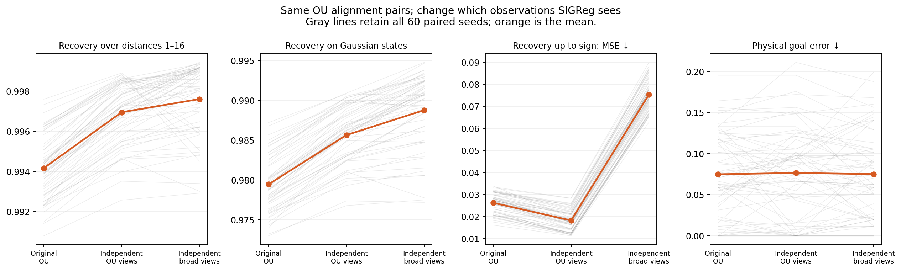

# Broad observations help OU’s affine recovery, with an important scale trade-off

**Completed:** 60 paired seeds, 180 OU encoders and 180 shared-data planning evaluations. The OU alignment pairs are identical across conditions. [Fixed protocol](../PROTOCOL.md).

| SIGReg data | R² over distances 1–16 ↑ | R² on held-out Gaussian states ↑ | Raw sign-only error ↓ | Physical goal error ↓ |
| --- | ---: | ---: | ---: | ---: |
| Original OU: same pair batch | 0.99417 | 0.97944 | 0.02625 | 0.07487 |
| Independent OU observations | 0.99695 | 0.98563 | 0.01825 | 0.07643 |
| Independent broad observations | 0.99761 | 0.98876 | 0.07535 | 0.07507 |

All three conditions have **0/60 grid-detected folds**. Broad observations use the same log-uniform 1–16 pool as the ICM experiment. OU alignment is not clipped; the Gaussian evaluation includes its tails outside that interval.

## What changes when only the observation pool changes?

Compare the last two rows: both sample SIGReg observations independently and use the same gradient implementation.

| Outcome | Mean benefit of broad pool | Holm-adjusted p |
| --- | ---: | ---: |
| Bounded-grid R² gain | +0.000656 | 3.18e-05 |
| Gaussian R² gain | +0.003136 | 1.07e-09 |
| Raw sign-only error reduction | -0.057099 | 2.78e-17 |
| Goal-error reduction | +0.001367 | 1 |

The isolated bounded-grid gain is about **0.00066 R²**, smaller than the 0.001 practical tolerance used in the earlier policy-equivalence study. Much of the gain over original OU already appears with independent sampling of OU observations. No significant reaching improvement is detected; nonsignificance is not proof of equivalence. All 16 planned comparisons share one Holm correction.

## Why does R² improve while sign-only recovery worsens?

R² permits fitting a scale and offset. The stricter error compares the raw network output with the true standardized latent, allowing only a global sign flip—the one-dimensional rotation. Broad-pool outputs become more compressed: on Gaussian test states, their mean standard deviation is **0.741**, versus **0.932** with independent OU observations; the target is 1. This worsens raw recovery despite better linearity. It is a scale error, not newly observed folding or evidence of lost information.

The planner centers and scales embeddings before predictor training, so a global scale error need not hurt this planning evaluation. The broad pool also changes the marginal on which SIGReg enforces its output distribution. Its formula and weight are unchanged, but the exact original population-theorem setup is not preserved.

## Does ICM plus broad observations beat regular OU?

On the same 60 seeds, the saved ICM/native-alignment+broad-SIGReg condition has bounded-grid recovery about **0.99755**, higher than original OU’s **0.99417**. But OU supplied the broad pool also reaches **0.99761**. The ICM condition therefore shows no special recovery advantage over broad-pool OU.

ICM+broad goal error is about **0.07598**, versus original OU **0.07487** and OU+broad **0.07507**. Neither planned ICM planning comparison is significant after correction. These compare fixed recipes with different pair laws and step scales; they do not establish a general ranking of autonomous policies.

[All tests/effect intervals](RESULTS.md) · [Representation curves](FIGURES.md) · [Full verification](VERIFICATION.json) · [Published code lock](LOCK.json)
