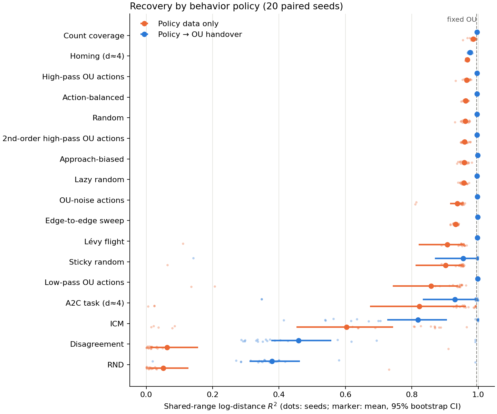
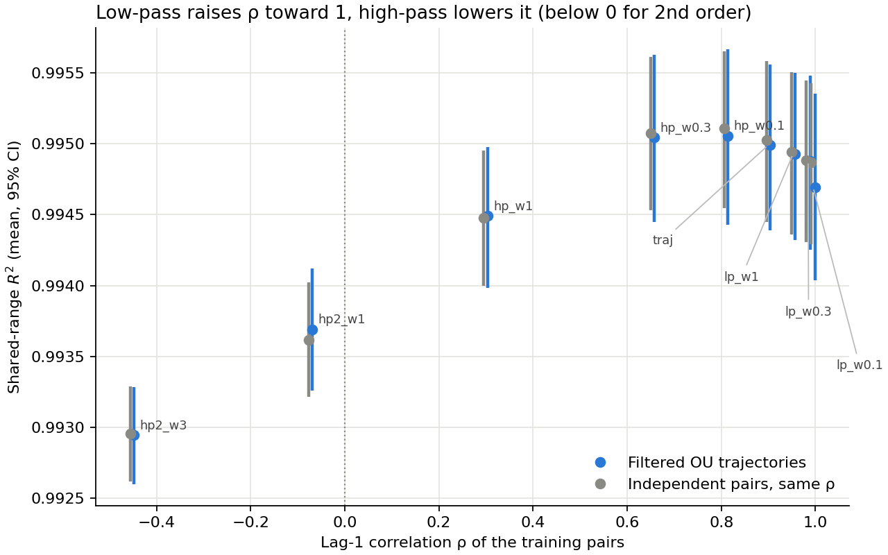

# Policy zoo results

Data seeds 8–27 (20 per condition), paired by seed. Mean shared-range $R^2$ with 95% bootstrap CI; folds = runs with any reversed grid step. p-values: exact paired sign-flip tests, Holm-corrected within each column (see [PROTOCOL.md](../PROTOCOL.md)). **Bold** marks Holm p < 0.05.

Reproduction: 35 earlier reliability runs (seeds 8–12) were regenerated and match every saved metric to 1e-7.

Reference floor: every condition shares the seed's encoder initialization, and after a single update fixed-OU runs already have mean $R^2$ = 0.9335. The tanh encoder starts close to affine in log-distance for most seeds, so scores largely measure whether training on a source keeps, improves or destroys that starting map.

## Policy data only (pure)

| Policy | Mean $R^2$ [95% CI] | Median | Folds | Δ vs random (p) | Δ vs ICM (p) | Δ vs fixed OU (p) | Folds vs ICM p |
| --- | ---: | ---: | ---: | ---: | ---: | ---: | ---: |
| Count coverage | 0.9845 [0.9798, 0.9884] | 0.9871 | 0/20 | **+0.0236 (0.0001)** | **+0.3811 (<0.0001)** | **-0.0106 (<0.0001)** | 0.0312 |
| Homing (d≈4) | 0.9667 [0.9655, 0.9678] | 0.9671 | 0/20 | +0.0058 (0.0729) | **+0.3633 (<0.0001)** | **-0.0283 (<0.0001)** | 0.0312 |
| High-pass OU actions | 0.9653 [0.9607, 0.9691] | 0.9673 | 0/20 | +0.0044 (0.1729) | **+0.3620 (<0.0001)** | **-0.0297 (<0.0001)** | 0.0312 |
| Action-balanced | 0.9619 [0.9593, 0.9644] | 0.9625 | 0/20 | +0.0010 (0.9987) | **+0.3585 (<0.0001)** | **-0.0331 (<0.0001)** | 0.0312 |
| Random | 0.9609 [0.9560, 0.9652] | 0.9631 | 0/20 | — | **+0.3575 (<0.0001)** | **-0.0341 (<0.0001)** | 0.0312 |
| 2nd-order high-pass OU actions | 0.9588 [0.9553, 0.9627] | 0.9567 | 0/20 | -0.0021 (0.9987) | **+0.3555 (<0.0001)** | **-0.0362 (<0.0001)** | 0.0312 |
| Approach-biased | 0.9575 [0.9526, 0.9623] | 0.9589 | 0/20 | -0.0034 (0.9987) | **+0.3541 (<0.0001)** | **-0.0375 (<0.0001)** | 0.0312 |
| Lazy random | 0.9567 [0.9530, 0.9602] | 0.9580 | 0/20 | -0.0042 (0.4869) | **+0.3533 (<0.0001)** | **-0.0383 (<0.0001)** | 0.0312 |
| OU-noise actions | 0.9365 [0.9155, 0.9513] | 0.9505 | 2/20 | **-0.0245 (<0.0001)** | **+0.3331 (<0.0001)** | **-0.0586 (<0.0001)** | 0.0312 |
| Edge-to-edge sweep | 0.9314 [0.9281, 0.9344] | 0.9330 | 0/20 | **-0.0295 (<0.0001)** | **+0.3280 (<0.0001)** | **-0.0636 (<0.0001)** | 0.0312 |
| Lévy flight | 0.9073 [0.8206, 0.9538] | 0.9519 | 1/20 | **-0.0536 (0.0014)** | **+0.3039 (0.0075)** | **-0.0877 (<0.0001)** | 0.0312 |
| Sticky random | 0.9018 [0.8114, 0.9502] | 0.9496 | 1/20 | **-0.0591 (0.0007)** | **+0.2984 (0.0083)** | **-0.0932 (<0.0001)** | 0.0312 |
| Low-pass OU actions | 0.8580 [0.7422, 0.9384] | 0.9399 | 2/20 | **-0.1030 (<0.0001)** | **+0.2546 (0.0413)** | **-0.1371 (<0.0001)** | 0.0430 |
| A2C task (d≈4) | 0.8229 [0.6739, 0.9633] | 0.9573 | 3/20 | -0.1380 (0.7738) | +0.2196 (0.0821) | **-0.1721 (<0.0001)** | 0.0654 |
| ICM | 0.6034 [0.4531, 0.7432] | 0.7477 | 10/20 | **-0.3575 (<0.0001)** | — | **-0.3917 (<0.0001)** | — |
| Disagreement | 0.0624 [0.0126, 0.1558] | 0.0141 | 19/20 | **-0.8985 (<0.0001)** | **-0.5410 (<0.0001)** | **-0.9326 (<0.0001)** | 0.0312 |
| RND | 0.0518 [0.0113, 0.1267] | 0.0119 | 20/20 | **-0.9091 (<0.0001)** | **-0.5516 (<0.0001)** | **-0.9432 (<0.0001)** | 0.0312 |

## Policy data, then OU handover (original protocol)

| Policy | Mean $R^2$ [95% CI] | Median | Folds | Δ vs random (p) | Δ vs ICM (p) | Δ vs fixed OU (p) | Folds vs ICM p |
| --- | ---: | ---: | ---: | ---: | ---: | ---: | ---: |
| Approach-biased | 0.9983 [0.9980, 0.9985] | 0.9984 | 0/20 | **+0.0017 (<0.0001)** | **+0.1803 (0.0260)** | **+0.0032 (<0.0001)** | 0.0586 |
| Low-pass OU actions | 0.9982 [0.9978, 0.9986] | 0.9986 | 0/20 | **+0.0017 (0.0001)** | **+0.1803 (0.0260)** | **+0.0032 (<0.0001)** | 0.0586 |
| Edge-to-edge sweep | 0.9979 [0.9976, 0.9982] | 0.9979 | 0/20 | **+0.0013 (<0.0001)** | **+0.1799 (0.0290)** | **+0.0029 (<0.0001)** | 0.0586 |
| OU-noise actions | 0.9975 [0.9971, 0.9980] | 0.9977 | 0/20 | **+0.0010 (0.0003)** | **+0.1796 (0.0352)** | **+0.0025 (<0.0001)** | 0.0586 |
| Lévy flight | 0.9974 [0.9970, 0.9978] | 0.9976 | 0/20 | **+0.0008 (0.0021)** | **+0.1794 (0.0352)** | **+0.0024 (<0.0001)** | 0.0586 |
| Random | 0.9966 [0.9961, 0.9970] | 0.9967 | 0/20 | — | **+0.1786 (0.0352)** | **+0.0015 (0.0023)** | 0.0586 |
| Lazy random | 0.9964 [0.9960, 0.9968] | 0.9964 | 0/20 | -0.0002 (0.4831) | **+0.1784 (0.0352)** | **+0.0014 (0.0107)** | 0.0586 |
| 2nd-order high-pass OU actions | 0.9963 [0.9958, 0.9967] | 0.9962 | 0/20 | **-0.0003 (0.0262)** | **+0.1783 (0.0352)** | **+0.0012 (0.0166)** | 0.0586 |
| Action-balanced | 0.9962 [0.9958, 0.9966] | 0.9962 | 0/20 | **-0.0003 (0.0025)** | **+0.1783 (0.0352)** | **+0.0012 (0.0123)** | 0.0586 |
| High-pass OU actions | 0.9962 [0.9958, 0.9966] | 0.9964 | 0/20 | **-0.0003 (0.0262)** | **+0.1782 (0.0352)** | **+0.0012 (0.0123)** | 0.0586 |
| Count coverage | 0.9961 [0.9952, 0.9970] | 0.9963 | 0/20 | -0.0004 (0.7974) | **+0.1781 (0.0352)** | **+0.0011 (0.0285)** | 0.0586 |
| Homing (d≈4) | 0.9749 [0.9731, 0.9767] | 0.9759 | 0/20 | **-0.0216 (<0.0001)** | **+0.1569 (0.0352)** | **-0.0201 (<0.0001)** | 0.0586 |
| Sticky random | 0.9549 [0.8691, 0.9979] | 0.9977 | 1/20 | -0.0417 (1.0000) | +0.1369 (0.0524) | -0.0402 (1.0000) | 0.0586 |
| A2C task (d≈4) | 0.9302 [0.8329, 0.9954] | 0.9949 | 2/20 | **-0.0664 (0.0301)** | +0.1122 (0.0893) | -0.0649 (0.4515) | 0.0586 |
| ICM | 0.8180 [0.7263, 0.9060] | 0.9943 | 9/20 | **-0.1786 (0.0262)** | — | **-0.1770 (0.0166)** | — |
| Disagreement | 0.4584 [0.3767, 0.5571] | 0.3679 | 18/20 | **-0.5381 (<0.0001)** | **-0.3596 (<0.0001)** | **-0.5366 (<0.0001)** | 0.0586 |
| RND | 0.3782 [0.3116, 0.4635] | 0.3555 | 19/20 | **-0.6183 (<0.0001)** | **-0.4397 (<0.0001)** | **-0.6168 (<0.0001)** | 0.0312 |

## Does the OU handover help?

| Policy | Handover − pure [95% CI] | Holm p |
| --- | ---: | ---: |
| Disagreement | +0.3960 [+0.3252, +0.4785] | <0.0001 ** |
| RND | +0.3264 [+0.2804, +0.3669] | <0.0001 ** |
| ICM | +0.2146 [+0.1120, +0.3307] | 0.0002 ** |
| Low-pass OU actions | +0.1403 [+0.0599, +0.2557] | <0.0001 ** |
| A2C task (d≈4) | +0.1072 [+0.0318, +0.2155] | <0.0001 ** |
| Lévy flight | +0.0901 [+0.0437, +0.1767] | <0.0001 ** |
| Edge-to-edge sweep | +0.0665 [+0.0637, +0.0696] | <0.0001 ** |
| OU-noise actions | +0.0611 [+0.0462, +0.0821] | <0.0001 ** |
| Sticky random | +0.0530 [+0.0473, +0.0607] | <0.0001 ** |
| Approach-biased | +0.0408 [+0.0361, +0.0455] | <0.0001 ** |
| Lazy random | +0.0397 [+0.0364, +0.0432] | <0.0001 ** |
| 2nd-order high-pass OU actions | +0.0374 [+0.0337, +0.0409] | <0.0001 ** |
| Random | +0.0356 [+0.0314, +0.0405] | <0.0001 ** |
| Action-balanced | +0.0344 [+0.0320, +0.0368] | <0.0001 ** |
| High-pass OU actions | +0.0309 [+0.0273, +0.0354] | <0.0001 ** |
| Count coverage | +0.0116 [+0.0071, +0.0169] | <0.0001 ** |
| Homing (d≈4) | +0.0082 [+0.0064, +0.0102] | <0.0001 ** |

## Low-pass and high-pass OU (exact Gaussian, pure)

Filtered trajectories vs independent pairs with the same lag-1 correlation ρ.

| Source | ρ | Filtered $R^2$ [95% CI] | Folds | Matched i.i.d. $R^2$ | Folds | Filtered − i.i.d. (Holm p) | Δ filtered vs fixed OU (Holm p) |
| --- | ---: | ---: | ---: | ---: | ---: | ---: | ---: |
| ou_traj | +0.900 | 0.9950 [0.9944, 0.9956] | 0/20 | 0.9950 | 0/20 | — | -0.0000 (1.0000) |
| ou_lp_w1 | +0.953 | 0.9949 [0.9943, 0.9955] | 0/20 | 0.9949 | 0/20 | -0.0000 (1.0000) | -0.0001 (1.0000) |
| ou_lp_w0.3 | +0.984 | 0.9949 [0.9943, 0.9955] | 0/20 | 0.9949 | 0/20 | -0.0000 (1.0000) | -0.0001 (1.0000) |
| ou_lp_w0.1 | +0.995 | 0.9947 [0.9940, 0.9954] | 0/20 | 0.9949 | 0/20 | -0.0002 (1.0000) | -0.0003 (0.9933) |
| ou_hp_w0.1 | +0.810 | 0.9951 [0.9944, 0.9957] | 0/20 | 0.9951 | 0/20 | -0.0001 (1.0000) | +0.0000 (1.0000) |
| ou_hp_w0.3 | +0.654 | 0.9950 [0.9944, 0.9956] | 0/20 | 0.9951 | 0/20 | -0.0000 (1.0000) | +0.0000 (1.0000) |
| ou_hp_w1 | +0.299 | 0.9945 [0.9940, 0.9950] | 0/20 | 0.9945 | 0/20 | +0.0000 (1.0000) | -0.0005 (0.0007) |
| ou_hp2_w1 | -0.073 | 0.9937 [0.9933, 0.9941] | 0/20 | 0.9936 | 0/20 | +0.0001 (1.0000) | -0.0013 (<0.0001) |
| ou_hp2_w3 | -0.452 | 0.9929 [0.9926, 0.9933] | 0/20 | 0.9930 | 0/20 | -0.0000 (1.0000) | -0.0021 (<0.0001) |
| fixed OU (i.i.d. pairs) | +0.900 | 0.9950 [0.9944, 0.9956] | 0/20 | — | — | — | — |

## Exploratory: twice the budget (added after the main results)

For ρ < 0 the implemented loss is lower for a Gaussianized fold than for any rescaled linear map (see README). Do 8,000 updates find it?

| Source | 4,000 updates | 8,000 updates | Folds (8,000) | Long − ordinary (Holm p) |
| --- | ---: | ---: | ---: | ---: |
| iid_ou_hp2_w1 | 0.9936 | 0.9984 | 0/20 | +0.0048 (<0.0001) |
| ou_hp2_w1 | 0.9937 | 0.9985 | 0/20 | +0.0048 (<0.0001) |
| iid_ou_hp2_w3 | 0.9930 | 0.9976 | 0/20 | +0.0046 (<0.0001) |
| ou_hp2_w3 | 0.9929 | 0.9976 | 0/20 | +0.0047 (<0.0001) |
| ou | 0.9950 | 0.9991 | 0/20 | +0.0041 (<0.0001) |

## Source statistics (pure protocol, physical policies)

Descriptive only; computed with simulator labels that fitting never sees.

| Policy | Size-bin entropy | Max bin mass | In sensor range | Gaussian-CDF dist. | Lag-1 corr. | Stay fraction |
| --- | ---: | ---: | ---: | ---: | ---: | ---: |
| Count coverage | 0.977 | 0.061 | 1.000 | 0.112 | 0.9952 | 0.329 |
| Homing (d≈4) | 0.346 | 0.432 | 1.000 | 0.057 | 0.8894 | 0.742 |
| High-pass OU actions | 0.899 | 0.093 | 1.000 | 0.111 | 0.9975 | 0.334 |
| Action-balanced | 0.910 | 0.115 | 1.000 | 0.119 | 0.9974 | 0.334 |
| Random | 0.918 | 0.096 | 1.000 | 0.118 | 0.9973 | 0.333 |
| 2nd-order high-pass OU actions | 0.910 | 0.098 | 1.000 | 0.123 | 0.9973 | 0.334 |
| Approach-biased | 0.970 | 0.066 | 1.000 | 0.108 | 0.9964 | 0.331 |
| Lazy random | 0.915 | 0.097 | 1.000 | 0.123 | 0.9992 | 0.801 |
| OU-noise actions | 0.906 | 0.176 | 1.000 | 0.146 | 0.9979 | 0.332 |
| Edge-to-edge sweep | 0.923 | 0.103 | 1.000 | 0.125 | 0.9973 | 0.034 |
| Lévy flight | 0.920 | 0.155 | 1.000 | 0.139 | 0.9977 | 0.335 |
| Sticky random | 0.897 | 0.182 | 1.000 | 0.147 | 0.9980 | 0.327 |
| Low-pass OU actions | 0.854 | 0.233 | 1.000 | 0.156 | 0.9982 | 0.332 |
| A2C task (d≈4) | 0.947 | 0.083 | 1.000 | 0.131 | 0.9942 | 0.338 |
| ICM | 0.627 | 0.257 | 1.000 | 0.271 | 0.9392 | 0.192 |
| Disagreement | 0.814 | 0.171 | 1.000 | 0.229 | 0.9860 | 0.316 |
| RND | 0.824 | 0.165 | 1.000 | 0.226 | 0.9866 | 0.308 |

Spearman correlation of a policy's mean pure $R^2$ with its source statistic (17 policies, descriptive):

| Statistic | Spearman ρ |
| --- | ---: |
| size_bin_entropy | +0.326 |
| size_bin_coverage | +0.412 |
| max_size_bin_mass | -0.407 |
| gaussian_cdf_distance | -0.907 |
| lag_correlation | +0.115 |
| stay_fraction | +0.453 |
| mean_abs_step | -0.689 |

Full per-run metrics are in `runs/`; aggregated numbers and every test are in `summary.json`.
