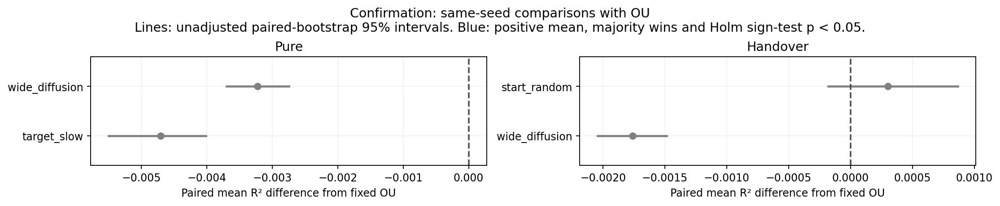
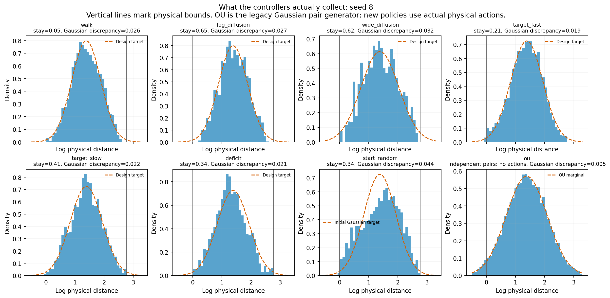

# Gaussian-targeted behavior policies

**These seven controllers give high recovery with physical actions, but none consistently beats fixed OU in fresh-seed testing.** They remain in the zoo, including the unsuccessful candidates. [Broader-coverage follow-up](../broad-policies/README.md) tests a separate idea with another fresh seed block.

The controllers guide the agent using the visible triangle height. They use the known height = 1/d relationship and a Gaussian target in log apparent size—an explicit prior, not simulator labels passed to the encoder. The world still has one distance and the same three actions.

These physical controllers are [outside the paper's exact Gaussian-OU hypotheses](../ASSUMPTION_BOUNDARY.md). The comparisons test finite-training representation recovery, not a new identifiability theorem.

## What was added?

| Controller | Rule after initial steering |
| --- | --- |
| `gaussian_walk` | Accept/reject local random walk targeting Gaussian log sizes |
| `gaussian_log_diffusion` | Same target; move less often nearby and more often far away |
| `gaussian_wide_diffusion` | Same movement rule, broader target distribution |
| `gaussian_target_fast` | Follow a smoothly changing random size target |
| `gaussian_target_slow` | Follow a slower random target |
| `gaussian_deficit` | Prefer under-visited size bins in Gaussian proportions |
| `gaussian_start_random` | Uniform feasible actions; initial steering is the only Gaussian guidance |

All seven use the first 64 of the existing 128 burn-in actions to approach a sampled target size. This changes the **collection policy**, not the reset distribution, interaction budget or encoder initialization. Recorded data start after burn-in. The same 4,000-update encoder protocol tests both pure policy data and the original OU handover.

## Fresh-seed comparison

All seven were screened on the original 20 seeds, then the top two per protocol were fixed before testing on **seeds 28–47**. The fixed-OU reference averages **0.994451 R²** on this fresh block.

| Selected policy | Encoder training | Mean R² | Difference from OU | Wins / 20 | Holm sign p |
| --- | --- | ---: | ---: | ---: | ---: |
| Wide log diffusion | Pure | 0.991228 | −0.003223 | 0 | <0.0001 |
| Slow random targets | Pure | 0.989743 | −0.004708 | 0 | <0.0001 |
| Initial steering, then random | OU handover | 0.994752 | +0.000301 | 11 | 0.8238 |
| Wide log diffusion | OU handover | 0.992689 | −0.001762 | 0 | <0.0001 |

Every selected policy has **0/20 detected folds**. A small positive mean for steering-then-random is not a consistent improvement over OU: it wins only 11/20 trials. Its non-significant result is not evidence of equivalence.

The new pure policies beat random consistently on this block (20/20 wins each), but their higher means than count do not give significant sign-test results against count (14/20 wins, adjusted p = 0.2306). The old approach-biased handover averages **0.997919**, above both new handover candidates.



## What did we learn?

The collected log-size distributions are much more Gaussian than many old policies, yet this does not guarantee the best global distance code. The narrower collection range and the transition rule also matter. The broader target does best among this family's pure candidates. These are explanatory clues, not a causal decomposition.



The [physical motion plots](output/figures/physical_trajectories.png) and report's stay fractions show what the agent actually does. The legacy **fixed OU** reference generates Gaussian latent pairs directly; **OU-noise actions** is a different, physically acting old policy. The full tables include both. Neither R² nor zero detected folds establishes planning superiority.

## Inspect and reproduce

- [All seven discovery comparisons and the original zoo](output/DISCOVERY_RESULTS.md)
- [Fresh confirmation, all baselines and paired intervals](output/CONFIRMATION_RESULTS.md)
- [Frozen selection](output/selection.json) · [Protocol](PROTOCOL.md)
- [Controller mathematics and detailed-balance assumptions](MATH.md)
- [Verification](output/verification.json): all 460 fitted model scores/curves/folds and source fingerprints; representative source regeneration and 11 full training replays reproduce exactly.

From repository root, install this folder's `requirements.txt`, then run:

```bash
OPENBLAS_NUM_THREADS=1 python behavior-policy-experiments/policy-zoo/targeted-policies/run_targeted.py --workers 6
OPENBLAS_NUM_THREADS=1 python behavior-policy-experiments/policy-zoo/targeted-policies/analyze_targeted.py
OPENBLAS_NUM_THREADS=1 python behavior-policy-experiments/policy-zoo/targeted-policies/plot_behavior.py
OPENBLAS_NUM_THREADS=1 python behavior-policy-experiments/policy-zoo/verify_new_policies.py --study targeted-policies --workers 4
```

Runs resume partial checkpoints every 1,000 encoder updates. Source-pair hashes, frozen learned count policies and model checkpoints are saved; large regenerable pair pools are ignored by Git. Tests are in `test_targeted.py`. All figures have PNG and PDF versions.
