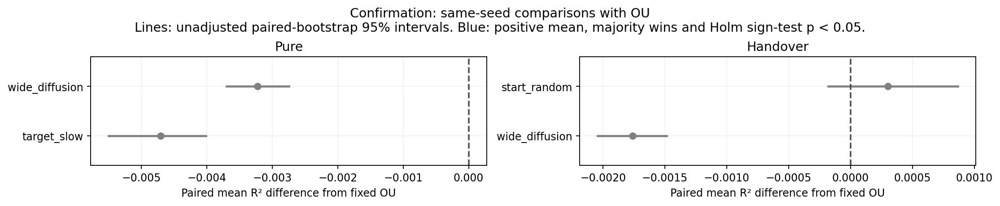

# Confirmation results

Seeds 28–47, paired by seed. R² measures representation recovery, not goal-reaching. Every candidate is retained.

## Matched comparisons with fixed OU

| Protocol | Policy | Mean Δ R² [paired 95% CI] | Wins / losses | Holm sign p | Pass fixed rule? |
| --- | --- | ---: | ---: | ---: | --- |
| handover | gaussian_start_random | +0.000301 [-0.000179, +0.000865] | 11 / 9 | 0.8238 | No |
| handover | gaussian_wide_diffusion | -0.001762 [-0.002043, -0.001487] | 0 / 20 | <0.0001 | No |
| pure | gaussian_wide_diffusion | -0.003223 [-0.003696, -0.002746] | 0 / 20 | <0.0001 | No |
| pure | gaussian_target_slow | -0.004708 [-0.005498, -0.004015] | 0 / 20 | <0.0001 | No |

## Pure rankings

| Policy | Mean R² [95% CI] | SD | Folds | Broader OU R² | Stay fraction | Gaussian discrepancy |
| --- | ---: | ---: | ---: | ---: | ---: | ---: |
| ou | 0.994451 [0.993903, 0.995028] | 0.001310 | 0/20 | 0.980270 | 0.000 | 0.0052 |
| gaussian_wide_diffusion (new) | 0.991228 [0.990774, 0.991723] | 0.001122 | 0/20 | 0.974159 | 0.643 | 0.0296 |
| gaussian_target_slow (new) | 0.989743 [0.989224, 0.990218] | 0.001160 | 0/20 | 0.971415 | 0.409 | 0.0224 |
| count | 0.973281 [0.960317, 0.983471] | 0.027469 | 0/20 | 0.955275 | 0.327 | 0.1149 |
| random | 0.961112 [0.958203, 0.964076] | 0.006823 | 0/20 | 0.915393 | 0.335 | 0.1152 |

## Handover rankings

| Policy | Mean R² [95% CI] | SD | Folds | Broader OU R² | Stay fraction | Gaussian discrepancy |
| --- | ---: | ---: | ---: | ---: | ---: | ---: |
| biased | 0.997919 [0.997523, 0.998274] | 0.000879 | 0/20 | 0.990148 | 0.330 | 0.1111 |
| random | 0.996371 [0.995822, 0.996854] | 0.001205 | 0/20 | 0.987167 | 0.335 | 0.1152 |
| gaussian_start_random (new) | 0.994752 [0.994015, 0.995487] | 0.001718 | 0/20 | 0.980908 | 0.339 | 0.0437 |
| gaussian_wide_diffusion (new) | 0.992689 [0.992249, 0.993162] | 0.001076 | 0/20 | 0.976659 | 0.643 | 0.0296 |

All per-seed differences, comparisons against random and the best old source, and source diagnostics are in the stage summary JSON.

Confidence intervals are unadjusted mean summaries. Sign tests concern win probability; they are a different null. Discovery uses old seeds. Confirmation uses fresh seeds and four selection-frozen comparisons.

