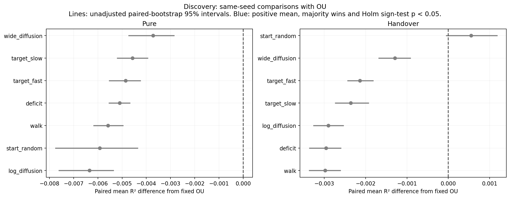

# Discovery results

Seeds 8–27, paired by seed. R² measures representation recovery, not goal-reaching. Every candidate is retained.

## Matched comparisons with fixed OU

| Protocol | Policy | Mean Δ R² [paired 95% CI] | Wins / losses | Holm sign p | Pass fixed rule? |
| --- | --- | ---: | ---: | ---: | --- |
| handover | gaussian_start_random | +0.000552 [-0.000048, +0.001176] | 12 / 8 | 0.5034 | No |
| handover | gaussian_wide_diffusion | -0.001294 [-0.001677, -0.000921] | 2 / 18 | 0.0008 | No |
| handover | gaussian_target_fast | -0.002138 [-0.002431, -0.001825] | 0 / 20 | <0.0001 | No |
| handover | gaussian_target_slow | -0.002359 [-0.002732, -0.001932] | 1 / 19 | 0.0001 | No |
| handover | gaussian_log_diffusion | -0.002900 [-0.003255, -0.002542] | 0 / 20 | <0.0001 | No |
| handover | gaussian_deficit | -0.002957 [-0.003355, -0.002602] | 0 / 20 | <0.0001 | No |
| handover | gaussian_walk | -0.002981 [-0.003360, -0.002612] | 0 / 20 | <0.0001 | No |
| pure | gaussian_wide_diffusion | -0.003718 [-0.004720, -0.002866] | 0 / 20 | <0.0001 | No |
| pure | gaussian_target_slow | -0.004575 [-0.005191, -0.003951] | 0 / 20 | <0.0001 | No |
| pure | gaussian_target_fast | -0.004858 [-0.005522, -0.004247] | 0 / 20 | <0.0001 | No |
| pure | gaussian_deficit | -0.005098 [-0.005538, -0.004686] | 0 / 20 | <0.0001 | No |
| pure | gaussian_walk | -0.005583 [-0.006167, -0.004970] | 0 / 20 | <0.0001 | No |
| pure | gaussian_start_random | -0.005917 [-0.007742, -0.004362] | 0 / 20 | <0.0001 | No |
| pure | gaussian_log_diffusion | -0.006345 [-0.007603, -0.005367] | 0 / 20 | <0.0001 | No |

## Pure rankings

| Policy | Mean R² [95% CI] | SD | Folds | Broader OU R² | Stay fraction | Gaussian discrepancy |
| --- | ---: | ---: | ---: | ---: | ---: | ---: |
| ou | 0.995026 [0.994453, 0.995598] | 0.001324 | 0/20 | 0.981223 | 0.000 | 0.0052 |
| gaussian_wide_diffusion (new) | 0.991308 [0.990243, 0.992288] | 0.002392 | 0/20 | 0.974825 | 0.633 | 0.0343 |
| gaussian_target_slow (new) | 0.990451 [0.989781, 0.991104] | 0.001553 | 0/20 | 0.972258 | 0.405 | 0.0204 |
| gaussian_target_fast (new) | 0.990168 [0.989614, 0.990677] | 0.001233 | 0/20 | 0.971946 | 0.205 | 0.0164 |
| gaussian_deficit (new) | 0.989928 [0.989374, 0.990449] | 0.001238 | 0/20 | 0.971316 | 0.336 | 0.0188 |
| gaussian_walk (new) | 0.989444 [0.989061, 0.989771] | 0.000833 | 0/20 | 0.970260 | 0.056 | 0.0184 |
| gaussian_start_random (new) | 0.989109 [0.987369, 0.990691] | 0.003876 | 0/20 | 0.973642 | 0.337 | 0.0434 |
| gaussian_log_diffusion (new) | 0.988682 [0.987475, 0.989596] | 0.002532 | 0/20 | 0.969582 | 0.663 | 0.0274 |
| count | 0.984474 [0.979795, 0.988327] | 0.010168 | 0/20 | 0.969438 | 0.329 | 0.1120 |
| homing | 0.966676 [0.965526, 0.967761] | 0.002655 | 0/20 | 0.930642 | 0.742 | 0.0570 |
| ou_actions_hp_w0.3 | 0.965334 [0.960774, 0.969109] | 0.009876 | 0/20 | 0.924499 | 0.334 | 0.1111 |
| action_balanced | 0.961882 [0.959330, 0.964317] | 0.005865 | 0/20 | 0.913465 | 0.334 | 0.1195 |
| random | 0.960914 [0.956026, 0.965211] | 0.010754 | 0/20 | 0.915436 | 0.333 | 0.1177 |
| ou_actions_hp2_w3 | 0.958831 [0.955334, 0.962617] | 0.008620 | 0/20 | 0.909994 | 0.334 | 0.1227 |
| biased | 0.957489 [0.952541, 0.962347] | 0.011531 | 0/20 | 0.931051 | 0.331 | 0.1079 |
| lazy | 0.956706 [0.953040, 0.960213] | 0.008413 | 0/20 | 0.906877 | 0.801 | 0.1232 |
| ou_actions | 0.936460 [0.915723, 0.951179] | 0.042939 | 2/20 | 0.873345 | 0.332 | 0.1459 |
| sweep | 0.931423 [0.928212, 0.934530] | 0.007430 | 0/20 | 0.888045 | 0.034 | 0.1245 |
| levy | 0.907277 [0.820367, 0.953713] | 0.188140 | 1/20 | 0.850074 | 0.335 | 0.1394 |
| sticky | 0.901821 [0.810487, 0.950233] | 0.197722 | 1/20 | 0.842623 | 0.327 | 0.1472 |
| ou_actions_lp_w0.1 | 0.857957 [0.744054, 0.938292] | 0.236259 | 2/20 | 0.804556 | 0.332 | 0.1560 |
| task | 0.822925 [0.674762, 0.963471] | 0.347709 | 3/20 | 0.801168 | 0.338 | 0.1309 |
| icm | 0.603374 [0.447053, 0.743126] | 0.344675 | 10/20 | 0.566532 | 0.192 | 0.2708 |
| disagreement | 0.062416 [0.012611, 0.155299] | 0.200277 | 19/20 | 0.053164 | 0.316 | 0.2286 |
| rnd | 0.051793 [0.011331, 0.126374] | 0.160566 | 20/20 | 0.041689 | 0.308 | 0.2261 |

## Handover rankings

| Policy | Mean R² [95% CI] | SD | Folds | Broader OU R² | Stay fraction | Gaussian discrepancy |
| --- | ---: | ---: | ---: | ---: | ---: | ---: |
| biased | 0.998258 [0.997988, 0.998510] | 0.000618 | 0/20 | 0.990614 | 0.331 | 0.1079 |
| ou_actions_lp_w0.1 | 0.998233 [0.997820, 0.998585] | 0.000898 | 0/20 | 0.990354 | 0.332 | 0.1560 |
| sweep | 0.997901 [0.997593, 0.998189] | 0.000696 | 0/20 | 0.990402 | 0.034 | 0.1245 |
| ou_actions | 0.997549 [0.997055, 0.997962] | 0.001070 | 0/20 | 0.989576 | 0.332 | 0.1459 |
| levy | 0.997384 [0.996972, 0.997770] | 0.000936 | 0/20 | 0.989176 | 0.335 | 0.1394 |
| random | 0.996553 [0.996122, 0.996988] | 0.001020 | 0/20 | 0.987541 | 0.333 | 0.1177 |
| lazy | 0.996403 [0.995972, 0.996827] | 0.001013 | 0/20 | 0.987125 | 0.801 | 0.1232 |
| ou_actions_hp2_w3 | 0.996273 [0.995825, 0.996701] | 0.001038 | 0/20 | 0.986860 | 0.334 | 0.1227 |
| action_balanced | 0.996237 [0.995841, 0.996611] | 0.000908 | 0/20 | 0.986702 | 0.334 | 0.1195 |
| ou_actions_hp_w0.3 | 0.996208 [0.995836, 0.996551] | 0.000854 | 0/20 | 0.986608 | 0.334 | 0.1111 |
| count | 0.996107 [0.995214, 0.996988] | 0.002086 | 0/20 | 0.983747 | 0.329 | 0.1120 |
| gaussian_start_random (new) | 0.995578 [0.994834, 0.996318] | 0.001725 | 0/20 | 0.982456 | 0.337 | 0.0434 |
| gaussian_wide_diffusion (new) | 0.993732 [0.993102, 0.994408] | 0.001512 | 0/20 | 0.978527 | 0.633 | 0.0343 |
| gaussian_target_fast (new) | 0.992888 [0.992441, 0.993355] | 0.001062 | 0/20 | 0.976757 | 0.205 | 0.0164 |
| gaussian_target_slow (new) | 0.992667 [0.992198, 0.993158] | 0.001114 | 0/20 | 0.976328 | 0.405 | 0.0204 |
| gaussian_log_diffusion (new) | 0.992127 [0.991643, 0.992629] | 0.001142 | 0/20 | 0.975253 | 0.663 | 0.0274 |
| gaussian_deficit (new) | 0.992070 [0.991660, 0.992499] | 0.000975 | 0/20 | 0.975134 | 0.336 | 0.0188 |
| gaussian_walk (new) | 0.992045 [0.991743, 0.992362] | 0.000723 | 0/20 | 0.975070 | 0.056 | 0.0184 |
| homing | 0.974923 [0.973064, 0.976698] | 0.004251 | 0/20 | 0.943991 | 0.742 | 0.0570 |
| sticky | 0.954858 [0.869082, 0.997943] | 0.191328 | 1/20 | 0.947526 | 0.327 | 0.1472 |
| task | 0.930175 [0.833061, 0.995413] | 0.199250 | 2/20 | 0.914770 | 0.338 | 0.1309 |
| icm | 0.817981 [0.724238, 0.905476] | 0.213180 | 9/20 | 0.790660 | 0.192 | 0.2708 |
| disagreement | 0.458429 [0.375707, 0.556414] | 0.213398 | 18/20 | 0.426473 | 0.316 | 0.2286 |
| rnd | 0.378235 [0.311441, 0.460283] | 0.175896 | 19/20 | 0.351333 | 0.308 | 0.2261 |

All per-seed differences, comparisons against random and the best old source, and source diagnostics are in the stage summary JSON.

Confidence intervals are unadjusted mean summaries. Sign tests concern win probability; they are a different null. Discovery uses old seeds. Confirmation uses fresh seeds and four selection-frozen comparisons.

