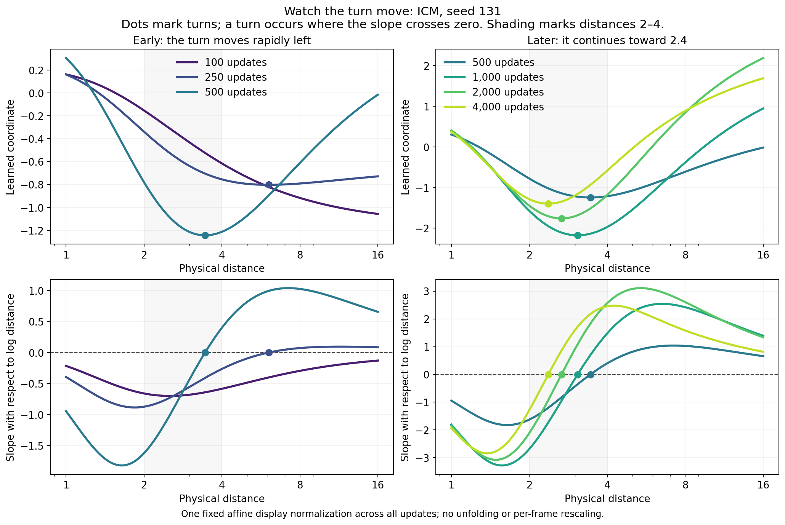
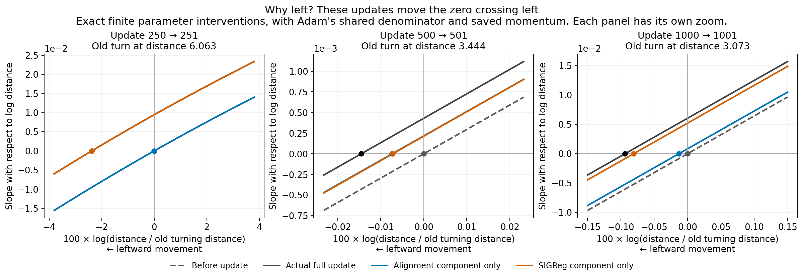
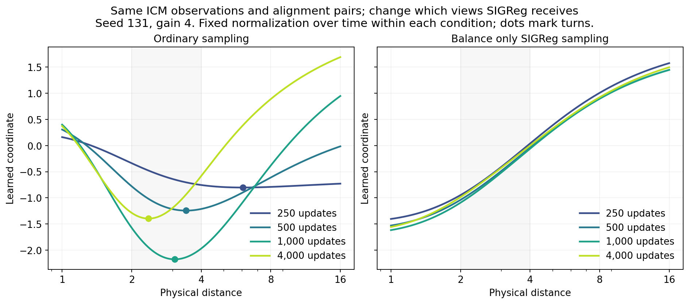

# Why does the fold move left?

**Training changes the shape of the curve. At its old bottom, the slope becomes positive, so the new bottom lies to the left.** This is movement of a feature of the learned function, not the agent moving or a change to the distance axis.

We examined the existing **ICM seed 131, input gain 4** checkpoints. These graphs use saved training states; no new training was needed.

## Watch the curve change



Read the upper panels as the learned representation versus physical distance. The dots mark its bottom. The lower panels show the slope: negative means the curve goes down as distance increases, positive means it goes up. The bottom is where that slope crosses zero.

The first turn appears near **15.81 at update 205**, then reaches **6.06 at 250**, **3.44 at 500**, and **2.37 at 4,000**. It does not start at 2–4. The gray band merely highlights that region. A single fixed display normalization is used throughout; an initially decreasing curve is allowed, because the output's overall sign is arbitrary.

## Which training pressure moves it?

We start from the same saved weights and apply either the actual full update, its alignment component, or its SIGReg component. Then we evaluate the resulting networks and locate their turns directly, using double precision.

| Update | Old turn | Full update | Alignment component only | SIGReg component only |
| --- | ---: | ---: | ---: | ---: |
| 250 → 251 | 6.063223 | 5.920736 | 6.062939 | 5.921005 |
| 500 → 501 | 3.443679 | 3.443179 | 3.443426 | 3.443431 |
| 1,000 → 1,001 | 3.073262 | 3.070384 | 3.072863 | 3.070782 |



Zero on the horizontal axis is the **old turning location**. A dot to its left means the updated turn moved left. The orange SIGReg-only result almost matches the full update at 250; at 500, the two components contribute about equally. Each panel uses a different zoom because the movement becomes much smaller.

These components include their accumulated optimizer momentum and use Adam's actual shared scaling. They isolate finite one-step effects at a fixed training state. They are not separate training histories, and their turning-point shifts need not add exactly.

## Why can SIGReg do this?

ICM's stored observations are concentrated near the object. SIGReg tries to make the **distribution of learned outputs** look Gaussian under those sampled observations. It does not require those outputs to stay in physical-distance order. Because the network shares its weights across all distances, updates driven by frequently sampled near views also change the far-distance slope. The observed leftward motion is one consequence of that interaction in this run.

The sampling intervention supports this explanation: keep the same ICM observations, movement pairs and initial weights, but sample the SIGReg batch more evenly across log-distance bins. The corresponding curve stays ordered at the displayed checkpoints:



Across all ten seeds at gain 4, this change reduces final folded runs from **5/10 to 0/10**. This is a sampling effect, with no OU phase and no new observations. It is not a universal repair: at gain 8, balanced sampling still leaves six folded runs, including one newly introduced fold.

## The local mathematical explanation

Write $q=\log d$ and let $s(q)$ be the slope of the representation. At a bottom $q_*$, $s(q_*)=0$ and the slope itself is increasing, so $\partial s/\partial q>0$. For a small weight update,

$$
\Delta q_* \approx
-\frac{\Delta s(q_*)}{\partial s(q_*)/\partial q}.
$$

A positive slope change at the old bottom therefore gives a **negative change in log-distance**, which is leftward movement. The finite interventions above check the direction directly; the separate [root-motion audit](output/refined-root-motion-check.json) checks this local approximation against refined roots. [MATH.md](MATH.md) gives the optimizer and sampling details.

**New continuation check:** [the turn had not settled at 2.4](stopping-point/README.md). The original learning rate reaches zero; restoring it to 0.0001 and continuing for 8,000 updates moves the same seed-131 turn from 2.368 to 1.905 while lowering the objective. Switching SIGReg sampling late instead gives 2.426. These checks explain why a nearly stationary late curve is insufficient evidence of an equilibrium.

These results do not prove that every update moves left, that every seed follows this history, or that any eventual position must be 2–4. Predicting the complete trajectory from data and initialization remains open.

Recreate the three PNG/PDF figures and the [numerical table](output/leftward-explanation.json) from repository root:

```bash
OPENBLAS_NUM_THREADS=1 python behavior-policy-experiments/qualitative-study/fold-location/training-mechanism/explain_leftward.py
```
