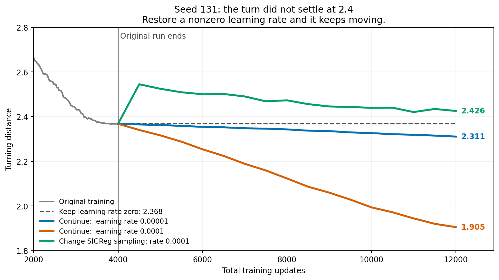
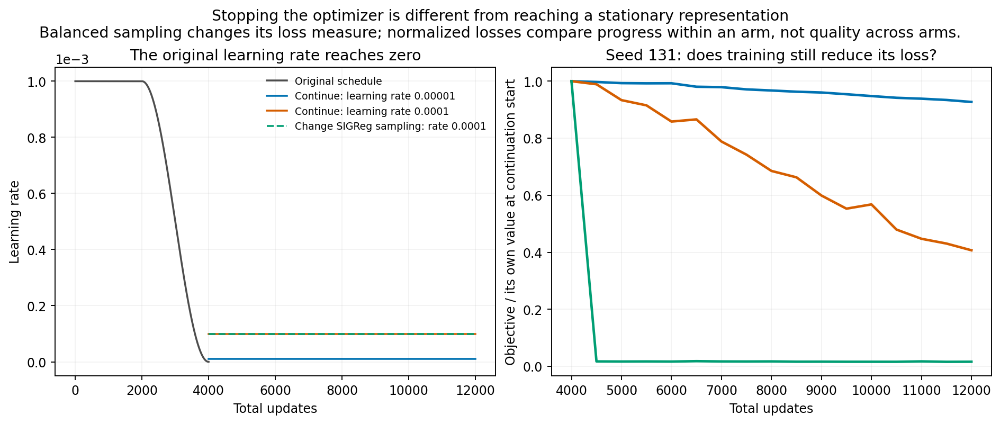
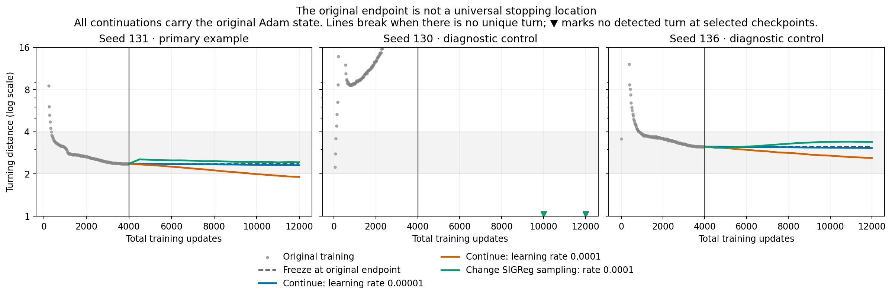
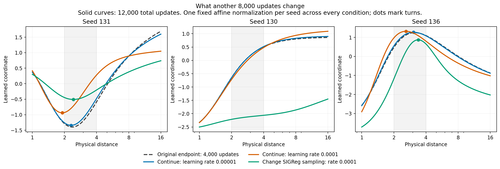

# Why did the turn stop near 2.4?

**It had not actually settled. That was where we stopped training.** The original learning rate decreases to exactly zero at the 4,000th update. Restarting it moves the same network's turn farther left and reduces its loss.

Our earlier statement that the turn “finally settles near 2.4” was too strong. We had explained individual movements, but had not checked whether the endpoint was stable. This experiment checks that distinction.

## Continue the same network

For seed 131, we retain the final weights **and Adam optimizer state**, the same stored ICM observations, and the same loss. We run another 8,000 updates with matched future batches:

| After the original 4,000 updates | Turn after another 8,000 updates |
| --- | ---: |
| Keep the weights frozen / learning rate zero | 2.368 |
| Ordinary sampling, learning rate 0.00001 | 2.311 |
| Ordinary sampling, learning rate 0.0001 | **1.905** |
| Change only SIGReg sampling to balanced replay, rate 0.0001 | 2.426 |



The ordinary rate-0.0001 run is **still moving**: its turn is 1.994 at 10,000 total updates and 1.905 at 12,000. Its fixed-batch diagnostic objective falls from **3.210 to 1.306**. Those objective values use the same sampling measure and evaluation batches. Neither the old endpoint nor the new endpoint is established as a limiting position.

## Why the schedule can make it look settled

A training update changes weights by an amount proportional to the learning rate. Near a simple turn, the movement of the turn is approximately

$$
\Delta\log d_* \approx
-\frac{\text{change in slope at the old turn}}
{\text{rate at which the old slope changes with log-distance}}.
$$

Shrinking the weight update can therefore shrink the turn's movement even while the loss still favors further change. At **zero learning rate**, weights cannot move at all, regardless of the gradient. We explicitly checked that a zero-rate Adam step leaves them identical.



This identifies an important reason for the apparent stopping: **the optimizer is being turned off**. It does not derive the precise value 2.368 from the schedule alone. That value depends on the preceding trajectory, including the input scale, samples, initialization and optimizer history. The earlier [scale and sampling controls](../README.md) establish that these also change the turn.

There is a second distinction: **a nearly fixed turning location does not imply a fixed curve**. In the late-balanced seed-131 run, the turn ends near its old location while the curve's height and spread change substantially; its own diagnostic objective drops from 65.239 to 1.039. That is progress on the changed objective, not evidence that balancing has removed the fold. The location of one turn is only one feature of a network with many adjustable weights.

## Why different trials need not follow the same story

We also continue the two previously selected diagnostic seeds, without selecting them based on these continuation outcomes:

| Seed | Turn at 4,000 | Ordinary sampling, rate 0.0001, at 12,000 | Late balanced sampling, same rate |
| --- | ---: | ---: | ---: |
| 131 | 2.368 | 1.905 | 2.426 |
| 130 | None | None | None |
| 136 | 3.137 | 2.599 | 3.384 |



Seed 136 already has a fold at initialization; seed 131 develops one during training. Seed 130 has no final turn in the evaluated interval, though its earlier history contains turns that leave that interval. There is no single shared history or universal final distance among these examples.



**Late balancing is not the same intervention as balancing from the start.** The earlier gain-4 experiment balanced SIGReg throughout and ended with 0/10 folded runs. Here we switch only after the ordinary network has trained for 4,000 updates; both initially folded examples remain folded after the continuation. These conditions also differ in their learning-rate histories, so this does not prove irreversible trapping. It does show that we cannot assume a late switch immediately reproduces the earlier repair.

Lower training loss also does not guarantee better physical-distance representation: seed 136's ordinary continuation lowers its diagnostic objective while its log-distance readout $R^2$ falls from about 0.035 to 0.0003. We have not run a new planning evaluation here.

## What we can now say

The original **2.4 was a finite training endpoint, not a demonstrated equilibrium**. Continuing the same model moves it. Its direction and speed depend on learning rate and SIGReg sampling; initialization and earlier training also matter. We can explain and measure these effects without claiming to predict a universal stopping distance.

Still open: the eventual behavior under much longer constant-rate training, whether a late switch can reliably remove folds, and a theory predicting complete trajectories across initializations. Constant-rate stochastic training may fluctuate rather than converge to one exact turn. These nine runs are diagnostic controls, not a new ten-trial significance result.

## Reproduce and verify

The [protocol](PROTOCOL.md) was fixed before these continuations. [Summary](output/summary.json), [checkpoint measurements](output/trajectory.csv), [source hashes](output/settings.json), and [verification](output/verification.json) accompany the code. The verifier independently replays all 72,000 continuation updates and checks all 153 stored model states, curves and slopes, plus final optimizer moments and random-generator states.

From repository root, with the parent study's dependencies:

```bash
OPENBLAS_NUM_THREADS=1 python behavior-policy-experiments/qualitative-study/fold-location/training-mechanism/stopping-point/run_continuation.py
OPENBLAS_NUM_THREADS=1 python behavior-policy-experiments/qualitative-study/fold-location/training-mechanism/stopping-point/report_continuation.py
OPENBLAS_NUM_THREADS=1 python behavior-policy-experiments/qualitative-study/fold-location/training-mechanism/stopping-point/verify_continuation.py
```

Runs save partial progress every 500 updates and resume on rerun. Published `output/starts/` files contain the original weights and optimizer states needed to reproduce the continuations without the older ignored partial checkpoints. All PNG figures also have PDF versions.
