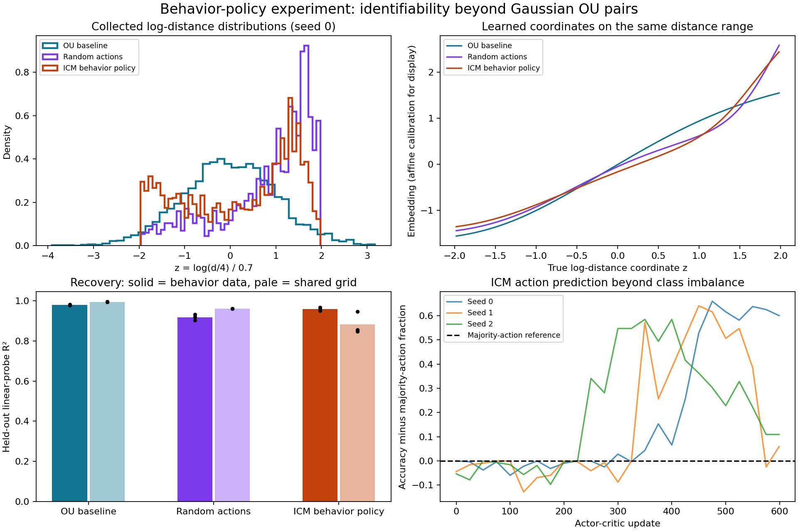

# Behavior-policy results

Generated from `metrics.json`; mean ± sample standard deviation across seeds. These are finite-sample recovery measurements, not an identifiability proof.

Seeds: 0, 1, 2. Policy updates per seed: 600; representation updates per condition: 4000.

| Condition | Behavior-distribution log-distance R² | Common-grid log-distance R² | Raw embedding variance |
| --- | ---: | ---: | ---: |
| ou | 0.9802 ± 0.0029 | 0.9946 ± 0.0012 | 0.8470 ± 0.0146 |
| random | 0.9186 ± 0.0153 | 0.9609 ± 0.0004 | 0.9540 ± 0.1375 |
| icm | 0.9589 ± 0.0075 | 0.8832 ± 0.0548 | 10.9339 ± 9.0725 |

## Per-seed outcomes

| Seed | Condition | Behavior R² | Common-grid R² | Raw variance | Gaussian CF discrepancy |
| --- | --- | ---: | ---: | ---: | ---: |
| 0 | ou | 0.9770 | 0.9941 | 0.8370 | 0.002537 |
| 0 | random | 0.9330 | 0.9613 | 0.9423 | 0.003801 |
| 0 | icm | 0.9514 | 0.9464 | 0.7638 | 0.012461 |
| 1 | ou | 0.9828 | 0.9959 | 0.8638 | 0.002050 |
| 1 | random | 0.9026 | 0.9606 | 1.0969 | 0.045616 |
| 1 | icm | 0.9588 | 0.8484 | 18.1955 | 0.047193 |
| 2 | ou | 0.9807 | 0.9937 | 0.8403 | 0.002925 |
| 2 | random | 0.9202 | 0.9607 | 0.8228 | 0.008763 |
| 2 | icm | 0.9665 | 0.8549 | 13.8424 | 0.039579 |

The common-grid probe tests the same physical distance range [1,16] for every condition. It is fitted on independent evaluation-only calibration samples. The behavior-distribution probe is fitted on separate calibration trajectories and scored on new episodes.

| Condition | Standardized latent Gaussian-CDF distance | Distance-bin coverage |
| --- | ---: | ---: |
| ou | 0.0101 ± 0.0010 | 1.0000 ± 0.0000 |
| random | 0.1329 ± 0.0140 | 1.0000 ± 0.0000 |
| icm | 0.2443 ± 0.0972 | 0.7396 ± 0.2387 |

CDF distances are descriptive; no independent-sample p-values are applied to correlated trajectories.

| Seed | Policy weight change (L2) | Mean action-distribution L1 difference from uniform | Final inverse accuracy | Final majority-action fraction |
| --- | ---: | ---: | ---: | ---: |
| 0 | 0.3447 | 0.0742 | 0.9781 | 0.3781 |
| 1 | 1.0459 | 0.4575 | 0.7531 | 0.6938 |
| 2 | 0.8596 | 0.5024 | 0.8344 | 0.7250 |

## Interpretation

The bounded random-action and ICM conditions violate the exact Gaussian-marginal and OU-transition assumptions. Consequently the Klindt-paper guarantee cannot be asserted for these policies. The tables quantify how close the trained coordinates remain to affine log-distance mappings in this toy experiment. A high R² is not a proof of universal identifiability; a lower R² does not refute the original theorem.

Differences between random and ICM involve learned action choice and its resulting occupancy, whereas comparisons to OU also change state support and transition geometry. Coverage alone does not equal a matched occupancy distribution. Raw embedding variances show that Gaussian regularization is approximate; optimization may contribute to recovery error.

For any non-degenerate bounded log-distance distribution, exact Gaussian output and exact affine recovery of that coordinate cannot both hold: every affine image of a bounded variable is bounded, whereas a standard Gaussian is not. This incompatibility already applies to the bounded random-action control; it does not single out curiosity as the cause. The numerical experiments measure approximate recovery instead.

See the parent README for the pinned upstream implementation, source-to-port mapping, complete protocol and limitations.
