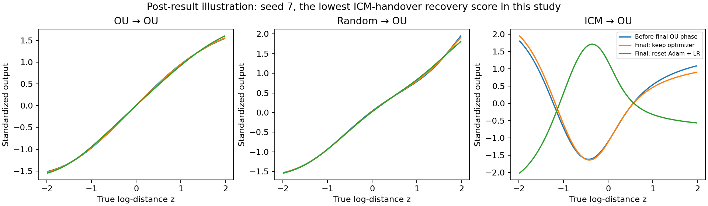

# What the controls establish

**The original three-run gain is real, but it does not hold reliably on new seeds.** We trained all 14 conditions on the three historical seeds and five new seeds, without changing the environment. Two new ICM→OU runs failed badly. The best supported explanation is that early data changes the learned weights in ways that can either help or damage subsequent OU training. Inherited Adam memory alone does not explain the outcome.

## The primary result

Shared-distance-range R², mean ± sample standard deviation:

| Training rule | Original seeds 0–2 | New seeds 3–7 | All eight seeds |
| --- | ---: | ---: | ---: |
| Fixed OU / OU→OU carry | 0.9946 ± 0.0012 | 0.9952 ± 0.0014 | 0.9950 ± 0.0013 |
| Random→OU carry | 0.9964 ± 0.0002 | 0.9959 ± 0.0008 | 0.9961 ± 0.0007 |
| ICM→OU carry | 0.9991 ± 0.0004 | 0.7326 ± 0.4327 | 0.8325 ± 0.3550 |

ICM→OU beats both controls on three of the five new seeds. But its other two scores are **0.6612 and 0.0041**, compared with fixed OU's **0.9952 and 0.9945** on those same seeds. Removing those runs would conceal a material failure mode. The five-new-seed paired-bootstrap interval for ICM minus random is wide, about [−0.6612, +0.0032]; this small study does not precisely estimate its average advantage or failure probability.

The broader fixed Gaussian OU test gives the same warning: new-seed means are **0.9818 for fixed OU**, **0.9864 for random→OU**, and **0.7222 for ICM→OU**. The result is not explained by evaluating only familiar distances.

Random→OU's new-seed shared-range gain over fixed OU is small: +0.00062, with three wins out of five and a descriptive paired-bootstrap interval of [−0.00031, +0.00147]. It is not strong evidence that random→OU is generally better. It does show that some improvement is possible without learning a curiosity policy.

## What the optimizer controls say

At update index 2976, all branches switch to the same final 1,024 pure-OU updates. Each source's four branches start with exactly the same weights. Adam reset and LR restart are independent interventions.

| Training rule, final tail | New-seed shared-range R² | New-seed broader OU R² |
| --- | ---: | ---: |
| Fixed OU, keep both | 0.9952 | 0.9818 |
| Fixed OU, reset both | 0.9972 | 0.9861 |
| Random→OU, keep both | 0.9959 | 0.9864 |
| Random→OU, reset both | 0.9977 | 0.9899 |
| ICM→OU, keep both | 0.7326 | 0.7222 |
| ICM→OU, reset both | 0.7619 | 0.7429 |

Restarting late training can improve OU without any curiosity. On the original three seeds, ICM→OU's advantage persists after resetting both Adam and LR: shared-range averages are 0.9993 for ICM, 0.9979 for random and 0.9969 for OU. This localizes the successful-run difference to inherited weights under a common tail protocol, rather than Adam memory alone. These historical successes are not an independent validation of the hypothesis.

The failed new runs are not repaired by either individual reset or their combination. Reset-both changes their scores from 0.6612 to 0.7994 and from 0.0041 to 0.0111. More aggressive late optimization helps one failure partially, but does not remove the failure mode.

## What matching OU exposure says

The handover uses about 1.024 million OU pair occurrences, versus 2.048 million for full OU. Two controls train only on exactly those handover OU occurrences, preserving their order and repetitions:

| OU-only exposure control | New-seed shared-range R² | New-seed broader OU R² |
| --- | ---: | ---: |
| Compressed learning-rate clock | 0.9914 | 0.9740 |
| Original learning-rate clock | 0.9909 | 0.9729 |

These do worse than the successful handovers, but beat the two failed ICM handovers. Thus OU pair count alone cannot explain the outcome. Early non-OU updates sometimes help and sometimes hurt. The exposure controls have only about 2,000 optimizer updates and different batch grouping; this is not an isolated proof that any one property of curiosity is responsible.

## What the failed representations look like

A post-result inspection finds a concrete distinction: both failed ICM→OU models have folded distance curves. The original OU and random carry models have no reversed-direction steps on the tested grid in any of the eight seeds. The six successful ICM handovers also have none.

| Failed seed | Reversed-direction grid steps before final OU | After normal final OU | After resetting Adam + LR |
| --- | ---: | ---: | ---: |
| 3 | 31.8% | 29.0% | 24.8% |
| 7 | 38.9% | 39.4% | 59.0% |

Fractions orient each curve by positive covariance with log-distance. A percentage above 50% can occur when a highly folded curve has little overall correlation; it is not a recovery score. Each plotted curve has its sign and scale adjusted independently for display. The folds remain after either orientation.

Both failed ICM policies concentrate near the object: about 86% and 79% of their training states are at distances 1–2. But some successful ICM policies concentrate even more strongly there, about 94–95%. Concentration alone is therefore not a sufficient explanation of which run fails. Policy learning, collected pairs and encoder initialization all vary with seed; the present study does not separate their individual contributions.

The observation supports a specific finite-training account: the handover can inherit a helpful distance mapping or a non-injective folded mapping, and the tested final OU optimization retains that distinction. Calling this a proved local minimum, or attributing it uniquely to ICM reward seeking, would go beyond the evidence.

## What this changes about the earlier conclusion

Treat ICM→OU as a potentially useful but unreliable curriculum in this implementation. The first three seeds overstated its reliability. The paper's ideal result has the same OU optimum for every final branch; these outcomes concern approximate regularization and finite optimization, not a counterexample to that theorem.

Within this same one-distance world, the next diagnostic would cross a fixed collected policy/dataset with several independent encoder initializations. That would distinguish unstable policy/data collection from unstable representation optimization. A separate fixed-budget test of longer OU tails or an invertible scalar encoder could then test how to repair the observed folds. Neither repair has been tested here.

The [full report](output/RESULTS.md) includes all conditions, individual scores, paired comparisons and exposure counts. [Training histories and resets](output/training_and_resets.png) and [every saved distance curve](output/distance_curves.png) provide the visual checks. All 112 saved evaluations and sampling-plan hashes reproduce; all six historical carry encoder weights match bit for bit. All 29 numerical checks pass.

## What the design can distinguish

The twelve source/reset conditions have the same 4,000 representation updates. For each source, the four tails fork from identical encoder weights. Across sources, the reset-both tails have fresh Adam state, the same learning-rate schedule, and exactly the same final OU observations in the same batches. Any difference after that intervention is due to the inherited weights under this fixed training protocol, rather than inherited Adam moments or a different final data stream.

This does not identify *which aspect* of those weights is responsible. It does not isolate coverage from transition geometry within the early data. It does not show that training converged to a local minimum, or that a longer or different optimizer could not repair a failure.

The matched-exposure controls use exactly the same OU pair occurrences as the handover. They remove non-OU training and shorten the update budget. The two learning-rate clocks probe that timing confound, but their batches and regularizer composition still differ. An advantage over these controls would show that OU-observation count alone is insufficient, not uniquely prove a curiosity mechanism.

## Why a folded distance curve matters

For a scalar continuous encoder, a curve that first decreases and then increases is not one-to-one. Different distances can give the same output, so no straight-line readout can recover distance perfectly. Checking finite grid differences is a diagnostic rather than a global proof of monotonicity.

The current finite-frequency, finite-weight SIGReg objective does not explicitly enforce invertibility. Training can inherit a fold that its remaining OU updates do not remove. This is a finite-training failure, outside the paper's exact Gaussian-output/global-optimum conclusion. The loss landscape has not been proved to contain a particular local minimum.

The curve and coverage checks were added after the first new seed failed. They are post-result descriptions, not the fixed primary outcome and not used to select checkpoints.
