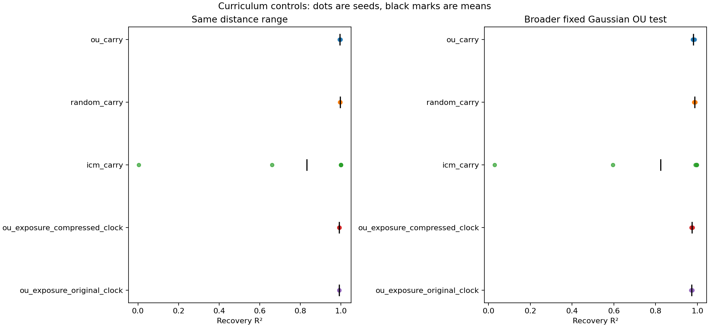

# What explains the curriculum gain?

Same triangle, same single distance coordinate, same encoder and SIGReg. All choices were fixed before this study's results were inspected.

Completed seeds: 0, 1, 2, 3, 4, 5, 6, 7. Seeds 0–2 were previously studied; seeds 3–7 are new to this study.

Scores are mean ± sample standard deviation. R² closer to 1 means a straighter log-distance readout. The fixed Gaussian OU test includes distances beyond the shared range [1,16].

| Condition | Shared-range R² | Fixed Gaussian OU R² | OU-test output variance |
| --- | ---: | ---: | ---: |
| ou_carry | 0.994984 ± 0.001305 | 0.981172 ± 0.003360 | 0.849397 ± 0.017106 |
| ou_reset_adam | 0.995169 ± 0.001338 | 0.981560 ± 0.003403 | 0.851224 ± 0.017697 |
| ou_restart_lr | 0.996779 ± 0.001248 | 0.985087 ± 0.003275 | 0.869928 ± 0.020843 |
| ou_reset_both | 0.997084 ± 0.001196 | 0.985737 ± 0.003178 | 0.874612 ± 0.021792 |
| random_carry | 0.996060 ± 0.000699 | 0.986505 ± 0.002237 | 0.987879 ± 0.024190 |
| random_reset_adam | 0.996743 ± 0.000592 | 0.987895 ± 0.001823 | 0.972494 ± 0.020783 |
| random_restart_lr | 0.997128 ± 0.000527 | 0.988604 ± 0.001827 | 0.962843 ± 0.021554 |
| random_reset_both | 0.997742 ± 0.000377 | 0.989730 ± 0.001468 | 0.950482 ± 0.019031 |
| icm_carry | 0.832531 ± 0.355009 | 0.823835 ± 0.350375 | 0.933855 ± 0.087879 |
| icm_reset_adam | 0.836738 ± 0.354028 | 0.826794 ± 0.350634 | 0.929186 ± 0.081308 |
| icm_restart_lr | 0.847611 ± 0.349508 | 0.835013 ± 0.350186 | 0.927721 ± 0.074104 |
| icm_reset_both | 0.850945 ± 0.346486 | 0.836864 ± 0.350598 | 0.926467 ± 0.068527 |
| ou_exposure_compressed_clock | 0.991339 ± 0.000506 | 0.973715 ± 0.002220 | 0.822630 ± 0.009098 |
| ou_exposure_original_clock | 0.990845 ± 0.000393 | 0.972727 ± 0.002064 | 0.819096 ± 0.010217 |

## Paired comparisons

Differences are first condition minus second. Positive means the first scored higher. The interval resamples whole paired seeds (20,000 bootstrap draws, fixed random seed). These small-sample descriptive intervals are not corrected for multiple comparisons and do not establish a general policy ranking.

| Seed group | Comparison | Test | Mean R² difference | 95% paired-bootstrap interval | Wins |
| --- | --- | --- | ---: | --- | ---: |
| all | icm_carry − ou_carry | common_grid_r2 | -0.162452 | [-0.411233, +0.004436] | 6/8 |
| all | icm_carry − ou_carry | reference_ou_r2 | -0.157338 | [-0.398310, +0.013838] | 6/8 |
| all | random_carry − ou_carry | common_grid_r2 | +0.001076 | [+0.000278, +0.001803] | 6/8 |
| all | random_carry − ou_carry | reference_ou_r2 | +0.005333 | [+0.003930, +0.006598] | 8/8 |
| all | icm_carry − random_carry | common_grid_r2 | -0.163528 | [-0.412323, +0.003005] | 6/8 |
| all | icm_carry − random_carry | reference_ou_r2 | -0.162671 | [-0.403875, +0.007931] | 6/8 |
| all | icm_carry − ou_exposure_compressed_clock | common_grid_r2 | -0.158808 | [-0.407645, +0.007908] | 6/8 |
| all | icm_carry − ou_exposure_compressed_clock | reference_ou_r2 | -0.149880 | [-0.391041, +0.021066] | 6/8 |
| all | icm_carry − ou_exposure_original_clock | common_grid_r2 | -0.158313 | [-0.407160, +0.008368] | 6/8 |
| all | icm_carry − ou_exposure_original_clock | reference_ou_r2 | -0.148893 | [-0.390095, +0.022048] | 6/8 |
| all | ou_reset_adam − ou_carry | common_grid_r2 | +0.000185 | [+0.000144, +0.000239] | 8/8 |
| all | ou_reset_adam − ou_carry | reference_ou_r2 | +0.000388 | [+0.000300, +0.000504] | 8/8 |
| all | ou_restart_lr − ou_carry | common_grid_r2 | +0.001795 | [+0.001522, +0.002040] | 8/8 |
| all | ou_restart_lr − ou_carry | reference_ou_r2 | +0.003915 | [+0.003350, +0.004441] | 8/8 |
| all | ou_reset_both − ou_carry | common_grid_r2 | +0.002101 | [+0.001755, +0.002393] | 8/8 |
| all | ou_reset_both − ou_carry | reference_ou_r2 | +0.004565 | [+0.003836, +0.005200] | 8/8 |
| all | random_reset_adam − random_carry | common_grid_r2 | +0.000684 | [+0.000592, +0.000777] | 8/8 |
| all | random_reset_adam − random_carry | reference_ou_r2 | +0.001390 | [+0.001047, +0.001744] | 8/8 |
| all | random_restart_lr − random_carry | common_grid_r2 | +0.001068 | [+0.000955, +0.001212] | 8/8 |
| all | random_restart_lr − random_carry | reference_ou_r2 | +0.002099 | [+0.001662, +0.002580] | 8/8 |
| all | random_reset_both − random_carry | common_grid_r2 | +0.001683 | [+0.001481, +0.001934] | 8/8 |
| all | random_reset_both − random_carry | reference_ou_r2 | +0.003225 | [+0.002451, +0.004023] | 8/8 |
| all | icm_reset_adam − icm_carry | common_grid_r2 | +0.004206 | [-0.001196, +0.013698] | 6/8 |
| all | icm_reset_adam − icm_carry | reference_ou_r2 | +0.002960 | [-0.003439, +0.012266] | 5/8 |
| all | icm_restart_lr − icm_carry | common_grid_r2 | +0.015080 | [-0.000006, +0.044928] | 6/8 |
| all | icm_restart_lr − icm_carry | reference_ou_r2 | +0.011179 | [-0.008795, +0.042207] | 6/8 |
| all | icm_reset_both − icm_carry | common_grid_r2 | +0.018413 | [+0.000252, +0.052940] | 7/8 |
| all | icm_reset_both − icm_carry | reference_ou_r2 | +0.013030 | [-0.010307, +0.049389] | 5/8 |
| all | icm_reset_adam − random_reset_adam | common_grid_r2 | -0.160005 | [-0.409796, +0.002572] | 6/8 |
| all | icm_reset_adam − random_reset_adam | reference_ou_r2 | -0.161101 | [-0.404813, +0.006823] | 6/8 |
| all | icm_reset_adam − ou_reset_adam | common_grid_r2 | -0.158431 | [-0.408121, +0.004422] | 6/8 |
| all | icm_reset_adam − ou_reset_adam | reference_ou_r2 | -0.154766 | [-0.398077, +0.013523] | 6/8 |
| all | random_reset_adam − ou_reset_adam | common_grid_r2 | +0.001574 | [+0.000787, +0.002276] | 7/8 |
| all | random_reset_adam − ou_reset_adam | reference_ou_r2 | +0.006335 | [+0.004945, +0.007557] | 8/8 |
| all | icm_restart_lr − random_restart_lr | common_grid_r2 | -0.149516 | [-0.398527, +0.002332] | 6/8 |
| all | icm_restart_lr − random_restart_lr | reference_ou_r2 | -0.153591 | [-0.400822, +0.006240] | 6/8 |
| all | icm_restart_lr − ou_restart_lr | common_grid_r2 | -0.149167 | [-0.398201, +0.003039] | 6/8 |
| all | icm_restart_lr − ou_restart_lr | reference_ou_r2 | -0.150074 | [-0.397282, +0.010352] | 6/8 |
| all | random_restart_lr − ou_restart_lr | common_grid_r2 | +0.000349 | [-0.000348, +0.001050] | 5/8 |
| all | random_restart_lr − ou_restart_lr | reference_ou_r2 | +0.003517 | [+0.002202, +0.004853] | 8/8 |
| all | icm_reset_both − random_reset_both | common_grid_r2 | -0.146797 | [-0.393934, +0.001789] | 6/8 |
| all | icm_reset_both − random_reset_both | reference_ou_r2 | -0.152865 | [-0.401180, +0.005175] | 6/8 |
| all | icm_reset_both − ou_reset_both | common_grid_r2 | -0.146139 | [-0.393322, +0.002764] | 6/8 |
| all | icm_reset_both − ou_reset_both | reference_ou_r2 | -0.148873 | [-0.397098, +0.009584] | 6/8 |
| all | random_reset_both − ou_reset_both | common_grid_r2 | +0.000658 | [+0.000032, +0.001305] | 5/8 |
| all | random_reset_both − ou_reset_both | reference_ou_r2 | +0.003992 | [+0.002710, +0.005284] | 8/8 |
| new | icm_carry − ou_carry | common_grid_r2 | -0.262656 | [-0.660014, +0.004057] | 3/5 |
| new | icm_carry − ou_carry | reference_ou_r2 | -0.259571 | [-0.643877, +0.014327] | 3/5 |
| new | random_carry − ou_carry | common_grid_r2 | +0.000619 | [-0.000314, +0.001469] | 3/5 |
| new | random_carry − ou_carry | reference_ou_r2 | +0.004590 | [+0.002972, +0.006207] | 5/5 |
| new | icm_carry − random_carry | common_grid_r2 | -0.263276 | [-0.661212, +0.003166] | 3/5 |
| new | icm_carry − random_carry | reference_ou_r2 | -0.264161 | [-0.649336, +0.008988] | 3/5 |
| new | icm_carry − ou_exposure_compressed_clock | common_grid_r2 | -0.258859 | [-0.656743, +0.007787] | 3/5 |
| new | icm_carry − ou_exposure_compressed_clock | reference_ou_r2 | -0.251780 | [-0.637299, +0.021954] | 3/5 |
| new | icm_carry − ou_exposure_original_clock | common_grid_r2 | -0.258339 | [-0.656313, +0.008268] | 3/5 |
| new | icm_carry − ou_exposure_original_clock | reference_ou_r2 | -0.250749 | [-0.636396, +0.022910] | 3/5 |
| new | ou_reset_adam − ou_carry | common_grid_r2 | +0.000150 | [+0.000123, +0.000178] | 5/5 |
| new | ou_reset_adam − ou_carry | reference_ou_r2 | +0.000312 | [+0.000261, +0.000366] | 5/5 |
| new | ou_restart_lr − ou_carry | common_grid_r2 | +0.001754 | [+0.001351, +0.002140] | 5/5 |
| new | ou_restart_lr − ou_carry | reference_ou_r2 | +0.003875 | [+0.003065, +0.004677] | 5/5 |
| new | ou_reset_both − ou_carry | common_grid_r2 | +0.001957 | [+0.001483, +0.002416] | 5/5 |
| new | ou_reset_both − ou_carry | reference_ou_r2 | +0.004314 | [+0.003354, +0.005274] | 5/5 |
| new | random_reset_adam − random_carry | common_grid_r2 | +0.000734 | [+0.000626, +0.000841] | 5/5 |
| new | random_reset_adam − random_carry | reference_ou_r2 | +0.001532 | [+0.001121, +0.001942] | 5/5 |
| new | random_restart_lr − random_carry | common_grid_r2 | +0.001127 | [+0.000961, +0.001328] | 5/5 |
| new | random_restart_lr − random_carry | reference_ou_r2 | +0.002316 | [+0.001738, +0.002935] | 5/5 |
| new | random_reset_both − random_carry | common_grid_r2 | +0.001806 | [+0.001510, +0.002164] | 5/5 |
| new | random_reset_both − random_carry | reference_ou_r2 | +0.003549 | [+0.002655, +0.004453] | 5/5 |
| new | icm_reset_adam − icm_carry | common_grid_r2 | +0.006670 | [-0.002042, +0.021823] | 4/5 |
| new | icm_reset_adam − icm_carry | reference_ou_r2 | +0.004653 | [-0.005609, +0.019537] | 2/5 |
| new | icm_restart_lr − icm_carry | common_grid_r2 | +0.024015 | [-0.000096, +0.071685] | 4/5 |
| new | icm_restart_lr − icm_carry | reference_ou_r2 | +0.017737 | [-0.014262, +0.067398] | 3/5 |
| new | icm_reset_both − icm_carry | common_grid_r2 | +0.029333 | [+0.000368, +0.084376] | 5/5 |
| new | icm_reset_both − icm_carry | reference_ou_r2 | +0.020674 | [-0.016729, +0.078868] | 2/5 |
| new | icm_reset_adam − random_reset_adam | common_grid_r2 | -0.257339 | [-0.656851, +0.002787] | 3/5 |
| new | icm_reset_adam − random_reset_adam | reference_ou_r2 | -0.261040 | [-0.650326, +0.007774] | 3/5 |
| new | icm_reset_adam − ou_reset_adam | common_grid_r2 | -0.256137 | [-0.654972, +0.004199] | 3/5 |
| new | icm_reset_adam − ou_reset_adam | reference_ou_r2 | -0.255230 | [-0.643277, +0.014060] | 3/5 |
| new | random_reset_adam − ou_reset_adam | common_grid_r2 | +0.001203 | [+0.000208, +0.002088] | 4/5 |
| new | random_reset_adam − ou_reset_adam | reference_ou_r2 | +0.005809 | [+0.004019, +0.007526] | 5/5 |
| new | icm_restart_lr − random_restart_lr | common_grid_r2 | -0.240388 | [-0.638608, +0.002605] | 3/5 |
| new | icm_restart_lr − random_restart_lr | reference_ou_r2 | -0.248739 | [-0.643807, +0.007120] | 3/5 |
| new | icm_restart_lr − ou_restart_lr | common_grid_r2 | -0.240396 | [-0.638171, +0.002928] | 3/5 |
| new | icm_restart_lr − ou_restart_lr | reference_ou_r2 | -0.245708 | [-0.639907, +0.010895] | 3/5 |
| new | random_restart_lr − ou_restart_lr | common_grid_r2 | -0.000008 | [-0.000784, +0.000768] | 3/5 |
| new | random_restart_lr − ou_restart_lr | reference_ou_r2 | +0.003031 | [+0.001418, +0.004648] | 5/5 |
| new | icm_reset_both − random_reset_both | common_grid_r2 | -0.235749 | [-0.631033, +0.002023] | 3/5 |
| new | icm_reset_both − random_reset_both | reference_ou_r2 | -0.247035 | [-0.643930, +0.005837] | 3/5 |
| new | icm_reset_both − ou_reset_both | common_grid_r2 | -0.235281 | [-0.630171, +0.002821] | 3/5 |
| new | icm_reset_both − ou_reset_both | reference_ou_r2 | -0.243211 | [-0.639177, +0.010319] | 3/5 |
| new | random_reset_both − ou_reset_both | common_grid_r2 | +0.000468 | [-0.000256, +0.001294] | 3/5 |
| new | random_reset_both − ou_reset_both | reference_ou_r2 | +0.003824 | [+0.002237, +0.005576] | 5/5 |
| historical | icm_carry − ou_carry | common_grid_r2 | +0.004555 | [+0.003075, +0.005832] | 3/3 |
| historical | icm_carry − ou_carry | reference_ou_r2 | +0.013051 | [+0.011943, +0.014570] | 3/3 |
| historical | random_carry − ou_carry | common_grid_r2 | +0.001837 | [+0.000753, +0.002641] | 3/3 |
| historical | random_carry − ou_carry | reference_ou_r2 | +0.006572 | [+0.005134, +0.008270] | 3/3 |
| historical | icm_carry − random_carry | common_grid_r2 | +0.002718 | [+0.002322, +0.003192] | 3/3 |
| historical | icm_carry − random_carry | reference_ou_r2 | +0.006479 | [+0.006299, +0.006809] | 3/3 |
| historical | icm_carry − ou_exposure_compressed_clock | common_grid_r2 | +0.007946 | [+0.007444, +0.008349] | 3/3 |
| historical | icm_carry − ou_exposure_compressed_clock | reference_ou_r2 | +0.019952 | [+0.019379, +0.020961] | 3/3 |
| historical | icm_carry − ou_exposure_original_clock | common_grid_r2 | +0.008396 | [+0.008011, +0.008738] | 3/3 |
| historical | icm_carry − ou_exposure_original_clock | reference_ou_r2 | +0.020869 | [+0.020145, +0.022090] | 3/3 |
| historical | ou_reset_adam − ou_carry | common_grid_r2 | +0.000244 | [+0.000165, +0.000344] | 3/3 |
| historical | ou_reset_adam − ou_carry | reference_ou_r2 | +0.000514 | [+0.000335, +0.000738] | 3/3 |
| historical | ou_restart_lr − ou_carry | common_grid_r2 | +0.001864 | [+0.001694, +0.002004] | 3/3 |
| historical | ou_restart_lr − ou_carry | reference_ou_r2 | +0.003981 | [+0.003336, +0.004315] | 3/3 |
| historical | ou_reset_both − ou_carry | common_grid_r2 | +0.002339 | [+0.002203, +0.002480] | 3/3 |
| historical | ou_reset_both − ou_carry | reference_ou_r2 | +0.004983 | [+0.004356, +0.005306] | 3/3 |
| historical | random_reset_adam − random_carry | common_grid_r2 | +0.000600 | [+0.000461, +0.000704] | 3/3 |
| historical | random_reset_adam − random_carry | reference_ou_r2 | +0.001154 | [+0.000674, +0.001801] | 3/3 |
| historical | random_restart_lr − random_carry | common_grid_r2 | +0.000971 | [+0.000901, +0.001078] | 3/3 |
| historical | random_restart_lr − random_carry | reference_ou_r2 | +0.001738 | [+0.001363, +0.002391] | 3/3 |
| historical | random_reset_both − random_carry | common_grid_r2 | +0.001477 | [+0.001378, +0.001597] | 3/3 |
| historical | random_reset_both − random_carry | reference_ou_r2 | +0.002685 | [+0.001705, +0.004272] | 3/3 |
| historical | icm_reset_adam − icm_carry | common_grid_r2 | +0.000100 | [-0.000008, +0.000304] | 2/3 |
| historical | icm_reset_adam − icm_carry | reference_ou_r2 | +0.000138 | [+0.000052, +0.000190] | 3/3 |
| historical | icm_restart_lr − icm_carry | common_grid_r2 | +0.000189 | [-0.000025, +0.000567] | 2/3 |
| historical | icm_restart_lr − icm_carry | reference_ou_r2 | +0.000247 | [+0.000177, +0.000329] | 3/3 |
| historical | icm_reset_both − icm_carry | common_grid_r2 | +0.000215 | [-0.000056, +0.000656] | 2/3 |
| historical | icm_reset_both − icm_carry | reference_ou_r2 | +0.000290 | [+0.000172, +0.000400] | 3/3 |
| historical | icm_reset_adam − random_reset_adam | common_grid_r2 | +0.002218 | [+0.001928, +0.002736] | 3/3 |
| historical | icm_reset_adam − random_reset_adam | reference_ou_r2 | +0.005463 | [+0.004581, +0.006012] | 3/3 |
| historical | icm_reset_adam − ou_reset_adam | common_grid_r2 | +0.004411 | [+0.003034, +0.005672] | 3/3 |
| historical | icm_reset_adam − ou_reset_adam | reference_ou_r2 | +0.012674 | [+0.011395, +0.014406] | 3/3 |
| historical | random_reset_adam − ou_reset_adam | common_grid_r2 | +0.002193 | [+0.001045, +0.002936] | 3/3 |
| historical | random_reset_adam − ou_reset_adam | reference_ou_r2 | +0.007211 | [+0.005383, +0.008609] | 3/3 |
| historical | icm_restart_lr − random_restart_lr | common_grid_r2 | +0.001936 | [+0.001714, +0.002139] | 3/3 |
| historical | icm_restart_lr − random_restart_lr | reference_ou_r2 | +0.004988 | [+0.004116, +0.005775] | 3/3 |
| historical | icm_restart_lr − ou_restart_lr | common_grid_r2 | +0.002880 | [+0.001748, +0.004163] | 3/3 |
| historical | icm_restart_lr − ou_restart_lr | reference_ou_r2 | +0.009317 | [+0.007978, +0.011470] | 3/3 |
| historical | random_restart_lr − ou_restart_lr | common_grid_r2 | +0.000944 | [-0.000208, +0.002025] | 2/3 |
| historical | random_restart_lr − ou_restart_lr | reference_ou_r2 | +0.004329 | [+0.002203, +0.006396] | 3/3 |
| historical | icm_reset_both − random_reset_both | common_grid_r2 | +0.001456 | [+0.000987, +0.001779] | 3/3 |
| historical | icm_reset_both − random_reset_both | reference_ou_r2 | +0.004085 | [+0.002229, +0.005030] | 3/3 |
| historical | icm_reset_both − ou_reset_both | common_grid_r2 | +0.002430 | [+0.001397, +0.003673] | 3/3 |
| historical | icm_reset_both − ou_reset_both | reference_ou_r2 | +0.008358 | [+0.006935, +0.010614] | 3/3 |
| historical | random_reset_both − ou_reset_both | common_grid_r2 | +0.000975 | [-0.000203, +0.001894] | 2/3 |
| historical | random_reset_both − ou_reset_both | reference_ou_r2 | +0.004273 | [+0.001905, +0.005619] | 3/3 |

## Exposure and timing checks

Every source uses identical initial encoder weights, minibatch indices and OU pairs. ICM and random handovers use the same pair-selection masks. Every tail starts from its source's exact same prefix checkpoint; the final pure-OU minibatches are identical across all 12 source/reset conditions.

OU→OU uses the same OU observations on both sides of the nominal handover, so its carry condition is exactly fixed OU. The historical carry controls are checked against their saved encoder weights bit for bit.

| Seed | Historical encoder checks | Final pure-OU starts at update index | Handover OU pairs | Full-OU pairs | Exposure-only updates | Final exposure batch |
| --- | --- | ---: | ---: | ---: | ---: | ---: |
| 0 | exact | 2976 | 1023968 | 2048000 | 2000 | 480 |
| 1 | exact | 2976 | 1023320 | 2048000 | 1999 | 344 |
| 2 | exact | 2976 | 1024561 | 2048000 | 2002 | 49 |
| 3 | new run / smoke | 2976 | 1024056 | 2048000 | 2001 | 56 |
| 4 | new run / smoke | 2976 | 1023624 | 2048000 | 2000 | 136 |
| 5 | new run / smoke | 2976 | 1023931 | 2048000 | 2000 | 443 |
| 6 | new run / smoke | 2976 | 1023668 | 2048000 | 2000 | 180 |
| 7 | new run / smoke | 2976 | 1024322 | 2048000 | 2001 | 322 |

The two exposure-only controls discard all non-OU slots and pack the exact remaining OU occurrences in order into full batches, plus one possible final partial batch. Their clocks either compress the original learning-rate rule to that shorter budget, or use each packed batch's last pair's original step. Both match OU observations exactly but have fewer optimizer updates, different batch grouping, and different regularizer composition from the handover. They do not isolate every possible mechanism.

At the final pure-OU boundary, Adam reset erases moment estimates and its step counter; LR restart independently starts the original hold-then-cosine rule over the remaining tail. Restarted runs spend longer at a larger learning rate; this is an intentional intervention, not equal integrated learning-rate exposure. The reset-both comparison tests the learned weights without inherited optimizer memory, given identical subsequent data and learning rates.

Representation update counts exclude the separate cost of learning ICM. Random and OU have no policy-training cost. Evaluation uses labels only for held-out readouts, never for updates, early stopping or selecting checkpoints.

## Individual scores

| Seed | Condition | Shared-range R² | Fixed OU R² |
| --- | --- | ---: | ---: |
| 0 | ou_carry | 0.994080 | 0.977024 |
| 0 | ou_reset_adam | 0.994301 | 0.977493 |
| 0 | ou_restart_lr | 0.996084 | 0.981338 |
| 0 | ou_reset_both | 0.996560 | 0.982312 |
| 0 | random_carry | 0.996197 | 0.983334 |
| 0 | random_reset_adam | 0.996900 | 0.985135 |
| 0 | random_restart_lr | 0.997098 | 0.985726 |
| 0 | random_reset_both | 0.997793 | 0.987607 |
| 0 | icm_carry | 0.998836 | 0.989664 |
| 0 | icm_reset_adam | 0.998828 | 0.989716 |
| 0 | icm_restart_lr | 0.998812 | 0.989841 |
| 0 | icm_reset_both | 0.998780 | 0.989836 |
| 0 | ou_exposure_compressed_clock | 0.990792 | 0.970148 |
| 0 | ou_exposure_original_clock | 0.990397 | 0.969292 |
| 1 | ou_carry | 0.995914 | 0.982827 |
| 1 | ou_reset_adam | 0.996258 | 0.983565 |
| 1 | ou_restart_lr | 0.997808 | 0.987121 |
| 1 | ou_reset_both | 0.998247 | 0.988133 |
| 1 | random_carry | 0.996666 | 0.987961 |
| 1 | random_reset_adam | 0.997303 | 0.988948 |
| 1 | random_restart_lr | 0.997600 | 0.989323 |
| 1 | random_reset_both | 0.998044 | 0.990037 |
| 1 | icm_carry | 0.998988 | 0.994770 |
| 1 | icm_reset_adam | 0.999292 | 0.994960 |
| 1 | icm_restart_lr | 0.999556 | 0.995098 |
| 1 | icm_reset_both | 0.999645 | 0.995067 |
| 1 | ou_exposure_compressed_clock | 0.991545 | 0.973808 |
| 1 | ou_exposure_original_clock | 0.990977 | 0.972680 |
| 2 | ou_carry | 0.993720 | 0.980725 |
| 2 | ou_reset_adam | 0.993885 | 0.981060 |
| 2 | ou_restart_lr | 0.995413 | 0.984061 |
| 2 | ou_reset_both | 0.995923 | 0.985081 |
| 2 | random_carry | 0.996360 | 0.988995 |
| 2 | random_reset_adam | 0.996821 | 0.989670 |
| 2 | random_restart_lr | 0.997438 | 0.990457 |
| 2 | random_reset_both | 0.997817 | 0.990700 |
| 2 | icm_carry | 0.999552 | 0.995295 |
| 2 | icm_reset_adam | 0.999557 | 0.995466 |
| 2 | icm_restart_lr | 0.999577 | 0.995531 |
| 2 | icm_reset_both | 0.999596 | 0.995694 |
| 2 | ou_exposure_compressed_clock | 0.991203 | 0.975916 |
| 2 | ou_exposure_original_clock | 0.990814 | 0.975150 |
| 3 | ou_carry | 0.995217 | 0.983871 |
| 3 | ou_reset_adam | 0.995373 | 0.984192 |
| 3 | ou_restart_lr | 0.997287 | 0.988365 |
| 3 | ou_reset_both | 0.997533 | 0.988880 |
| 3 | random_carry | 0.994843 | 0.985994 |
| 3 | random_reset_adam | 0.995763 | 0.988206 |
| 3 | random_restart_lr | 0.996344 | 0.989461 |
| 3 | random_reset_both | 0.997261 | 0.991210 |
| 3 | icm_carry | 0.661173 | 0.595275 |
| 3 | icm_reset_adam | 0.697433 | 0.627849 |
| 3 | icm_restart_lr | 0.780451 | 0.707556 |
| 3 | icm_reset_both | 0.799438 | 0.726815 |
| 3 | ou_exposure_compressed_clock | 0.991191 | 0.975622 |
| 3 | ou_exposure_original_clock | 0.990575 | 0.974428 |
| 4 | ou_carry | 0.993775 | 0.978521 |
| 4 | ou_reset_adam | 0.993877 | 0.978741 |
| 4 | ou_restart_lr | 0.995023 | 0.981147 |
| 4 | ou_reset_both | 0.995169 | 0.981443 |
| 4 | random_carry | 0.995127 | 0.984759 |
| 4 | random_reset_adam | 0.995908 | 0.986289 |
| 4 | random_restart_lr | 0.996340 | 0.987151 |
| 4 | random_reset_both | 0.997148 | 0.988477 |
| 4 | icm_carry | 0.998813 | 0.996257 |
| 4 | icm_reset_adam | 0.999345 | 0.996240 |
| 4 | icm_restart_lr | 0.999700 | 0.996338 |
| 4 | icm_reset_both | 0.999762 | 0.995811 |
| 4 | ou_exposure_compressed_clock | 0.991087 | 0.973006 |
| 4 | ou_exposure_original_clock | 0.990626 | 0.972080 |
| 5 | ou_carry | 0.997600 | 0.987110 |
| 5 | ou_reset_adam | 0.997799 | 0.987514 |
| 5 | ou_restart_lr | 0.998736 | 0.989918 |
| 5 | ou_reset_both | 0.998796 | 0.990069 |
| 5 | random_carry | 0.996751 | 0.989448 |
| 5 | random_reset_adam | 0.997338 | 0.990358 |
| 5 | random_restart_lr | 0.997720 | 0.990893 |
| 5 | random_reset_both | 0.998294 | 0.991638 |
| 5 | icm_carry | 0.999552 | 0.995976 |
| 5 | icm_reset_adam | 0.999579 | 0.995957 |
| 5 | icm_restart_lr | 0.999609 | 0.995925 |
| 5 | icm_reset_both | 0.999635 | 0.995947 |
| 5 | ou_exposure_compressed_clock | 0.992453 | 0.976580 |
| 5 | ou_exposure_original_clock | 0.991670 | 0.975045 |
| 6 | ou_carry | 0.995090 | 0.981182 |
| 6 | ou_reset_adam | 0.995248 | 0.981505 |
| 6 | ou_restart_lr | 0.997306 | 0.985988 |
| 6 | ou_reset_both | 0.997540 | 0.986505 |
| 6 | random_carry | 0.996389 | 0.987122 |
| 6 | random_reset_adam | 0.996977 | 0.988250 |
| 6 | random_restart_lr | 0.997306 | 0.988933 |
| 6 | random_reset_both | 0.997807 | 0.989893 |
| 6 | icm_carry | 0.999218 | 0.994830 |
| 6 | icm_reset_adam | 0.999386 | 0.994935 |
| 6 | icm_restart_lr | 0.999513 | 0.995030 |
| 6 | icm_reset_both | 0.999581 | 0.994996 |
| 6 | ou_exposure_compressed_clock | 0.991027 | 0.972894 |
| 6 | ou_exposure_original_clock | 0.990677 | 0.972197 |
| 7 | ou_carry | 0.994473 | 0.978119 |
| 7 | ou_reset_adam | 0.994612 | 0.978412 |
| 7 | ou_restart_lr | 0.996574 | 0.982759 |
| 7 | ou_reset_both | 0.996906 | 0.983477 |
| 7 | random_carry | 0.996144 | 0.984430 |
| 7 | random_reset_adam | 0.996937 | 0.986307 |
| 7 | random_restart_lr | 0.997178 | 0.986892 |
| 7 | random_reset_both | 0.997773 | 0.988277 |
| 7 | icm_carry | 0.004119 | 0.028610 |
| 7 | icm_reset_adam | 0.000482 | 0.019232 |
| 7 | icm_restart_lr | 0.003674 | 0.004786 |
| 7 | icm_reset_both | 0.011122 | 0.000747 |
| 7 | ou_exposure_compressed_clock | 0.991414 | 0.971743 |
| 7 | ou_exposure_original_clock | 0.991020 | 0.970945 |

See [the protocol](../README.md) and [interpretation](../INTERPRETATION.md).
