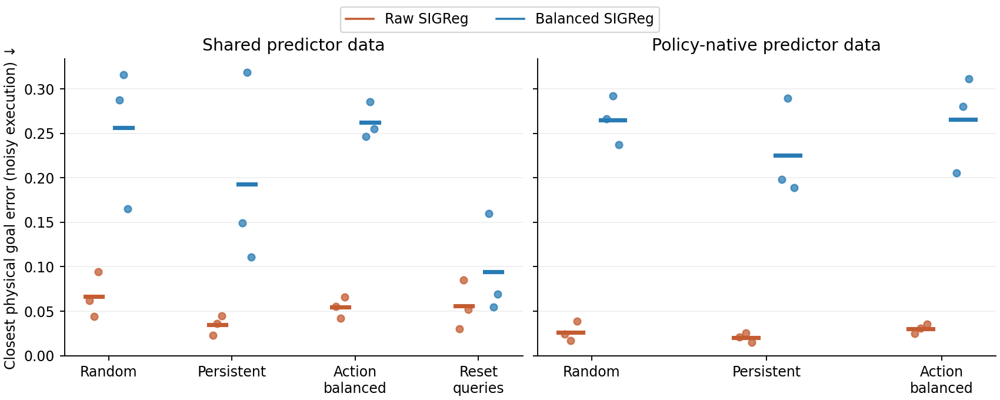

# Beyond reproduction: latest nonlinear results

The scene still has one changing coordinate, distance. This follow-up adds **12 matched-coverage encoders**, **84 action predictors**, and evaluation with and without execution noise. All checkpoint evaluations reproduce. [Fixed protocol and task-design pilot](EXTENSION_PROTOCOL.md).

## Coverage explains part of the earlier difference

When zero/nonlinear worlds receive identical broad source-state and action coverage, all learned encoders have no detected grid reversals. With balanced SIGReg, mean log-distance recovery is 0.9913 versus 0.9857. The strong compression seen in nonlinear trajectory training is greatly reduced.

This intervention matches source states and actions, not successor distributions. It uses simulator resets and changes both coverage factors relative to trajectories. It supports a coverage explanation; it does not isolate state coverage from action coverage or prove nonlinear identification.

## Actual goal reaching favors raw SIGReg here

Noisy execution; three representation seeds and two predictor fits per seed. Smaller closest physical error is better. Goals oppose the initial drift and have verified two-action reachability witnesses.

| Representation / predictor data | Closest error | Within 0.1 | Final error |
| --- | ---: | ---: | ---: |
| Persistent, raw SIGReg / shared | 0.0346 | 97.4% | 0.2819 |
| Persistent, raw SIGReg / native | **0.0204** | **100%** | 0.2129 |
| Persistent, balanced SIGReg / shared | 0.1930 | 60.9% | 0.9009 |
| Persistent, balanced SIGReg / native | 0.2256 | 58.9% | 1.1408 |
| Reset-query, raw SIGReg / shared | 0.0558 | 87.5% | 0.4319 |
| Reset-query, balanced SIGReg / shared | 0.0945 | 81.2% | 0.3981 |
| Always stay | 0.4541 | 5.2% | 1.6711 |

The raw persistent encoder supports good local goal reaching. Balanced encoders can predict their compressed coordinates accurately while controlling physical distance poorly. Native predictor data can help on these tasks despite worse global prediction MSE. [Explanation and conditional error bound](CONTROL_INTERPRETATION.md) · [All policies and deterministic results](output-control/RESULTS.md).

Each dot averages the two predictor fits within one representation seed; horizontal marks show the mean over the three seeds.

## A concrete step toward a nonlinear theorem

The instantaneous action-effect lemma does not justify a constant action coefficient for ordinary one-second transitions. At a short interval $\delta$, physical distance itself has action contrast

$$
C_\delta(d)=c+\tfrac12\delta cb'(d)+O(\delta^2).
$$

With $N$ independently noisy endpoints per action, the leading contrast-estimation variance is

$$
\operatorname{Var}(\widehat C_\delta(d))\simeq\frac{\sigma(d)^2}{2N\delta}.
$$

Shorter intervals reduce bias but increase sampling noise. Numerical variance is 0.94–1.03 times this leading formula in four checks. This explains why the earlier shared-noise prototype was unusually easy and gives a concrete design for independently sampled drift learning. [Derivation, assumptions and checks](DRIFT_ESTIMATION.md).

The next priority is a multi-interval, action-structured drift learner with independent noise and an explicit information-preservation condition. It should be evaluated on both coordinate recovery and physical control; the present studies do not establish a nonlinear JEPA theorem or long-range planning capability.
