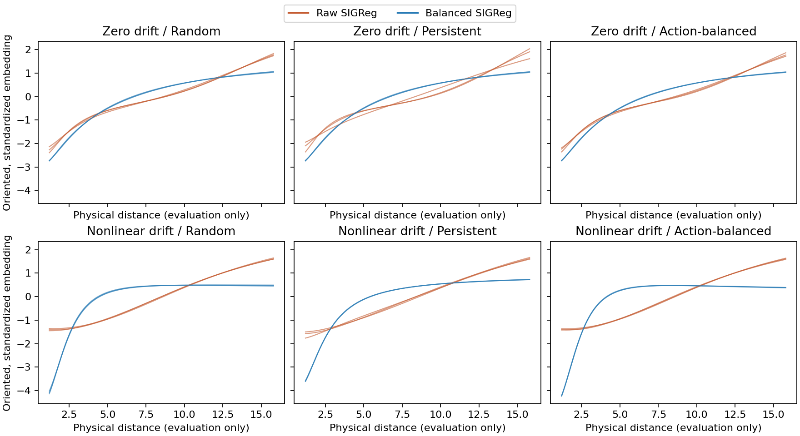

# Flexible JEPA on nonlinear trajectories

Same triangle and one distance. Raw alignment in every cell; only SIGReg sampling changes. Three fixed seeds per cell. Details: [protocol](../TRAJECTORY_PROTOCOL.md).

| Drift | Policy | SIGReg data | Runs | Distance $R^2$ | Log-distance $R^2$ | Runs with reversals | Worst reversal (% of output range) |
| --- | --- | --- | ---: | ---: | ---: | ---: | ---: |
| Zero | random | raw | 3 | 0.9782 | 0.9413 | 0 | 0.0000 |
| Zero | random | balanced | 3 | 0.8628 | 0.9920 | 0 | 0.0000 |
| Zero | persistent | raw | 3 | 0.9782 | 0.9142 | 0 | 0.0000 |
| Zero | persistent | balanced | 3 | 0.8611 | 0.9916 | 0 | 0.0000 |
| Zero | action_balanced | raw | 3 | 0.9788 | 0.9407 | 0 | 0.0000 |
| Zero | action_balanced | balanced | 3 | 0.8597 | 0.9911 | 0 | 0.0000 |
| Nonlinear | random | raw | 3 | 0.9917 | 0.8741 | 2 | 0.4118 |
| Nonlinear | random | balanced | 3 | 0.4670 | 0.7430 | 3 | 0.6883 |
| Nonlinear | persistent | raw | 3 | 0.9975 | 0.9067 | 0 | 0.0000 |
| Nonlinear | persistent | balanced | 3 | 0.6536 | 0.8914 | 0 | 0.0000 |
| Nonlinear | action_balanced | raw | 3 | 0.9916 | 0.8743 | 3 | 0.3889 |
| Nonlinear | action_balanced | balanced | 3 | 0.4036 | 0.6833 | 3 | 2.0923 |

Means use identical interior evaluation grids; per-seed scores, coverage, and checkpoints are saved. Worst reversal measures the largest cumulative drop along increasing distance after orienting the embedding, relative to its full grid range. This supplementary size diagnostic was added after observing shallow reversals; the original reversal counts are retained. Neither affine target is guaranteed by this passive objective. No action-conditioned predictor or planning evaluation is included.

