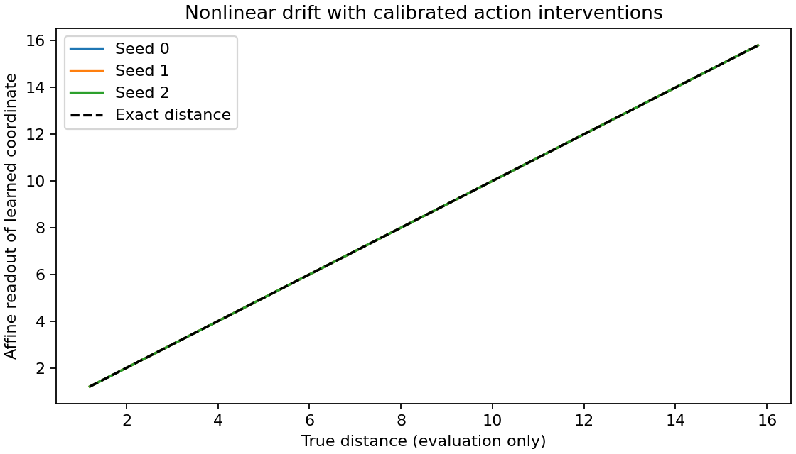

# Nonlinear action-anchor check

Three fixed seeds; one physical distance; no distance-labelled training targets.

| Seed | Physical-distance $R^2$ | Action-effect loss |
| --- | ---: | ---: |
| 0 | 1.000000 | 1.1898e-08 |
| 1 | 1.000000 | 1.58665e-08 |
| 2 | 1.000000 | 3.87625e-08 |

The analytic perturbation satisfies the proved bound in the independent check. The encoder uses known apparent-size ordering and paired interventions with common simulator noise. These are stronger assumptions than the passive experiment.

