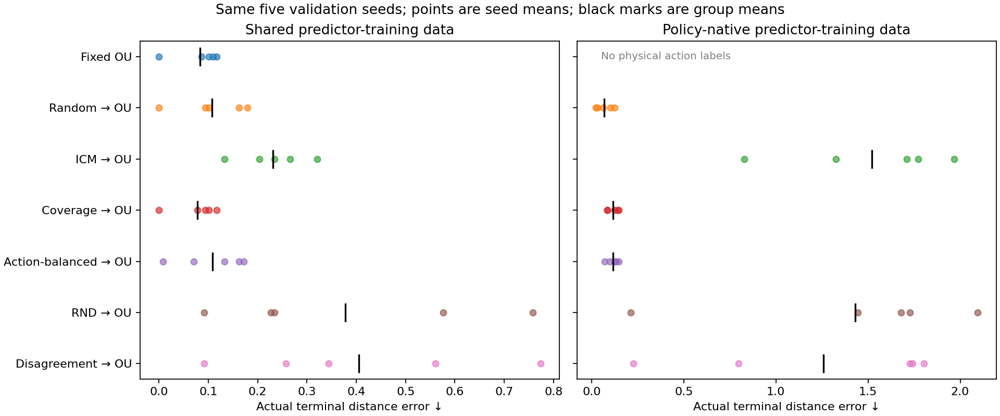

# Planning: first completed comparison

**Both representation quality and action-data coverage matter.** All three completed suites use the same goal-reaching task and an oracle-validated planner. The original encoders have eight seeds; the policy/repair validation comparison below uses the same five new seeds, 8–12.

Mean actual terminal distance error; lower is better:

| Encoder's behavior source | Shared random-action predictor data | Policy-native predictor data |
| --- | ---: | ---: |
| Fixed OU | 0.083 | Not defined: OU pairs lack actions |
| Random→OU | 0.107 | 0.069 |
| ICM→OU | 0.231 | 1.521 |
| Count-based coverage→OU | 0.078 | 0.118 |
| Action-balanced→OU | 0.109 | 0.115 |
| RND→OU | 0.377 | 1.431 |
| Disagreement→OU | 0.406 | 1.259 |

Every row above uses the same five validation seeds. These are small-sample means, not a statistically established universal policy ranking. No case-level significance tests are used.

## What the two tests distinguish

- **Shared data:** every frozen encoder receives equally sampled physical action transitions for predictor training. Remaining differences include representation geometry and predictor approximation.
- **Native data:** each predictor trains on transitions from its encoder's behavior policy. Differences also include state/action coverage. Native OU is omitted rather than given invented actions.
- **Folded encoders:** several physical distances share an output, so the predictor/planner can confuse goals even with shared data. Coverage is a separate problem: native ICM data makes planning worse even when the encoding is useful.

All goals are locally reachable. The exact-dynamics oracle has zero terminal error; success means finishing within one physical step of 0.25. This is not a test of long-range planning or partial observability.

## Learned OU, a separate cohort

Five additional seeds, 13–17: fixed OU has mean shared-data planning error 0.083; learning correlation and spread gives 0.102. The small representation-score gain therefore does not establish a planning gain. The physical learned-OU controller followed by OU gives 0.097 with shared data but 1.017 with its own data. An action-probability floor does not guarantee coverage of goal states.

## Completed and remaining

Completed: 40 evaluations of the original encoders, 40 of alternative policies, 77 of repair-study encoders, and 45 of learned-OU variants (202 total). All 202 saved evaluations reproduce. Checkpoints and per-seed scores are saved. A terminal-only random-search pilot failed its oracle check and was superseded before interpreting these comparisons; the validated planner uses direct candidate paths and a small intermediate goal cost.

Remaining research questions: test whether representation and coverage effects remain after more predictor-training seeds, larger planning budgets and separately matched state/action coverage. Current predictor initialization is paired within each seed. Shared-data results do not prove that representation geometry is the only remaining source of error.

[Protocol](README.md) · [Original encoders](output-legacy/RESULTS.md) · [Alternative policies](output-policies/RESULTS.md) · [Repair encoders](output-repairs/RESULTS.md) · [Learned OU](output-learned_ou/RESULTS.md)

