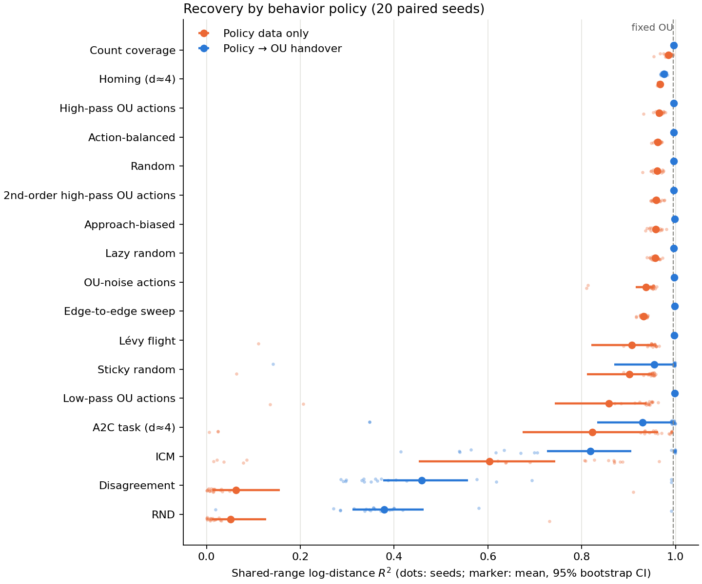
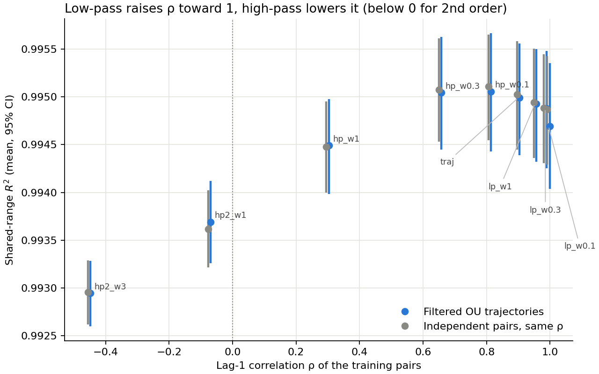

# Policy zoo: many behavior policies, one protocol

**Latest: [original-policy identifiability, ICM-fold tests and actual planning](original-policy-followup/README.md).** We re-evaluated 700 original encoders. Removing alignment preserves fold status in all 100 new fits; collecting earlier with the same frozen ICM actor repairs all ten old folds and improves actual reaching. SIGReg is unchanged.

**Expanded catalog:** [13 additional physical controllers and fresh-seed comparisons](new-policy-results/README.md), bringing the catalog to 30 physical policies. The new report includes failures, comparisons with the old best policies, and a clear [boundary between theorem assumptions and empirical extensions](ASSUMPTION_BOUNDARY.md). The original comparison below remains reproducible.

Same triangle, same single distance coordinate, same encoder and loss as the [reliability study](../reliability/README.md). This study adds 11 physical behavior policies and 16 latent Gaussian sources, including low-pass and high-pass filtered OU. It reruns the six previously tested policies on the same 20 data seeds (8–27), so every comparison is **paired by seed**: each seed fixes the encoder initialization and minibatch index stream for all conditions. The 35 earlier runs on seeds 8–12 were regenerated and match their saved metrics exactly.

Physical policies are run two ways. **Pure** uses only the policy's data for all 4,000 updates. **Handover** uses the original 25%→75% handover to fixed OU, the protocol behind the earlier tables. Settings and tests were fixed in advance in [PROTOCOL.md](PROTOCOL.md). Full tables, CIs and every p-value are in [output/RESULTS.md](output/RESULTS.md).

**New explanation and tests:** [short explanation of the data, initialization and loss effects](mechanism-tests/SUMMARY.md), with crossed fits and targeted statistical checks. These exploratory follow-ups retain the original results and distinguish truly untrained encoders from their first training update.

## Separating coverage from movement

The original zoo changes both **which distances are visited** and **how the agent moves between them**. It establishes associations, not a causal explanation of those differences. Curriculum recovery gains also do not establish planning gains.

The new [matched-coverage comparison](matched-coverage/README.md) holds both endpoint distributions, all occupied bins, stationarity and overall physical movement fixed while changing local crossing rules. It evaluates affine distance recovery, folds and actual goal-reaching with shared versus policy-native predictor data. SIGReg stays unchanged. These controlled policies follow up the zoo; they do not replace its original ICM or OU results.

## Findings

**1. Most simple policies recover distance about as well as random actions. Learned curiosity bonuses are the outliers.** Pure-protocol mean shared-range $R^2$ over 20 seeds (Holm-corrected paired sign-flip tests):

| Policy | Pure $R^2$ | Folds | Handover $R^2$ |
| --- | ---: | ---: | ---: |
| Fixed OU (reference) | 0.9950 | 0/20 | — |
| Count coverage | 0.9845 | 0/20 | 0.9961 |
| Homing near d≈4 | 0.9667 | 0/20 | 0.9749 |
| High-pass OU actions | 0.9653 | 0/20 | 0.9962 |
| Action-balanced | 0.9619 | 0/20 | 0.9962 |
| **Random** | 0.9609 | 0/20 | 0.9966 |
| 2nd-order high-pass OU actions, lazy, approach-biased | 0.957–0.959 | 0/20 | 0.996–0.998 |
| OU-noise actions | 0.9365 | 2/20 | 0.9975 |
| Edge-to-edge sweep | 0.9314 | 0/20 | 0.9979 |
| Lévy flight, sticky random | 0.90–0.91 | 1/20 | 0.955–0.997 |
| Low-pass OU actions | 0.8580 | 2/20 | 0.9982 |
| A2C task policy | 0.8229 | 3/20 | 0.9302 |
| **ICM** | 0.6034 | 10/20 | 0.8180 |
| Disagreement | 0.0624 | 19/20 | 0.4584 |
| RND | 0.0518 | 20/20 | 0.3782 |

In the pure protocol only count coverage beats random significantly. Persistent policies do significantly worse than random: sticky, Lévy, low-pass OU actions, OU-noise actions and the sweep. All other policies significantly beat ICM, except RND and disagreement (far worse) and the A2C task policy (not significant). No pure policy matches fixed OU. Under handover, the 11 policies from count coverage upward slightly but significantly beat fixed OU (+0.001 to +0.003). The handover still cannot rescue ICM, RND, disagreement, sticky or the task policy on every seed.

**2. Temporal persistence hurts when the policy's data are used alone.** The four OU-action policies have identical uniform action marginals and differ only in the action noise's spectrum. Low-passing the noise (longer runs) lowers pure recovery from 0.966 to 0.858 and produces folds. High-passing it keeps random-level recovery. Sticky and Lévy runs show the same pattern. A plausible reason is that long runs pile repeated views near the reflecting walls, giving a more non-Gaussian occupancy. Under handover the ordering reverses slightly: most persistent policies are among the best.

**3. The best single predictor of pure recovery is how Gaussian the visited log-distances are.** Across the 17 physical policies, Spearman ρ = −0.91 between mean $R^2$ and the Gaussian-CDF distance of the visited log-distance distribution. Coverage entropy is a much weaker predictor (ρ = +0.33). Homing covers few size bins (entropy 0.35) but visits a near-Gaussian bump (CDF distance 0.057), and it ranks second. This agrees with the [reliability mechanism](../reliability/MECHANISM.md): SIGReg sees the sampled marginal, and what matters is its shape, not just its support. This correlation is descriptive, not causal.

**4. Low-pass and high-pass OU in latent space change almost nothing, and the reason is informative.** A linear filter keeps a Gaussian process Gaussian, so every filtered pair is bivariate normal with some lag-1 correlation ρ. Filtering spans ρ from +0.995 (low-pass) down to +0.30 (high-pass), and to −0.07 and −0.45 (second-order high-pass).

- Filtered trajectories never differ significantly from i.i.d. pairs with the same ρ (all original Holm p = 1). At the population one-pair level, a stationary Gaussian source is specified by its marginal variance and ρ. Finite correlated datasets can still differ. The [follow-up equivalence tests](mechanism-tests/README.md) support agreement within ±0.001 R² for these trained encoders; a non-significant difference alone would not establish that.
- All 160 filtered and 160 matched runs stay at $R^2$ ≥ 0.991 with no folds. Differences from fixed OU are tiny but significant for the high-pass end: −0.0005 at ρ = 0.30, and −0.0013 / −0.0021 at ρ = −0.07 / −0.45.
- **The negative-ρ result is not identifiability.** For ρ < 0, an even Gaussianized fold can beat a linear code on population alignment. A [finite paired-batch calculation](mechanism-tests/MATH.md) gives expected implemented loss **1.648** for that fold versus **2.568** for the best rescaled linear code at ρ ≈ −0.452. This corrects the earlier 2.71 reference, which was not the rescaled minimum. With 8,000 updates (exploratory), trained linear recovery *improves* to 0.998 and there are still 0/80 folds. A lower-loss measurable comparator and the trained finite network differ; this does not prove that the fixed architecture can represent the comparator exactly, or isolate optimization from expressivity and finite-data effects.

**5. Initialization supplies a substantial, uneven head start.** Every condition shares a seed's initialization. The truly untrained mean $R^2$ is **0.886**, with 5/20 initially folded encoders; the previously quoted **0.934** is after one OU update. Good policies can refine or repair these maps. ICM ends at 0.603 and worsens the untouched baseline in 17/20 seeds (follow-up Holm-adjusted sign-test p = 0.0387). Read large differences as data-dependent training effects; treat third-decimal differences as conditional on the architecture. The [crossed experiment](mechanism-tests/README.md) separates data and initialization more directly.





## Caveats

- Twenty seeds detect large effects. A non-significant difference does not show equivalence.
- The A2C task policy barely trained in the fixed 600-update budget: entropy 1.092 vs 1.099 for uniform, reward 0.07→0.21. It behaves like a weakly biased random policy, not a true homing agent. The hand-coded homing policy covers that case.
- Learned-bonus policies (ICM, RND, disagreement) use untuned reward scales, as before. This is a ranking for this implementation, not of the algorithms in general.
- Folds are any reversed grid step: a descriptive diagnostic, not a proof of injectivity.

## Run

```sh
python -m unittest discover -s behavior-policy-experiments/policy-zoo -p 'test_*.py' -v
python behavior-policy-experiments/policy-zoo/run_zoo.py            # ~25 min on 11 CPU workers
python behavior-policy-experiments/policy-zoo/analyze.py            # stats, RESULTS.md, figures
python behavior-policy-experiments/policy-zoo/run_zoo.py --quick --output /tmp/zoo-smoke
```

The runner resumes from `output/runs/`. Regenerable datasets (`output/sources/`) and evaluation arrays are not committed. Frozen learned policies for new seeds are in `output/policies/`, and earlier seeds reuse the reliability caches. `policies.train` gained an optional `reward_fn` for the task policy. Existing policy kinds are unchanged, as the exact reproduction confirms.
