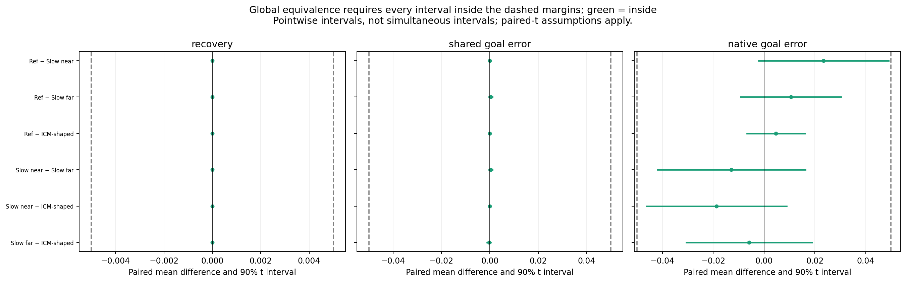
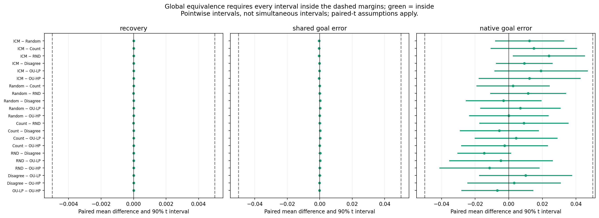

# Did matched policies perform around the same?

**Optional margin sensitivity.** The user clarified that they wanted the [margin-free performance-difference tests](MATCHED_OMNIBUS.md). The proposed margins below were not endorsed and are not the basis of the requested test’s conclusion. These supplementary post hoc analyses do not replace the campaign’s 54 planned tests.

Practical margins: **±0.005 R²**, **±0.05 physical goal error**. The latter is 0.2 of an action step. These are proposed practical choices, not estimated from the outcomes. A sensitivity table is provided. [Test protocol](../EQUIVALENCE_PROTOCOL.md).

## previous stationary four

Four stationary surrogate policies; exact endpoint marginals/action counts matched.

Policies: 4; paired seeds: 10.

| Endpoint | Difference-test Holm p | Mean-equivalence global p | Mean equivalent? | Median-equivalence p | Smallest margin exceeding all 90% mean-interval endpoints |
| --- | ---: | ---: | --- | ---: | ---: |
| recovery | 1 | 5.8963e-28 | yes, under stated assumptions/margin | 0.00097656 | 6.5711e-06 |
| shared_goal_error | 1 | 2.9554e-16 | yes, under stated assumptions/margin | 0.00097656 | 0.0011067 |
| native_goal_error | 1 | 0.044423 | yes, under stated assumptions/margin | 0.054688 | 0.048967 |

**Joint primary mean equivalence (recovery AND shared-data reaching): p = 2.9554e-16.** Both endpoints must pass; native-data reaching asks an additional question. Including all three endpoints gives p = 0.044423.

| Endpoint | Margin | Global mean-equivalence p |
| --- | ---: | ---: |
| recovery | 1e-06 | 0.82661 |
| recovery | 1e-05 | 0.0030011 |
| recovery | 0.0001 | 1.4782e-12 |
| recovery | 0.001 | 1.1763e-21 |
| recovery | 0.005 | 5.8963e-28 |
| recovery | 0.01 | 1.1486e-30 |
| recovery | 0.02 | 2.2403e-33 |
| shared_goal_error | 0.005 | 4.442e-07 |
| shared_goal_error | 0.01 | 7.2643e-10 |
| shared_goal_error | 0.025 | 1.6134e-13 |
| shared_goal_error | 0.05 | 2.9554e-16 |
| shared_goal_error | 0.1 | 5.5813e-19 |
| shared_goal_error | 0.25 | 1.4332e-22 |
| shared_goal_error | 0.5 | 2.7797e-25 |
| shared_goal_error | 1 | 5.4101e-28 |
| native_goal_error | 0.005 | 0.89091 |
| native_goal_error | 0.01 | 0.82009 |
| native_goal_error | 0.025 | 0.45657 |
| native_goal_error | 0.05 | 0.044423 |
| native_goal_error | 0.1 | 0.00021553 |
| native_goal_error | 0.25 | 5.9165e-08 |
| native_goal_error | 0.5 | 1.0268e-10 |
| native_goal_error | 1 | 1.835e-13 |

## original policies common reset

Seven original policies; starts and regularizer exposure matched, successors/stationarity not forced.

Policies: 7; paired seeds: 20.

| Endpoint | Difference-test Holm p | Mean-equivalence global p | Mean equivalent? | Median-equivalence p | Smallest margin exceeding all 90% mean-interval endpoints |
| --- | ---: | ---: | --- | ---: | ---: |
| recovery | 1 | 7.3719e-47 | yes, under stated assumptions/margin | 9.5367e-07 | 1.4852e-05 |
| shared_goal_error | 1 | 1.1248e-30 | yes, under stated assumptions/margin | 9.5367e-07 | 0.0008555 |
| native_goal_error | 1 | 0.03357 | yes, under stated assumptions/margin | 0.13159 | 0.046621 |

**Joint primary mean equivalence (recovery AND shared-data reaching): p = 1.1248e-30.** Both endpoints must pass; native-data reaching asks an additional question. Including all three endpoints gives p = 0.03357.

| Endpoint | Margin | Global mean-equivalence p |
| --- | ---: | ---: |
| recovery | 1e-06 | 0.87478 |
| recovery | 1e-05 | 0.23739 |
| recovery | 0.0001 | 3.109e-14 |
| recovery | 0.001 | 1.5457e-33 |
| recovery | 0.005 | 7.3719e-47 |
| recovery | 0.01 | 1.3891e-52 |
| recovery | 0.02 | 2.6333e-58 |
| shared_goal_error | 0.005 | 9.6723e-12 |
| shared_goal_error | 0.01 | 2.3692e-17 |
| shared_goal_error | 0.025 | 6.1987e-25 |
| shared_goal_error | 0.05 | 1.1248e-30 |
| shared_goal_error | 0.1 | 2.0798e-36 |
| shared_goal_error | 0.25 | 5.6006e-44 |
| shared_goal_error | 0.5 | 1.0606e-49 |
| shared_goal_error | 1 | 2.0155e-55 |
| native_goal_error | 0.005 | 0.92964 |
| native_goal_error | 0.01 | 0.86353 |
| native_goal_error | 0.025 | 0.46239 |
| native_goal_error | 0.05 | 0.03357 |
| native_goal_error | 0.1 | 3.4832e-05 |
| native_goal_error | 0.25 | 1.319e-11 |
| native_goal_error | 0.5 | 3.2424e-17 |
| native_goal_error | 1 | 6.6508e-23 |

## Interpret the tests carefully

- Friedman tests detect policy rank differences; a nonsignificant result does not establish equivalence.
- Global mean equivalence requires every paired TOST to pass. Its p is the maximum component p. This is an intersection-union test, so the global conjunction does not need an extra pair-count correction. The 90% intervals are pointwise, not simultaneous.
- Mean-TOST assumes approximately normal paired seed differences. Exactly constant observed differences use its degenerate limit, not a distribution-free population-mean guarantee. With only 10/20 seeds and discrete goal errors, the normal approximation needs caution. The median sign-TOST is an assumption-light check of typical differences, not proof about their mean.
- Detectable differences and practical equivalence can coexist: a tiny consistent effect can be statistically detectable yet lie comfortably inside a practical margin.
- All conclusions are conditional on the chosen margins, these actors, representation/predictor budgets and goal distribution. No equivalence claim extends to the entire original native-policy zoo.
- The minimum supported margin is a descriptive precision threshold, not a reason to choose a margin after inspecting the data.

[Full pairwise differences, intervals, tests and sensitivity](MATCHED_EQUIVALENCE.json).
