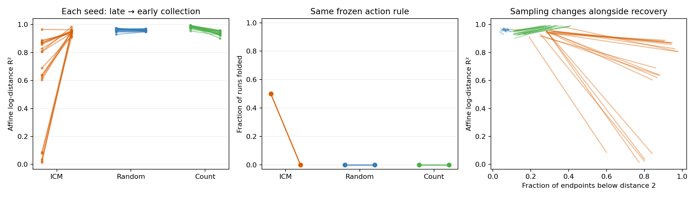

# Original policies: why ICM folds

**The original policies differ strongly.** The earlier matched-coverage test used modified stationary policies, so it did not settle the original ICM–random–OU comparison.

[Full zoo comparison](output/RESULTS.md) · [Collection experiment and graphs](output/EARLY_COLLECTION_RESULTS.md) · [Mechanism and limitations](MECHANISM.md)

## Main result: collect earlier from the same ICM actor

The old collection discarded 128 steps after a reset and kept the next 64. We kept the **same frozen ICM actor** and collected the first 64 instead. Same transition count, encoder, SIGReg, full training loss, initialization and training budget.

| ICM outcome | Late collection | Early collection |
| --- | ---: | ---: |
| Affine log-distance R², 20 seeds | 0.6035 | 0.9457 |
| Folded encoders | 10/20 | 0/20 |
| Observations below distance 2 | 84.1% | 27.8% |
| Shared-data goal error, 10 seeds | 0.8316 | 0.0516 |
| Native-data goal error, 10 seeds | 0.9504 | 0.0973 |

Recovery improves in 19/20 seeds (Holm p = 0.00020). All ten old folds are repaired (p = 0.0078). Shared-data reaching improves in all ten tested seeds (p = 0.0059). All seeds are included; no successful-run subset.

A stricter, post hoc correction across **all 29 new tests** keeps recovery significant (p = 0.0011), while fold repair and planning are borderline (both p = 0.0508). These exploratory results need fresh-seed replication. [Sensitivity check](output/GLOBAL_CORRECTION.json).

Random changes little. Count stays unfolded but loses affine recovery, from 0.9845 to 0.9385. Earlier collection is not universally better.

Early data are transient. Collection age changes occupancy and the empirical pair law: this is **not** a stationary matched-marginal test.



## Identifiability across the original zoo

We re-evaluated **700 saved encoders**: all 17 original physical policies under pure and OU-handover training, plus ideal OU references. The full report separates affine recovery, preservation of distance order, and numerically equal codes at different distances.

| Original pure policy | Affine R² | Folds / 20 | Shared-data goal error |
| --- | ---: | ---: | ---: |
| Ideal OU pairs | 0.9950 | 0 | 0.0844 |
| Count | 0.9845 | 0 | 0.0758 |
| Random | 0.9609 | 0 | 0.0387 |
| Low-pass OU actions | 0.8580 | 2 | 0.3090 |
| ICM | 0.6034 | 10 | 0.8316 |
| RND | 0.0518 | 20 | 2.0297 |

Recovery uses 20 seeds; planning uses the fixed first ten, 8–17. Random/count do not significantly beat OU in the corrected planning tests. Better affine recovery does not automatically mean better reaching, and finite R² does not certify the paper’s theorem.

## New hypothesis and evidence

**Late ICM collection concentrates observations near the object. The finite network fits that region while distorting less-constrained distances.** This concerns JEPA's input data, not a claim that ICM's own curiosity model folds.

Removing alignment on five original data sources preserved fold status in **all 100 new fits**. Explicit alignment is therefore unnecessary for these intervention folds. SIGReg was unchanged. Paired endpoints still share finite minibatches, so this does not eliminate every pair-law effect or establish a sole cause. [Clarification](CLARIFICATIONS.md).

The same-actor collection repair supports investigating concentration and generalization. Early ICM still has lower affine recovery than ideal OU. Next: replicate early versus late collection on fresh ICM actors/seeds, then test intermediate ages—16, 32 and 64—to locate the onset of concentration, folding and planning failure. These follow-ups remain proposed; ages 0 and 128 on the original cohort are completed.

## Reproduce

From the repository root, with the existing environment plus SciPy:

```sh
python3 behavior-policy-experiments/policy-zoo/original-policy-followup/run_original.py --workers 6
python3 behavior-policy-experiments/policy-zoo/original-policy-followup/analyze_original.py
python3 behavior-policy-experiments/policy-zoo/original-policy-followup/run_early.py
python3 behavior-policy-experiments/policy-zoo/original-policy-followup/analyze_early.py
python3 behavior-policy-experiments/policy-zoo/original-policy-followup/combine_statistics.py
python3 behavior-policy-experiments/policy-zoo/original-policy-followup/verify_original.py --include-early
```

Run in this order. Actors are frozen; no downloads or actor retraining. Encoder fits resume every 1,000 updates; interrupted predictor fits restart deterministically. Large regenerated source pools are ignored by Git.

[Original protocol](PROTOCOL.md) · [Collection protocol](EARLY_COLLECTION_PROTOCOL.md) · [Verification](output/VERIFICATION.json)

Verification: 700 original and 160 intervention geometry evaluations, 170 physical planning replays, four controlled tests, and original/intervention training replay gates pass.
