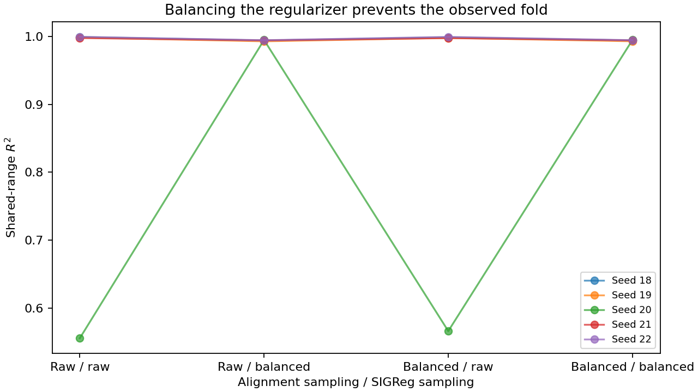

# What explains the behavior-policy difference?

**The strongest evidence points to the distribution used by SIGReg.** Balancing that batch prevents the observed folds; balancing only the alignment batch does not. This is a controlled finite-training result, supported by the weighted-loss calculation in [MECHANISM.md](MECHANISM.md), not a global-convergence theorem.

## Repairs and alternatives

Five new validation seeds, 8–12; 4,000 representation updates unless marked otherwise:

| Condition | Mean shared-range $R^2$ | Runs with reversed grid steps |
| --- | ---: | ---: |
| Fixed OU | 0.9944 | 0/5 |
| Random→OU | 0.9960 | 0/5 |
| ICM→OU | 0.7382 | 4/5 |
| Balance the same ICM transition pool | 0.9940 | 0/5 |
| Start with 20% OU | 0.3883 | 5/5 |
| Finish the handover earlier | 0.7188 | 4/5 |
| ICM with a random-action floor | 0.6462 | 4/5 |
| ICM + coverage reward | 0.7359 | 4/5 |
| Monotone encoder diagnostic | 0.8721 | 0/5 |
| Count-based coverage→OU | 0.9959 | 0/5 |
| Action-balanced→OU | 0.9957 | 0/5 |
| RND→OU | 0.4672 | 4/5 |
| Disagreement→OU | 0.5176 | 4/5 |
| OU, 8,000 updates | 0.9992 | 0/5 |
| ICM→OU, 8,000 updates | 0.7328 | 4/5 |

Balanced replay restores roughly OU-level performance and repairs both earlier diagnostic failures. It uses the same stored transitions, changes repetitions, and cannot fill empty bins. It relies on known apparent-size ordering. The monotone architecture prevents folds but does not guarantee a straight-line distance readout. Reward scales and capacities have not been tuned separately for every exploration algorithm, so this is not a universal ranking.

## Is the failure just unlucky initialization?

Freeze each of the eight earlier policies and collected datasets, then cross each with three independent encoder initializations. Both problematic sources, 3 and 7, fail in all three cases; the other six sources succeed in all three. Their matched OU controls do not fold. The failure is therefore robust to these tested initializations, although policy choice and collection randomness remain bundled within a dataset seed.

## Which loss term matters?

An additional test uses fresh seeds 18–22 and independent alignment/regularizer batches in every cell:

| Alignment sampling | SIGReg sampling | Mean shared-range $R^2$ | Folded runs |
| --- | --- | ---: | ---: |
| Ordinary | Ordinary | 0.9100 | 1/5 |
| Ordinary | Balanced | 0.9940 | 0/5 |
| Balanced | Ordinary | 0.9119 | 1/5 |
| Balanced | Balanced | 0.9941 | 0/5 |

The same effect repairs the two historical failures. Repeated observations change the regularizer's sampled output distribution and its gradient weighting. A non-Gaussian state distribution can require a nonlinear Gaussianizing coordinate; it does not mathematically require folding. Folding is an additional finite-training failure. [Exact argument and gradient](MECHANISM.md) · [Ablation protocol](LOSS_ABLATION.md).

## Learned OU and planning

The [learned-OU study](../learned-ou/README.md) learns correlation near 0.5, but correlation alone barely improves recovery. Learning spread yields a small gain. The physical OU-inspired controller remains distinct from exact OU pairs. Its good shared-data planning and weaker native-data planning reinforce the importance of collection coverage; see the [planning summary](../planning/SUMMARY.md).

## Limits

Five-seed validation groups are small. The ablation identifies a regularizer-sampling intervention under this architecture and budget; it does not prove every policy failure has the same cause, that a particular local minimum exists, or that state and action coverage contribute equally. Checkpoint-only reevaluation, full per-seed scores and all failed runs are retained.
