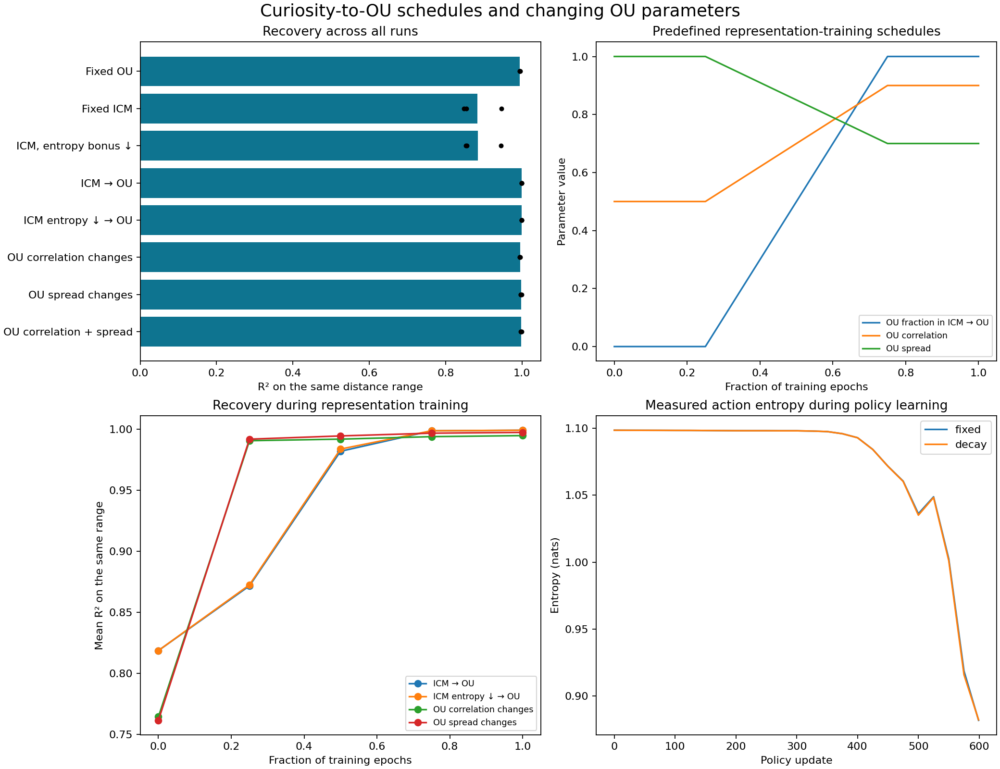

# Scheduled exploration results

All scores use separate calibration and test data. R²=1 is a perfect straight-line readout of log-distance. Values are means ± sample standard deviations across completed runs.

3-run comparison; all schedules were fixed before evaluation.

| Training rule | Same distance-range R² | Fixed Gaussian OU test R² | Output variance on the fixed OU test |
| --- | ---: | ---: | ---: |
| Fixed OU | 0.9946 ± 0.0012 | 0.9802 ± 0.0029 | 0.8470 ± 0.0146 |
| Fixed ICM | 0.8832 ± 0.0548 | 0.8454 ± 0.0571 | 15.7655 ± 13.1750 |
| ICM, entropy bonus ↓ | 0.8844 ± 0.0526 | 0.8466 ± 0.0541 | 15.9391 ± 13.3215 |
| ICM → OU | 0.9991 ± 0.0004 | 0.9932 ± 0.0031 | 0.9626 ± 0.0478 |
| ICM entropy ↓ → OU | 0.9991 ± 0.0004 | 0.9933 ± 0.0031 | 0.9639 ± 0.0467 |
| OU correlation changes | 0.9947 ± 0.0010 | 0.9805 ± 0.0025 | 0.8482 ± 0.0131 |
| OU spread changes | 0.9974 ± 0.0013 | 0.9867 ± 0.0031 | 0.8814 ± 0.0272 |
| OU correlation + spread | 0.9977 ± 0.0011 | 0.9874 ± 0.0026 | 0.8863 ± 0.0255 |

## Main findings in these runs

The gradual ICM→OU handover recovered a much straighter log-distance scale than fixed ICM in every tested run. It also finished closer to the intended output variance of 1. Combining the handover with entropy-bonus decay gave nearly the same result as the handover alone.

Entropy-bonus decay by itself changed recovery and measured action randomness very little at this starting weight. This does not rule out different entropy settings; it tests the original small bonus decreasing to zero.

Changing OU correlation alone made little difference. Starting with a wider log-distance spread and narrowing it improved recovery more in this setup. Only three runs were tested; these observations do not establish a general advantage for every schedule or environment.

The fixed OU test is the same for every row; its Gaussian states include distances outside [1,16]. The first score tests only the shared range [1,16]. The ideal standard-Gaussian output variance is 1.

## Individual runs

| Run | Training rule | Same-range R² | Fixed OU R² | Final-source variance |
| --- | --- | ---: | ---: | ---: |
| 0 | Fixed OU | 0.9941 | 0.9770 | 0.8370 |
| 0 | Fixed ICM | 0.9464 | 0.9112 | 0.7638 |
| 0 | ICM, entropy bonus ↓ | 0.9451 | 0.9090 | 0.7456 |
| 0 | ICM → OU | 0.9988 | 0.9897 | 0.9325 |
| 0 | ICM entropy ↓ → OU | 0.9988 | 0.9897 | 0.9337 |
| 0 | OU correlation changes | 0.9944 | 0.9778 | 0.8399 |
| 0 | OU spread changes | 0.9970 | 0.9839 | 0.8684 |
| 0 | OU correlation + spread | 0.9975 | 0.9852 | 0.8758 |
| 1 | Fixed OU | 0.9959 | 0.9828 | 0.8638 |
| 1 | Fixed ICM | 0.8484 | 0.8087 | 18.1955 |
| 1 | ICM, entropy bonus ↓ | 0.8551 | 0.8165 | 18.9619 |
| 1 | ICM → OU | 0.9990 | 0.9948 | 1.0177 |
| 1 | ICM entropy ↓ → OU | 0.9990 | 0.9948 | 1.0176 |
| 1 | OU correlation changes | 0.9959 | 0.9827 | 0.8633 |
| 1 | OU spread changes | 0.9988 | 0.9900 | 0.9127 |
| 1 | OU correlation + spread | 0.9989 | 0.9902 | 0.9153 |
| 2 | Fixed OU | 0.9937 | 0.9807 | 0.8403 |
| 2 | Fixed ICM | 0.8549 | 0.8163 | 13.8424 |
| 2 | ICM, entropy bonus ↓ | 0.8530 | 0.8142 | 13.7627 |
| 2 | ICM → OU | 0.9996 | 0.9953 | 0.9375 |
| 2 | ICM entropy ↓ → OU | 0.9996 | 0.9954 | 0.9402 |
| 2 | OU correlation changes | 0.9939 | 0.9810 | 0.8415 |
| 2 | OU spread changes | 0.9963 | 0.9860 | 0.8632 |
| 2 | OU correlation + spread | 0.9967 | 0.9869 | 0.8676 |

## Why the earlier ICM result was worse

The original learned policies chose approach more often than retreat in two runs, producing uneven distance coverage. Their output variances also departed greatly from the training target. A high score on frequently visited distances therefore concealed weaker performance elsewhere. These are measured differences, but they do not separate every causal mechanism.

| Run | Policy | Approach / stay / retreat | Mean action entropy (nats) | Frozen curiosity reward at d=1..2 | At d=8..16 |
| --- | --- | --- | ---: | ---: | ---: |
| 0 | fixed | 0.370 / 0.327 / 0.303 | 1.0950 | 0.021346 | 0.002151 |
| 0 | decay | 0.370 / 0.326 / 0.304 | 1.0951 | 0.028332 | 0.002057 |
| 1 | fixed | 0.562 / 0.250 / 0.188 | 0.9755 | 0.042422 | 0.094365 |
| 1 | decay | 0.559 / 0.253 / 0.188 | 0.9783 | 0.033431 | 0.052471 |
| 2 | fixed | 0.585 / 0.212 / 0.203 | 0.9566 | 0.023807 | 0.028434 |
| 2 | decay | 0.587 / 0.211 / 0.202 | 0.9535 | 0.025032 | 0.016159 |

The reward columns measure the final frozen curiosity model. They do not reconstruct how its reward changed while learning, so they cannot establish the cause of the preference by themselves.

## What the schedules mean

ICM→OU replaces training pairs gradually: first 25% all ICM, middle 50% increasing OU fraction, last 25% all OU. The entropy-bonus schedule is a separate change during the earlier policy-training stage: its coefficient decreases from 0.0005 to zero on the same quarter/half/quarter timing. Actual action entropy is measured, not assumed to follow the coefficient.

OU correlation changes from 0.5 to 0.9; OU observation spread changes from 1.0 to 0.7 where enabled. Changing correlation preserves each epoch's standard-Gaussian hidden state. Changing spread changes the physical-distance distribution over epochs. All OU schedules hold the final settings fixed for the last quarter.

The OU pairs are simulator-generated training views; the handover is a sampling curriculum, not a single continuous three-action trajectory or a conversion between discrete-action and continuous-state entropy units.

Models and reports are saved for reproducibility. The original results remain in the sibling curiosity/output folder.

