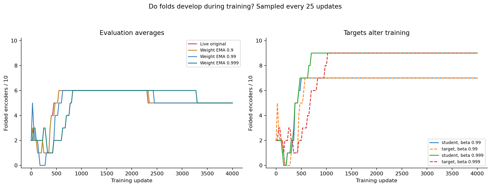

# Does EMA prevent encoder folding?

[Fixed protocol](PROTOCOL.md) · [Training](run.py) · [Independent report](report.py)

This study checks both parameter averaging for evaluation (decays 0.9/0.99/0.999) and stop-gradient EMA targets during training (0.99/0.999) in the original scalar MLP. Ten stored ICM datasets, seeds 130–139; same initial weights and training draws across arms. All fits start from initialization. This is separate from EMA in the earlier actor/ICM system.

The EMA-target alignment uses a symmetric sum so its parameter gradient equals the original alignment gradient when teacher and student weights match. SIGReg acts only on student endpoint codes. No predictor, ordering penalty, weighted moments, geometry labels, or new observations enter training. A full zero-lag control checks the comparison. This is an extension of the existing scalar trainer, not a full BYOL/image-JEPA reproduction.

Run from the workspace root:

```sh
OPENBLAS_NUM_THREADS=1 python3 icm-folding/ema-study/run.py --check
OPENBLAS_NUM_THREADS=1 python3 icm-folding/ema-study/run.py
OPENBLAS_NUM_THREADS=1 python3 icm-folding/ema-study/report.py
```

Two independent training processes may use `--shard 0 --shards 2` and `--shard 1 --shards 2`. Completed fit files are reused. Histories are sampled every 25 updates; final checks use 20,001 float64 points. Parameter averages can lag learning; final output standard deviations and R² are reported alongside folds. Empirical grid checks are not injectivity guarantees.

## Completed results

All 31 fits completed. Weight averaging at decays 0.9, 0.99 and 0.999 leaves the final fold count unchanged at 5/10. EMA targets increase final student folds to 7/10 at 0.99 (six material) and 9/10 at 0.999 (eight material); the corresponding targets fold in 7/10 and 9/10. They do not prevent folding in this configuration. Original live training has a sampled fold at some time in 9/10 runs; evaluation averages at 0.99 and 0.999 have one in all ten, including transient turns. The zero-lag seed-131 control reproduces its baseline exactly.

For seed 131, the first sampled fold occurs at update 225 in the live original, 225 in the 0.9 average, 300 in the 0.99 average, and 450 in the 0.999 average. All remain folded at 4,000. Thus slower averaging can delay a visible fold without eliminating it. Final output standard deviations are nonzero (minimum above 0.65 across all tested encoder types), so the no-fold comparisons do not count constant-code collapse as success.

Every final student/average/target (82 saved encoders across 31 fits) passed independent float64 20,001-point recomputation. All ten live original reruns and the full zero-lag control reproduced the original weights bit-for-bit. These are historical-source, single-configuration experiments without a predictor or LR sweep; they do not establish a failure of all EMA recipes or a direct-repair result.

[Results](output/RESULTS.md) · [Summary and per-seed fold times](output/summary.json) · [Checkpoint verification](output/verification.json) · [Formula checks](output/formula-checks.json)



[All seed curves: parameter averages](output/weight_averages.png) · [All seed curves: EMA targets](output/ema_targets.png)
