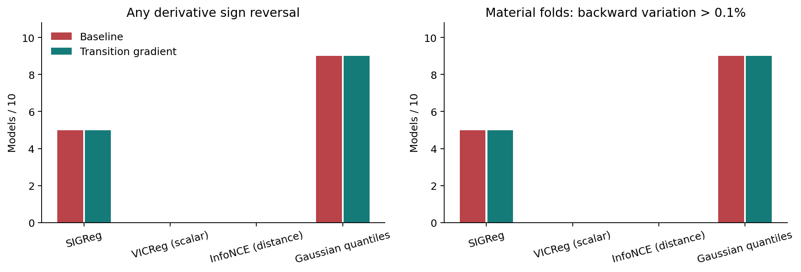
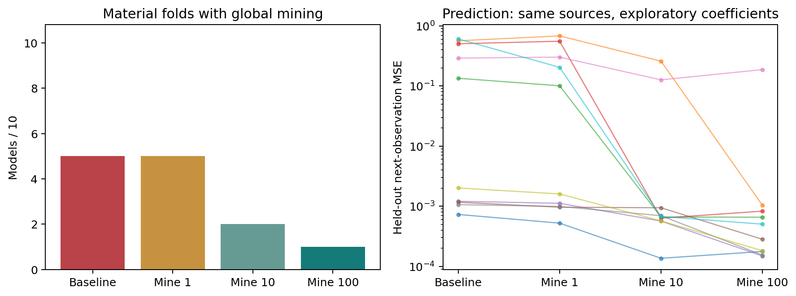
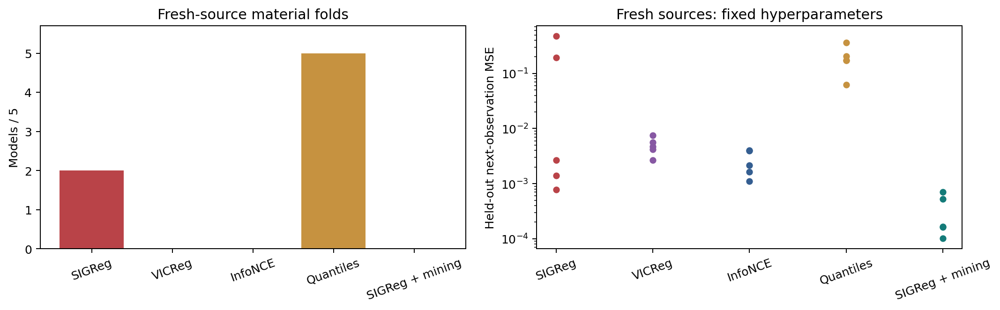
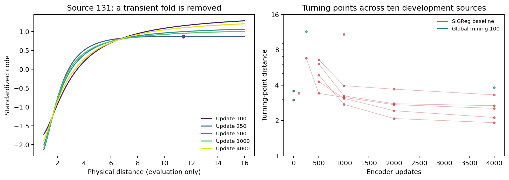

# Learning from scratch: original MLP gradients and other regularizers

[Graph gallery](output/index.html) · [Main tables](output/RESULTS.md) · [Global mining](output/MINING.md) · [Fresh-source check](output/FRESH.md) · [Strength control](output/STRENGTH.md) · [Protocol and adaptive decisions](PROTOCOL.md)

**A transition-based gradient can substantially reduce folding in the original MLP without an ordered spline or known dynamics equation. It is not a guarantee.** SIGReg with global successor-conflict mining reduced final folds from 5/10 to 1/10 on ten development sources. With coefficient 100 fixed before generating five new ICM policy sources, it reduced final folds from 2/5 to 0/5 and improved held-out observation prediction in all five pairs. One development source remains substantially folded.

The study also finds that folding is not unique to SIGReg. Gaussian quantile matching folds frequently. The tested scalar VICReg and distance-score InfoNCE objectives fold much less often, with one tiny VICReg reversal on a fresh source. These are toy scalar adaptations with one main hyperparameter setting, not comparisons of complete image-learning pipelines.

## What changed in the gradients?

The encoder is the same feedforward `6 -> 48 -> 48 -> 1` tanh MLP. It starts from random weights in every fit. The encoder receives the original six sensor coordinates through the original fixed `tanh(4*x)` preprocessing. It gets no supplied apparent-height coordinate, distance ordering, physical labels, or analytic dynamics. ICM's separate 32-dimensional feature encoder and policy are not modified by this repair.

For two observed transitions with the same action, ask: **do the current codes look almost identical even though the observed successors differ?** If so, add a separating gradient to those codes. The successors are samples from the environment, not a privileged dynamics model.

Let `f` be the scalar encoder, `t_i` the successor observation after fixed preprocessing and training-set whitening, and `a_i=a_j`. Set

\[
D_{ij}=\sqrt{\operatorname{mean}_k(t_{ik}-t_{jk})^2},\qquad
m_{ij}=\tfrac12\min(2,D_{ij}),
\]
\[
L_{\mathrm{conflict}}
=\operatorname{mean}_{(i,j)\in\mathcal P}
\left[m_{ij}-\frac{|f(x_i)-f(x_j)|}{\operatorname{stopgrad}(\sigma_f)}\right]_+^2,
\qquad L=L_{\mathrm{base}}+\lambda L_{\mathrm{conflict}}.
\]

The code scale has a minimum of 0.05. Pair selection and scale are detached deliberately; backpropagation separates the selected code pairs without choosing a global sign or ordering. This is an auxiliary-loss gradient, not weight projection or an architectural constraint. At an exact symmetric collision the absolute-distance gradient can be zero, so the rule is not guaranteed to escape every collision.

The original local rule selects eight nearest learned-code neighbors per anchor within a 128-transition minibatch, conditioned on action. At coefficient 1 it barely changes the folded examples. Global mining encodes the entire training set every 50 updates, sorts by the **current learned code** within each action, compares neighbor offsets 1/2/4/8/16/32, and retains the 512 largest successor-gap violations. Each update samples 64 of these pairs. This makes rare conflicts visible to the gradient. It does not sort by physical distance.

The base SIGReg batches and native occupancy remain fixed. Mining supplies additional targeted observation exposures and computation. The gradient-strength control raises the local coefficient to 100; it helps but leaves 4/10 derivative reversals (3/10 material folds), compared with 1/10 for global mining. Thus the full improvement is not explained by increasing the coefficient alone. This is still not a matched-compute ablation.

## Why successor differences are relevant, mathematically

Suppose a shared action-conditioned decoder `G` predicts two successor targets with errors at most epsilon, and `G(.,a)` is L-Lipschitz in the code. The triangle inequality gives

\[
\|t_i-t_j\|\le
\|t_i-G(f(x_i),a)\|+
\|G(f(x_i),a)-G(f(x_j),a)\|+
\|G(f(x_j),a)-t_j\|
\le2\epsilon+L|f(x_i)-f(x_j)|.
\]

Therefore `|f(x_i)-f(x_j)| >= max(0,(||t_i-t_j||-2 epsilon)/L)`. Distinct deterministic successors cannot both be perfectly predicted from exactly the same code and action. This argument needs observed transitions, not an analytic dynamics formula. Our hinge is a heuristic version of this separation requirement: it does **not** certify a decoder Lipschitz constant or a uniform error bound. No prediction decoder is required during encoder training; fresh decoders are fit afterward for evaluation.

The argument also explains the limits. In a stochastic environment, different successor samples need not imply different states; conditional future distributions or averages would be needed. Pixel detail can be irrelevant nuisance. In a partially observed environment, identical observations may require history to distinguish hidden states. Sparse data cannot certify unseen states, and a scalar bottleneck may be insufficient for the underlying state dimension.

## Do other regularizers fold?

These are baseline runs without the proposed collision gradient:

| Objective | Development sources: any final fold | Fresh sources: any final fold |
| --- | ---: | ---: |
| SIGReg | 5/10 | 2/5 |
| VICReg, scalar adaptation | 0/10 | 1/5, tiny |
| InfoNCE, scalar distance score | 0/10 | 0/5 |
| Gaussian quantile matching | 9/10 | 5/5 |

VICReg's off-diagonal covariance term is identically zero in one dimension. Its invariance and per-branch variance terms use coefficients 25 and 25. InfoNCE uses symmetric cross-view classification, a squared-distance score, batch-standardized scalar codes, temperature 0.1, and 128 candidates (127 negatives and one positive). Scalar cosine would mostly encode sign and is inappropriate here. Gaussian quantile matching minimizes empirical univariate Wasserstein squared distance to normal quantiles, alongside alignment. It is a second full-distribution matching control, not a VICReg variant.

Both *any derivative sign reversal* and *material folding* are reported. The material threshold was specified before the main runs: backward variation greater than 0.001 of total curve variation. The tiny fresh VICReg turn passes the derivative test but is below that threshold. It is still counted as a fold in the table above.

**Interpretation:** the results argue against folding being inevitable with every anti-collapse objective. Full Gaussian marginal matching is associated with frequent folds in these trained scalar MLPs, while the variance constraint and the tested contrastive objective are usually ordered. This does not establish a theorem that Gaussian matching causes folds or that VICReg/InfoNCE cannot fold. An ordered mapping can also match a continuous target marginal; architecture and optimization matter.



## Does fixing the folds improve prediction?

The encoder is frozen after training. A matched fresh `4 -> 64 -> 64 -> 6` decoder receives the scalar code plus one-hot action and predicts the next observed vector. Training and held-out data use disjoint whole trajectories. Targets are whitened with training-set statistics. The original scalar representation objective has no learned predictor; this decoder is an independent downstream evaluation.

| SIGReg condition | Final folds, development | Mean held-out MSE, development | Final folds, fresh | Mean held-out MSE, fresh |
| --- | ---: | ---: | ---: | ---: |
| Baseline | 5/10 | 0.210549 | 2/5 | 0.135788 |
| Global mining, coefficient 100 | 1/10 | 0.019100 | 0/5 | 0.000334 |

All ten development and all five fresh paired held-out prediction errors improve. In the fresh cohort the geometric-mean per-source MSE ratio is 0.021; the ratio of aggregate arithmetic means is different because the baseline errors are highly skewed. Five sources are too few to infer a broad success probability. The development coefficient sweep was adaptive; the fresh-source coefficient was fixed before generating the policies.

The common uniform-distance/random-action evaluation also improves (development mean MSE 1.316871 -> 0.103342; fresh 3.114902 -> 0.013081). This is a coverage/extrapolation stress test, not a held-out sample from native occupancy. Raw-input and action-only predictor references are provided in the measured tables; a finite raw-input decoder is not a rigorous error lower bound.





Source 131 with global mining briefly has a detected fold at update 250 but is ordered at the end. Thus the method need not preserve order throughout training. Source 136 retains a large final fold even with coefficient 100, within the observed training support, and has a large remaining mined gap violation. This is a concrete counterexample to a hard guarantee for the new rule.



## Evidence, scope, and reproduction

Completed: 80 main fits (4 objectives x 2 gradients x 10 sources), 30 adaptive global-mining fits, 10 matched-strength local controls, and 25 fixed-hyperparameter fresh-source fits. Total **145 encoder fits**, plus five freshly trained ICM policies, ten raw-input decoder references, and a separate 100-step timing run excluded from all results. All encoders start from random initialization.

Every final encoder was reloaded and its curve/derivative independently recomputed on 20,001 points. Every stored downstream decoder's held-out and coverage-stress errors were recomputed. Audits check source hashes, paired initialization, paired base minibatches, retained histories, and the observation/action-only training dictionary. Four finite-difference objective gradient checks and direction/sign-invariance tests for the collision gradient passed. These are empirical checks, not continuous-domain certificates.

- [Main 80-model audit](output/verification.json)
- [Global 30-model audit](output/mining-verification.json)
- [Fresh 25-model audit](output/fresh-verification.json)
- [Local-strength 10-model audit](output/strength-verification.json)
- [Protocol](PROTOCOL.md), including the sequence of adaptive decisions

Run sequentially from the workspace root (completed checkpoints are reused; `--shard`/`--shards` can partition training):

```sh
OPENBLAS_NUM_THREADS=1 python3 icm-folding/mlp-gradient-study/run.py --check
OPENBLAS_NUM_THREADS=1 python3 icm-folding/mlp-gradient-study/run.py
OPENBLAS_NUM_THREADS=1 python3 icm-folding/mlp-gradient-study/reference.py
OPENBLAS_NUM_THREADS=1 python3 icm-folding/mlp-gradient-study/hard_mining.py
OPENBLAS_NUM_THREADS=1 python3 icm-folding/mlp-gradient-study/hard_mining.py --coefficient 100
OPENBLAS_NUM_THREADS=1 python3 icm-folding/mlp-gradient-study/strength_control.py
OPENBLAS_NUM_THREADS=1 python3 icm-folding/mlp-gradient-study/fresh.py
OPENBLAS_NUM_THREADS=1 python3 icm-folding/mlp-gradient-study/report.py
OPENBLAS_NUM_THREADS=1 python3 icm-folding/mlp-gradient-study/mining_report.py
OPENBLAS_NUM_THREADS=1 python3 icm-folding/mlp-gradient-study/fresh_report.py
OPENBLAS_NUM_THREADS=1 python3 icm-folding/mlp-gradient-study/strength_report.py
OPENBLAS_NUM_THREADS=1 python3 icm-folding/mlp-gradient-study/history_plot.py
```

The method is promising on this renderer, and its per-update inputs do not require known dynamics. Unknown dynamics is not the same as stochasticity or partial observability; those remain untested. Additional work should compare multiple latent dimensions, standard vector InfoNCE/VICReg pipelines, nuisance observations, stochastic transitions, and matched-compute alternatives. There is no demonstrated reason yet to prefer this more expensive modification over standard alternatives across environments.

Primary objective definitions: [VICReg](https://arxiv.org/abs/2105.04906), [official VICReg implementation](https://github.com/facebookresearch/vicreg/blob/main/main_vicreg.py), [InfoNCE/CPC](https://arxiv.org/abs/1807.03748). The MLP, renderer, ICM policies and SIGReg implementation are reused from this workspace's existing studies; the new code imports them rather than duplicating their sources or checkpoints.
