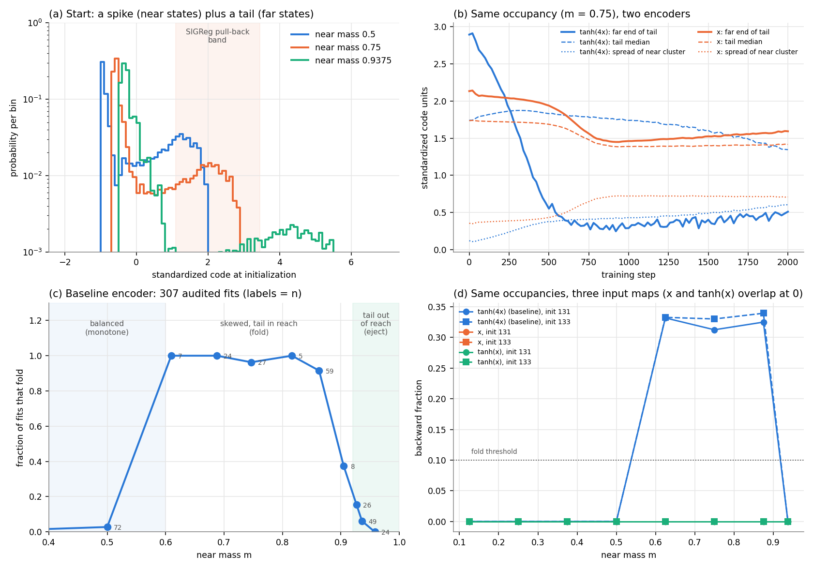

# Why the code folds: one framework

Written November 22, 2026. This organizes every fold experiment in this study around one mechanism. Each claim
below is labelled by its evidence:
- **tested**: pre-registered and confirmed;
- **falsified**: pre-registered and failed;
- **observed**: measured, but not pre-registered.

None of this is an analytic guarantee.

## The one-sentence version

A fold happens when an objective forces the code histogram toward a fixed shape, the histogram starts out lopsided, and
the encoder can fix the lopsidedness faster by bending the tail of its code curve back over the heavy region than by
stretching the heavy region out.

## The three ingredients

### 1. A force: the objective must target a fixed shape for the code histogram

SIGReg asks that the histogram of codes across states look like N(0, 1). The code is a scalar function f(d) of
distance, so the histogram is just the occupancy P pushed through f.

| Objective | Fixed shape target? | Folds? |
| --- | --- | --- |
| SIGReg, or only its even (cosine) half | yes | yes |
| variance control + skewness penalty | yes | yes |
| InfoNCE + skewness penalty | yes | yes |
| InfoNCE, temporal InfoNCE, variance control alone | no | no |

**Tested.** Adding only a skewness penalty to InfoNCE makes it fold under the same occupancies.

InfoNCE scores codes through a learned critic, which absorbs any monotone reparametrization of the code. A lopsided
histogram therefore costs InfoNCE nothing, and nothing pulls on the tail. This is the whole answer to why InfoNCE does
not fold: no shape target means no force.

### 2. What the force pushes on: a heavy cluster next to a tail

Through the initial encoder, the near-wall states (d < 2) become a spike and the far states a tail (panel a). This
histogram is skewed. SIGReg's exact per-sample force on a skewed histogram has a fixed sign pattern:
- the bulk is pushed outward;
- tail codes 1.1–3.45 standard deviations out are pulled back toward the bulk;
- codes beyond about 3.45 are pushed weakly further out, since the Gaussian kernel barely sees them.

The near mass m sets where the tail sits, giving three regimes (panel c, 307 audited fits):

| Regime | Near mass | What happens |
| --- | --- | --- |
| balanced | ≤ 0.5 | Spike and tail have similar mass. The histogram is roughly symmetric, the pull is weak and symmetric, and the tail just compresses. Monotone. |
| skewed, tail in reach | about 0.6–0.9 | The tail sits in the pull-back band, so it is pulled back. This is the fold regime. |
| tail out of reach | ≳ 0.92 | The light tail starts beyond the band and is pushed out (ejection). SIGReg instead fits the spike alone, by inflating the code scale (raw sd ≈ 3). Monotone. |

**Tested.**
- Asymmetry is necessary: removing it at fixed near mass stopped the fold.
- Ejection: traced exactly at m = 0.9375.

**Falsified.**
- Skewness is not sufficient. Laws whose skewness came from far mass piled at d 2–3, with no spread tail, did not fold.

### 3. Which response wins: the encoder's tangent kernel

A skewed histogram can be made Gaussian in two ways:
- **Stretch the heavy region.** The monotone quantile map Φ⁻¹(F_P(d)) always exists and never folds.
- **Bend the tail** back over the heavy region, which folds the code.

Gradient descent takes whichever the encoder can express quickly. That is set by its tangent kernel: how far moving one
state's code drags another's. The measurements below use [kernel.py](kernel.py) at both initializations; 0 means two
codes can only move together.

| Encoder input map | Near cluster d 1 vs 1.9 | Tail d 4 vs 16 | Folds at m = 0.625–0.875? |
| --- | ---: | ---: | --- |
| `tanh(4x)` (baseline) | 0.003–0.005 | 0.14–0.16 | yes, all 6 |
| `x` | 0.06 | 0.02–0.03 | no, 0 of 6 |
| `tanh(x)` | 0.03–0.04 | 0.02–0.03 | no, 0 of 6 |

In the baseline encoder, the near cluster is locked together, because `tanh(4x)` squashes d = 1–2 into 3.5% of the input
range. Spreading the cluster is therefore slow, while the tail can bend freely. Panel b shows the race at m = 0.75 (replays
bit-identical to the saved fits):
- **Baseline:** the far end of the tail drops from 2.9 to 0.3 standard deviations within about 500 steps, passing the tail
  median that stays near 1.8. The code curve turns back: a fold. The cluster spreads only later.
- **`x` input:** the tail moves as one block (end minus median stays about 0.3), while the cluster spreads from 0.35 to
  0.7. Skewness reaches 0 monotonically.

**Observed** (the geometry test, 48 fits):
- Changing only the input map, with the same occupancies, initial weights and training, removed every fold (0 of 32 fits
  under `x` and `tanh(x)`, at m from 0.125 to 0.9375).
- The initial skewness was up to 2.7 in these encoders, so this falsified the pre-registered skewness rule (19 of 38
  correct) and both of its specific hypotheses.

**Falsified** (the compact-cluster test, 32 fits): the refined guess "a cluster with tiny input span is enough" failed.
- A cluster squeezed into d ∈ [1, 1.02) under `x` did not fold.
- A wide cluster did fold at initialization 133 under both unsquashed maps.

Input span is therefore not the right measure. The kernel's coupling, which depends on the initial weights as well as the
input map, is the candidate; it has been measured on 3 maps × 2 initializations, not yet tested prospectively.

## How the earlier puzzles fit

| Earlier puzzle | Explanation in this framework |
| --- | --- |
| "Mass below distance 2 causes the fold." | In the baseline encoder, d < 2 is exactly the kernel-locked region, so near mass sets both the spike and where the tail sits. |
| Skewness is necessary but not sufficient. | Skewness creates the force (2); whether the tail bends depends on the tail being spread and on the kernel (3). |
| The fold disappears above m ≈ 0.92. | The tail starts beyond the pull-back band and is ejected (2). |
| The same law folds at one initialization and not another. | The race in (3) is decided by the kernel, which depends on the initial weights. Near the boundary the initialization decides. |
| InfoNCE never folds. | No shape target, so no force (1). |
| The InfoNCE gradient can repair SIGReg folds. | Interpretation, not tested: it adds an order-preserving force without a shape force (1). |

## What is still open

1. Pre-register a kernel-based prediction: compute decoupling for new input maps or initializations, predict fold or no
   fold, then train.
2. Give a law-dependent version of the kernel statistic. It should weight the decoupling by where the occupancy's spike
   and tail fall, which the compact-cluster misses suggest is needed.
3. Account for the 1.1 and 3.45 force zero-crossings analytically, for general laws.

## Reproduce

- [geometry.py](geometry.py) and [GEOMETRY_PROTOCOL.md](GEOMETRY_PROTOCOL.md): input-map test; results in
  `output/geometry/summary.json`.
- [compact.py](compact.py) and [COMPACT_PROTOCOL.md](COMPACT_PROTOCOL.md): compact-cluster test; results in
  `output/compact/summary.json`.
- [race.py](race.py): bit-exact replays with race statistics, in `output/geometry/race/`.
- [kernel.py](kernel.py): tangent-kernel decoupling, in `output/kernel.json`.
- [framework_figure.py](framework_figure.py): the figure above.
- Earlier skewness and cluster tests: [output/skew/RESULTS.md](output/skew/RESULTS.md).
