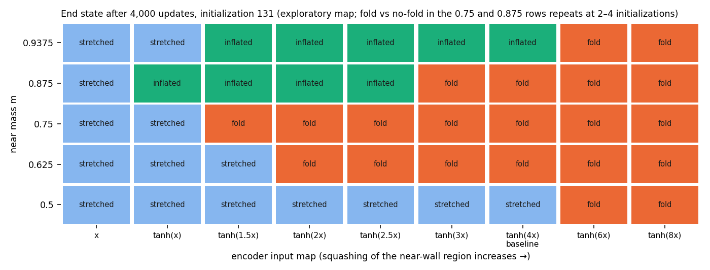

# Why the code folds: one framework

Written November 22, 2026; updated the same day with the kernel test, the force landscape and the phase map. This organizes every fold experiment in this study around one mechanism. Each claim
below is labelled by its evidence:
- **tested**: pre-registered and confirmed;
- **falsified**: pre-registered and failed;
- **observed**: measured, but not pre-registered.

None of this is an analytic guarantee.

## The one-sentence version

A fold happens when three things hold:
- an objective forces the code histogram toward a fixed shape;
- the histogram starts out lopsided;
- the encoder's parametrization lets that pressure turn into a bend of the code curve. With an identical starting
  histogram, changing only what the encoder can move changed the outcome.

The pressure needs only four numbers. SIGReg's force can be cut down to "move the spike and the tail as blocks, and
adjust each block's spread", and the fold still forms in 12 of 12 cases, with the same size. Position alone or spread
alone does not fold.

**Revised twice after causal tests below.**
- "The spike can't stretch, so bending wins the race": falsified.
- "SIGReg pulls the tail's far end harder than its middle": falsified.

How the encoder turns the block-level pressure into a bend is still open.

Training ends in one of three states:
- **stretched**: monotone and symmetric;
- **folded**;
- **inflated**: the code scale blows up so the heavy region alone looks Gaussian, and the tail is left out of SIGReg's
  reach.

Which state wins is set jointly by the near mass and by how strongly the encoder's input squashes the near-wall region
(the phase map above).

## The three ingredients

### 1. A force: the objective must target a fixed shape for the code histogram

SIGReg asks that the histogram of codes across states look like N(0, 1). The code is a scalar function f(d) of
distance, so the histogram is just the occupancy P pushed through f.

| Objective | Fixed shape target? | Folds? |
| --- | --- | --- |
| SIGReg, or only its even (cosine) half | yes | yes |
| variance control + skewness penalty | yes | yes |
| InfoNCE + skewness penalty | yes | yes |
| InfoNCE, temporal InfoNCE, variance control alone | no | no |

**Tested.** Adding only a skewness penalty to InfoNCE makes it fold under the same occupancies.

InfoNCE scores codes through a learned critic, which absorbs any monotone reparametrization of the code. A lopsided
histogram therefore costs InfoNCE nothing, and nothing pulls on the tail. This is the whole answer to why InfoNCE does
not fold: no shape target means no force.

### 2. What the force pushes on: a heavy cluster next to a tail

Through the initial encoder, the near-wall states (d < 2) become a spike and the far states a tail (panel a). This
histogram is skewed.

**Exact form of the force.** SIGReg1D is N·MMD² with kernel ≈ √(2π)·exp(−u²/2). The gradient on a code at u is therefore
proportional to the slope of the excess landscape

  E(u) = (code histogram blurred by a unit Gaussian)(u) − (N(0, 2) density)(u),

and each code slides downhill on E. [force_landscape.py](force_landscape.py) checks this against the exact SIGReg1D
gradient: correlation ≥ 0.999 on skew-normal laws and on the three native initial code laws, with zero-crossings
matching to 0.01.

E is high where the codes over-fill the Gaussian (at the spike) and low where they under-fill it (in the gap between
spike and tail). This gives a sign pattern:
- codes in the spike are pushed outward;
- codes between the gap's bottom and the tail's own crest are pulled back: the pull-back band;
- codes beyond the crest slide outward: the start of ejection.

The band depends on the law. The earlier values 1.1 and 3.45 were specific to a skew-normal:

| Near mass | Pull-back band (standardized) | Tail at initialization |
| --- | --- | --- |
| 0.5 | 0.43–2.17 | median 1.0, end 1.98: it sits in the gap and just compresses |
| 0.75 | 1.04–3.02 | end 2.89: the whole tail is pulled back |
| 0.9375 | 1.63–4.63 | median 3.8, end 5.88: the outer part slides out |

For the baseline encoder, the near mass m sets where the tail sits, giving three regimes (panel c, 307 audited fits):

| Regime | Near mass | What happens |
| --- | --- | --- |
| balanced | ≤ 0.5 | Spike and tail have similar mass. The histogram is roughly symmetric, the pull is weak and symmetric, and the tail just compresses. Monotone. |
| skewed, tail in reach | about 0.6–0.9 | The tail sits in the pull-back band, so it is pulled back. This is the fold regime. |
| tail out of reach | ≳ 0.92 | The light tail starts beyond the band and is pushed out (ejection). SIGReg instead fits the spike alone, by inflating the code scale (raw sd ≈ 3). Monotone. |

**Tested.**
- Asymmetry is necessary: removing it at fixed near mass stopped the fold.
- Ejection: traced exactly at m = 0.9375.

**Falsified.**
- Skewness is not sufficient. Laws whose skewness came from far mass piled at d 2–3, with no spread tail, did not fold.

### 3. Which response wins: how strongly the encoder squashes the heavy region

> **Read with the causal stretch test below.** The stretch-versus-bend race in this section was the working hypothesis.
> Holding the starting histogram fixed falsified it at m = 0.625 and 0.75: the fold formed on schedule even when the
> spike could stretch. The measurements here stand; the interpretation is revised below.

A skewed histogram can be made Gaussian in two ways:
- **Stretch the heavy region.** The monotone quantile map Φ⁻¹(F_P(d)) always exists and never folds.
- **Bend the tail** back over the heavy region, which folds the code.

Gradient descent takes whichever the encoder can express quickly. That is set by its tangent kernel: how far moving one
state's code drags another's. The measurements below use [kernel.py](kernel.py) at both initializations; 0 means two
codes can only move together.

| Encoder input map | Near cluster d 1 vs 1.9 | Tail d 4 vs 16 | Folds at m = 0.625–0.875? |
| --- | ---: | ---: | --- |
| `tanh(4x)` (baseline) | 0.003–0.005 | 0.14–0.16 | yes, all 6 |
| `x` | 0.06 | 0.02–0.03 | no, 0 of 6 |
| `tanh(x)` | 0.03–0.04 | 0.02–0.03 | no, 0 of 6 |

In the baseline encoder, the near cluster is locked together, because `tanh(4x)` squashes d = 1–2 into 3.5% of the input
range. Spreading the cluster is therefore slow, while the tail can bend freely. Panel b shows the race at m = 0.75 (replays
bit-identical to the saved fits):
- **Baseline:** the far end of the tail drops from 2.9 to 0.3 standard deviations within about 500 steps, passing the tail
  median that stays near 1.8. The code curve turns back: a fold. The cluster spreads only later.
- **`x` input:** the tail moves as one block (end minus median stays about 0.3), while the cluster spreads from 0.35 to
  0.7. Skewness reaches 0 monotonically.

**Observed** (the geometry test, 48 fits):
- Changing only the input map, with the same occupancies, initial weights and training, removed every fold (0 of 32 fits
  under `x` and `tanh(x)`, at m from 0.125 to 0.9375).
- The initial skewness was up to 2.7 in these encoders, so this falsified the pre-registered skewness rule (19 of 38
  correct) and both of its specific hypotheses.

**Falsified** (the compact-cluster test, 32 fits): the refined guess "a cluster with tiny input span is enough" failed.
- A cluster squeezed into d ∈ [1, 1.02) under `x` did not fold.
- A wide cluster did fold at initialization 133 under both unsquashed maps.

**Prospective kernel test** ([protocol](KERNEL_PROTOCOL.md), [code](kernel_test.py), 52 fits; 40 of 52 correct).
- **The prediction.** Fold if the locking ratio L = decoupling(tail)/decoupling(cluster) at initialization exceeds 5.
- **What held.** Fold fraction rose across L bins (0.50, 0.57, 0.96), so the ordinal prediction held.
- **What failed.**
  - At m = 0.75, every map from `tanh(1.5x)` up folded, even at L = 2.
  - At m = 0.875, maps `tanh(1.5x)`–`tanh(2.5x)` ended inflated, not folded, even at L = 26.
  - Spearman correlation between log L and backward fraction was −0.04, not positive (predicted positive).
- **What decided it.** Within each map, all four initializations gave the same outcome. The squashing strength k of
  `tanh(kx)` decides; the initialization-to-initialization variation in L does not.

**A first-order statistic also failed** (recorded before the kernel test). It used the instantaneous kernel-filtered
velocity at initialization ([kernel_race.py](kernel_race.py)) and made 73–133 errors in 418 fits, against 44 for near
mass alone. The fold develops nonlinearly over about 300 steps.

**Phase map** ([phase.py](phase.py), exploratory, initialization 131; 45 cells). The fold threshold in k depends on the
near mass:

| near mass | smallest squashing that folds |
| --- | --- |
| 0.5 | 6 |
| 0.625 | 2 |
| 0.75 | 1.5 |
| 0.875 | 3 |
| 0.9375 | 6 |

Below the threshold, low near mass ends stretched and high near mass ends inflated. The fold is easiest near
m ≈ 0.7. There the histogram is skewed enough to create a strong pull-back, and the tail is heavy enough to stay within
the kernel's reach.

The fold versus no-fold boundary at m = 0.75 and 0.875 repeats at 2–4 initializations. One exception to the simple
picture: under `x` at m = 0.875, the run sat in the inflated state for about 1,000 steps and then stretched (race replay).
So the inflated state can be transient, and the map shows the state at 4,000 updates.

## Causal stretch test: starting histogram held fixed

([protocol](STRETCH_PROTOCOL.md), [code](stretch.py), [timing replays](stretch_race.py); 36 fits, pre-registered)

The baseline encoder gets one extra input channel whose weights start at zero, so the initial code is bit-identical
(maximum difference 0) and the starting histogram is the same. The channel is nonzero only near the wall (near-only:
the spike can stretch), only far from it (far-only: the tail bends more), or everywhere as a copy of `tanh(4x)`
(duplicate: control).

| Channel | m = 0.625 | m = 0.75 | m = 0.875 | Prediction |
| --- | --- | --- | --- | --- |
| near-only | fold 4/4 | fold 4/4 | no fold 4/4 | no fold in ≥ 10 of 12, **failed** (4 of 12) |
| far-only | fold 4/4 | fold 4/4 | fold 4/4 | fold in ≥ 10 of 12, held |
| duplicate | fold 4/4 | fold 4/4 | fold 4/4 | fold in ≥ 10 of 12, held |

**What this establishes.**
- **Causal, at m = 0.875:** the same starting histogram folds or does not depending only on what the encoder can move,
  at all four initializations. The starting histogram alone does not decide the outcome.
- **The stretch race is falsified at m = 0.625 and 0.75.** Bit-exact replays at m = 0.75, initialization 131:
  - with the near-only channel, the spike stretched much faster (spread 0.58 at step 300 against 0.28 for the
    duplicate), and skewness fell faster;
  - the tail's far end still crossed its median at step 300, the same step as the duplicate.
  The fold forms regardless of how fast the spike stretches.
- **At m = 0.875 the channel changed the path.** The near-only run went to the inflated state (sd ≈ 1.6) for about
  1,000 steps and then stretched; the duplicate folded at step 240.

**Revised mechanism (since falsified by the rigid test below).** The force landscape pulls the tail's far end back harder than its middle, because the landscape
steepens toward the tail's crest. If the encoder lets the end move independently, the end overtakes the middle. The
evidence for each part:
- tail decoupling 0.14–0.16 under `tanh(4x)` against 0.02–0.03 under `x`;
- folds under every map that resolves the tail;
- the race traces.

Stretching the spike competes with this only near the top of the fold window, where the tail starts near its crest.

**Not yet tested causally:** reducing only tail bendability with the starting histogram held fixed. Zero-initialized
channels can add flexibility but not remove it. That test needs a different design, such as freezing the parameters that
move the tail.

## Rigid-force tests: which part of SIGReg's force is needed

([protocol with two addenda](RIGID_PROTOCOL.md), [code](rigid.py); 52 fits, each condition pre-registered before it was
trained)

The baseline encoder is used, with an identical start and loss value. Only the gradient that SIGReg sends to the codes is
projected. "Rigid" means a group (spike: d < 2; tail: d ≥ 2) receives only a block shift plus a rescale about its own
mean; "shift" and "scale" keep only one of those two parts.

| Condition | m = 0.625 | m = 0.75 | m = 0.875 | Prediction |
| --- | --- | --- | --- | --- |
| tail rigid | fold 4/4 | fold 4/4 | fold 4/4 | no fold, **failed** |
| spike rigid | fold 4/4 | fold 4/4 | fold 4/4 | fold, held |
| both rigid | fold 4/4 | fold 4/4 | fold 4/4 | fold, held |
| shift only (both groups) | — | no fold 4/4 | no fold 4/4 | fold, **failed** |
| scale only (both groups) | — | no fold 4/4 | no fold 4/4 | no fold, held (scale blows up, sd 12–17) |

What this establishes:
- **The detailed shape of SIGReg's force is not needed.** With only block shift and rescale for each group, the fold
  forms at every mass and initialization, with backward fraction 0.33–0.37, the same as unmodified SIGReg.
- **Differential pull within the tail is not needed** (tail rigid still folds).
- **Both parts are needed together.** Moving the blocks alone leaves the code skewed and monotone (skewness 1.4–2.5).
  Rescaling alone inflates the code.

## How sure each claim is

| Claim | Status |
| --- | --- |
| SIGReg's force is the slope of the blurred histogram minus N(0, 2) | exact identity, checked numerically |
| Without a target shape (InfoNCE), no fold; adding one makes InfoNCE fold | pre-registered, held |
| The encoder's parametrization causally changes the outcome from an identical start | pre-registered, held at m = 0.875 (4/4 initializations) |
| Asymmetry of the starting histogram is necessary (baseline encoder) | pre-registered, held |
| "The spike can't stretch, so the tail bends" (race) | **falsified** at m = 0.625 and 0.75 |
| The fold needs differential pull along the tail | **falsified** (tail rigid still folds) |
| Block-level SIGReg (shift and rescale of spike and tail) is enough to fold | pre-registered, held (12/12) |
| Block shift alone, or block rescale alone, is enough | shift-only **falsified** (0/8); scale-only did not fold, as predicted |
| How the encoder converts block-level pressure into a bend | **open** |
| Phase map and its wedge shape | exploratory; one initialization per cell outside the 0.75 and 0.875 rows |
| All of the above | one MLP architecture, one data source, 4,000 updates, fold threshold 0.1 |

## How the earlier puzzles fit

| Earlier puzzle | Explanation in this framework |
| --- | --- |
| "Mass below distance 2 causes the fold." | In the baseline encoder, d < 2 is exactly the squashed region, so near mass sets both the spike and where the tail sits. |
| Skewness is necessary but not sufficient. | Skewness creates the force (2); whether the tail bends depends on the tail being spread and on the kernel (3). |
| The fold disappears above m ≈ 0.92. | In the baseline encoder, the tail starts past its crest on the landscape and the run ends inflated (2). Stronger squashing (`tanh(6x)`) folds even there (3). |
| The same law folds at one initialization and not another. | Laws on the phase boundary for the baseline encoder. Away from the boundary, initializations agree (kernel test). |
| InfoNCE never folds. | No shape target, so no force (1). |
| The InfoNCE gradient can repair SIGReg folds. | Interpretation, not tested: it adds an order-preserving force without a shape force (1). |

## What is still open

0. **How the encoder converts block-level pressure into a bend.** Measure the encoder's response to the four block
   forces over training (which parameters carry the bend, and where along the tail it starts). Then test that response
   causally by freezing the responsible parameters from an identical start.
1. **Why the threshold curve has its shape.** A reduced model should reproduce the U-shaped fold threshold in (k, m):
   the spike's stretch speed against the tail's bend speed, with the landscape's band.
2. **Is the inflated state stable?** It can be escaped (under `x` at m = 0.875 it was), so longer runs would show
   whether the inflated cells eventually stretch or fold.
3. **Other architectures.** Wider or deeper encoders, and encoders without input squashing but with other
   compressions (for example a learned first layer that saturates).
4. **A law-weighted predictor.** One that uses where each occupancy's spike and tail fall in the encoder's input; the
   compact-cluster misses suggest it is needed.

## Reproduce

- [geometry.py](geometry.py) and [GEOMETRY_PROTOCOL.md](GEOMETRY_PROTOCOL.md): input-map test; results in
  `output/geometry/summary.json`.
- [compact.py](compact.py) and [COMPACT_PROTOCOL.md](COMPACT_PROTOCOL.md): compact-cluster test; results in
  `output/compact/summary.json`.
- [race.py](race.py): bit-exact replays with race statistics, in `output/geometry/race/`.
- [kernel.py](kernel.py): tangent-kernel decoupling, in `output/kernel.json`.
- [kernel_test.py](kernel_test.py) and [KERNEL_PROTOCOL.md](KERNEL_PROTOCOL.md): prospective test; results in `output/kernel-test/summary.json`.
- [force_landscape.py](force_landscape.py): excess-landscape identity; `output/force_landscape.json`.
- [phase.py](phase.py): phase map; `output/phase.json`.
- [rigid.py](rigid.py) and [RIGID_PROTOCOL.md](RIGID_PROTOCOL.md): rigid-force tests; `output/rigid/summary.json`.
- [stretch.py](stretch.py), [STRETCH_PROTOCOL.md](STRETCH_PROTOCOL.md) and [stretch_race.py](stretch_race.py): causal stretch test; `output/stretch/`.
- [framework_figure.py](framework_figure.py): both figures above (`python3 framework_figure.py phase` also draws the map).
- Earlier skewness and cluster tests: [output/skew/RESULTS.md](output/skew/RESULTS.md).
