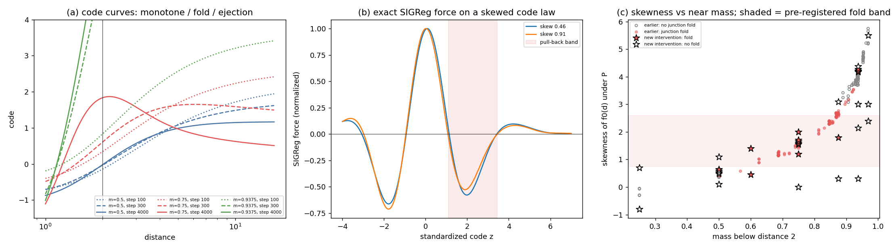

# Which occupancy feature causes the fold, and why InfoNCE does not fold

Updated November 21, 2026. All fits share one encoder class, source-131 alignment pairs, the original 4,000-update
schedule and a dense 20,001-point reload. Every fold count below is an empirical check, not an analytic guarantee.

A junction fold means a backward fraction above 0.1. That threshold matches a gap in the observed distribution:
- large folds have backward fraction 0.15–0.43 and turn at distance 1.8–4.8;
- tiny far-end turns have 0.003–0.10 and turn at distance 5–15.

The old 0.001 "material" threshold mixed these two phenomena.

## Findings

### 1. What SIGReg does to the code

The encoder is a scalar function of distance, because the sensor is deterministic. In one dimension, `SIGReg1D` is
exactly 1024 × MMD² between the code law and N(0,1), with a kernel equal to √(2π)·exp(−u²/2) to within 0.007.

For a positively skewed standardized code law, the exact per-sample force (panel b) has fixed zero crossings:
- the bulk is pushed outward;
- codes at 1.1 < z < 3.45 are pulled back toward the bulk;
- codes beyond 3.45 are weakly pushed out.

Replayed training (bit-exact with the saved dose checkpoints) shows three outcomes (panel a):

| Near mass m | What happens to the far branch |
| --- | --- |
| 0.5 | rises and flattens |
| 0.75 | rises to code about 2.6, then is pulled back over the near branch: the fold |
| 0.9375 | is thrown to code about 14, outside the kernel's reach, and stays monotone |

### 2. Why near mass looked like the cause

In the initialization's input geometry, the region from distance 1 to 2 occupies 0.04 of f0's range, against 0.18 for
distance 2 to 16. The near cluster is almost a single point there. A point mass m with everything else above it has
skewness of at least (2m−1)/√(m(1−m)), so near mass and code asymmetry were confounded in every earlier study.

### 3. Asymmetry is necessary

Asymmetry here means skewness γ of the initialization code f0(d) under P.

- Pre-registered tests that kept near mass fixed and removed asymmetry stopped the fold, at both initializations:
  - m = 0.75, γ = 0: no fold. Every earlier law at m = 0.75 had folded.
  - m = 0.875 and 0.9375, γ = 0.3: no fold.
- Across all 338 audited cells, 136 of 138 junction folds have γ > 0.45. The two exceptions are on the boundary:
  - γ = 0.42, backward 0.145;
  - γ = 0.45, which is the same law that does not fold at initialization 133.

### 4. Asymmetry is not sufficient

The pre-registered skewness rule scored 20 of 26 predicted cells correct. The six failures are kept as falsifications:

| Law (near mass, γ) | Initialization | Predicted | Observed |
| --- | --- | --- | --- |
| (0.5, 1.1) | 131 | fold | tiny turn only |
| (0.5, 1.1) | 133 | fold | no fold |
| (0.9375, 2.15) | 131 | fold | tiny turn only |
| (0.9375, 2.15) | 133 | fold | no fold |
| (0.96875, 2.4) | 131 | fold | tiny turn only |
| (0.25, 0.7) | 133 | fold | no fold |

The (0.5, 1.1), (0.9375, 2.15) and (0.96875, 2.4) laws reached their γ by piling the far mass at distance 2–3, leaving
almost no spread tail. The fold needs a far tail spread over distance.

The cluster-position test placed the near mass in one window at a time. It falsified the pre-registered wall
hypothesis: at m = 0.75 every window folds, including [1.75, 2). It also showed that position matters at the other
masses:

| Near mass | Window | Initialization 131 | Initialization 133 |
| ---: | --- | ---: | ---: |
| 0.9375 | wall, [1, 1.25) | fold, 0.41 | fold, 0.26 |
| 0.9375 | [1.5, 1.75) | fold, 0.15 | no fold, 0.07 |
| 0.9375 | junction, [1.75, 2) | no fold | no fold |
| 0.5 | wall, [1, 1.25) | no fold | no fold |
| 0.5 | junction, [1.75, 2) | fold, 0.22 | no fold, 0.09 |

Earlier, no law at m = 0.9375 had folded.

### 5. The distribution alone cannot decide every case

Three of the 31 new laws fold under one initialization and not the other:
- (0.6, γ 0.45): backward 0.40 vs 0.01;
- cluster (0.5, [1.75, 2)): 0.22 vs 0.09;
- cluster (0.9375, [1.5, 1.75)): 0.15 vs 0.07.

No feature of P alone can be exact near the boundary. The best scalar, near mass or γ with a two-sided window, has
24–26 errors in 338 cells. The best searched two-feature depth-3 tree has 8, and that search is overfitting-prone.

## Statement of the feature

The occupancy feature that causes the fold is its asymmetry in the encoder's input geometry: a heavy cluster that the
encoder cannot spread, next to a far tail of lighter mass spread over distance.

A marginal-shape target pulls the spread tail back toward the bulk. The smooth encoder can only do that by turning its
far branch back over the cluster, which is the fold.

- Without the asymmetry (γ ≤ 0.45), there is no fold, apart from two boundary cases.
- With it, there are two other outcomes. One is a monotone code when the tail is not spread. The other is ejection,
  when the tail lies beyond the kernel's reach; how far that ejection regime extends depends on how compact the cluster
  is.
- Near the boundaries, the initialization decides.

This is a necessary condition plus a mechanism, not a sufficient one-number threshold. The data above show that no
exact distribution-only threshold exists for this encoder.

## Why InfoNCE and the other objectives do not fold

Folding needs the asymmetric occupancy and an objective that imposes a target shape on the code marginal.

| Objective | Shape target on the code marginal? | Folds? |
| --- | --- | --- |
| SIGReg (0.9 alignment + 0.1 SIGReg) | yes, the whole Gaussian | yes, in the window |
| Even-only SIGReg (sine term removed) | yes, the even part of the Gaussian | yes, 4 of 5 laws, including native m = 0.9375 (0.34), where full SIGReg does not fold; this falsifies the pre-registered no-fold prediction |
| Variance control + 1×skew² | yes, zero skewness | yes, 4 of 5 laws |
| Variance control + 10×skew² | yes, zero skewness | yes, 3 of 5 laws; at native m = 0.75 only 0.037 (predicted fold) |
| Raw/own-code InfoNCE + skew², κ = 1 and 10 | yes, zero skewness | yes, at native m = 0.75 (0.29, 0.32) and 0.9375 (0.30, 0.31); not at the m = 0.5 laws |
| Raw/own-code InfoNCE alone | no | no turn in the 40 dose cells; on the new laws, no junction fold and one tiny turn (0.058 on (0.9375, 2.15)) |
| Temporal InfoNCE | no | none |
| Variance hinge alone | no | only tiny turns (2/40 above 0.001 earlier; here at most 0.066, below the 0.1 junction threshold) |

The plain objectives see the code marginal at most through its second moment:
- Raw/own-code InfoNCE scores codes only through a learned critic. Any strictly monotone reparametrization of the codes
  can be absorbed by the critic, so the loss sets no preferred marginal shape.
- Temporal InfoNCE divides code differences by the batch standard deviation.
- The variance control constrains only the variance.

So an asymmetric occupancy creates no tail-retracting force under these objectives. Adding only a skewness target makes
InfoNCE fold under the same occupancy (B4). The earlier attached/detached test showed that a strong InfoNCE gradient
also actively removes SIGReg folds (λ = 100).

Removing SIGReg's odd-moment term does not prevent folding: the even part also folds. The fold therefore comes from
matching a fixed marginal shape in general, not specifically from the skewness term.

## Files

[Protocol](../../SKEW_PROTOCOL.md) · [cluster protocol](../../CLUSTER_PROTOCOL.md) · [locked predictions](PREDICTIONS.json) ·
[cluster predictions](CLUSTER_PREDICTIONS.json) · [all cells](summary.json) · [code](../../skew.py) · [cluster code](../../cluster.py) ·
[report](../../skew_report.py) · [trace replay](../../trace.py) · [earlier-cell law reconstruction](../../feature_bank.py) ·
[function-space solver](../../function_space.py)
