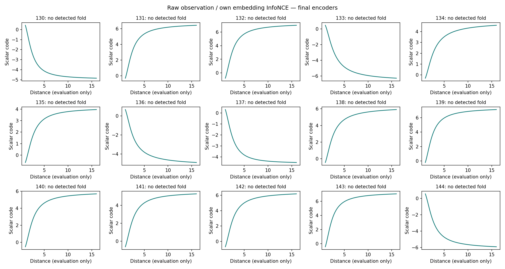

# Raw observation–own embedding InfoNCE results

Completed November 18, 2026. All 15 new fits use 4,000 updates from initialization.
Positive pairs are a raw observation and its own scalar code, with 255 other raw observations as negatives.
The learned quadratic critic, fixed raw standardization and candidate count are specified in [the protocol](../PROTOCOL.md).

| Sources | Objective | Folds | Material folds | Mean held-out MSE | Mean coverage MSE |
|---|---|---:|---:|---:|---:|
| Historical | Raw observation / own code | 0/10 | 0/10 | 0.001102 | 0.058873 |
| Historical | SIGReg | 5/10 | 5/10 | 0.210549 | 1.316871 |
| Historical | VICReg (scalar) | 0/10 | 0/10 | 0.004397 | 0.046030 |
| Historical | Temporal InfoNCE (distance) | 0/10 | 0/10 | 0.002071 | 0.054770 |
| Reused follow-up | Raw observation / own code | 0/5 | 0/5 | 0.001468 | 0.090494 |
| Reused follow-up | SIGReg | 2/5 | 2/5 | 0.135788 | 3.114902 |
| Reused follow-up | VICReg (scalar) | 1/5 | 0/5 | 0.004945 | 0.038740 |
| Reused follow-up | Temporal InfoNCE (distance) | 0/5 | 0/5 | 0.002560 | 0.119524 |

Minimum final raw/code encoder standard deviation: 1.525188.
Mean held-out raw/code InfoNCE: 4.256814; uniform candidate baseline log(256) = 5.545177.

MSE is next-observation prediction from a frozen scalar code and action, using a separately trained decoder and targets whitened on training data. Coverage MSE uses the original uniform-distance stress set, not another native held-out draw.
Comparisons are descriptive: the raw/code run changes the critic, pairing, candidate count, score units and computation. Historical baselines are reloaded from the earlier verified study; they are not rerun or overwritten. The follow-up sources were already available, so this is not fresh prospective validation.
A 20,001-point derivative check is empirical and can miss inter-grid folds. No injectivity theorem, hyperparameter robustness, generalization to other renderers, or late repair is established. Identical observations can be negatives, so candidate-index accuracy has an unavoidable ambiguity.

| Seed | Fold | Backward fraction | Std | Held-out MSE | Raw/code held-out loss |
|---|---:|---:|---:|---:|---:|
| 130 | 0 | 0 | 1.7282 | 0.000392 | 4.3978 |
| 131 | 0 | 0 | 2.1945 | 0.001364 | 4.0233 |
| 132 | 0 | 0 | 2.5475 | 0.001038 | 4.2037 |
| 133 | 0 | 0 | 2.2389 | 0.001834 | 4.1004 |
| 134 | 0 | 0 | 1.6080 | 0.000940 | 4.2348 |
| 135 | 0 | 0 | 1.5252 | 0.001171 | 4.3768 |
| 136 | 0 | 0 | 1.8087 | 0.000908 | 4.1824 |
| 137 | 0 | 0 | 1.5983 | 0.001000 | 4.4162 |
| 138 | 0 | 0 | 2.0765 | 0.000926 | 4.2383 |
| 139 | 0 | 0 | 2.3979 | 0.001446 | 4.1785 |
| 140 | 0 | 0 | 2.0362 | 0.001422 | 4.2290 |
| 141 | 0 | 0 | 1.9322 | 0.002562 | 4.2537 |
| 142 | 0 | 0 | 2.2662 | 0.000990 | 4.3317 |
| 143 | 0 | 0 | 2.4331 | 0.001216 | 4.2861 |
| 144 | 0 | 0 | 2.1399 | 0.001148 | 4.3995 |
