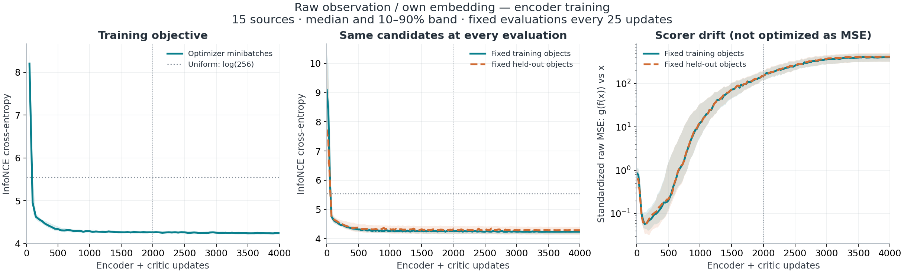
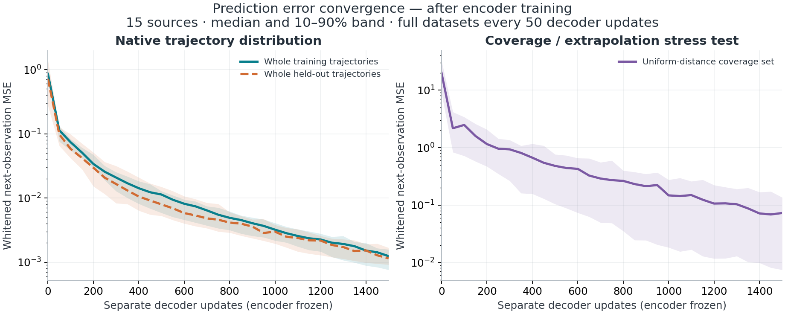
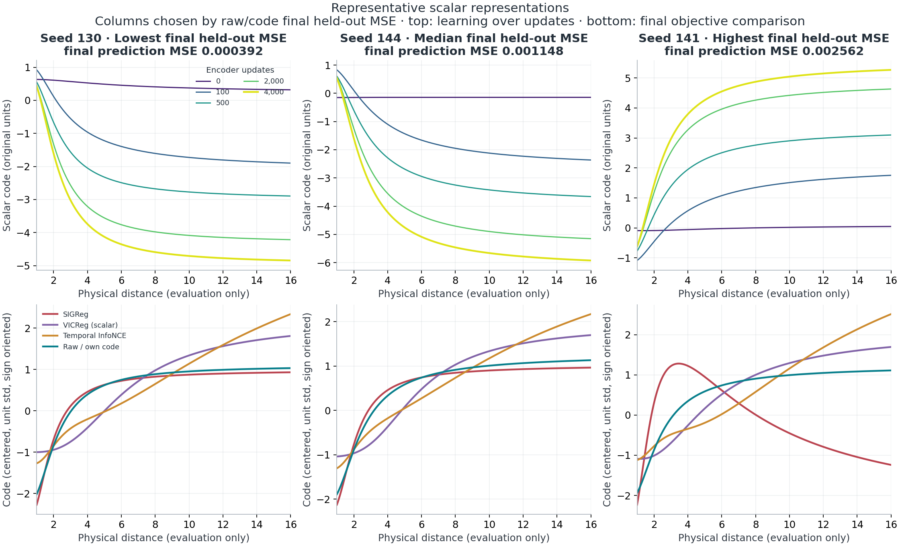
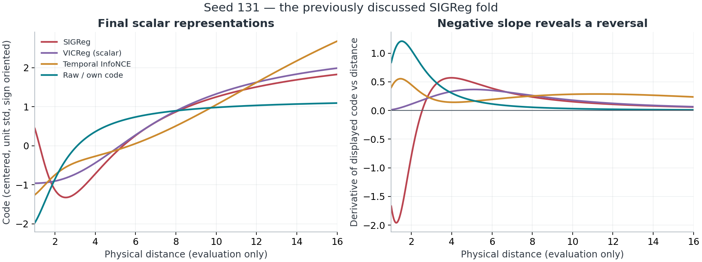

# Dense replay convergence measurements

All 15 final encoders, critics and downstream decoders reproduce the saved models bit-for-bit.
Shading in figures is the 10th–90th percentile across sources, not a confidence interval.
Encoder fixed-batch raw MSE measures the scorer output against the observation; decoder MSE measures next-observation prediction. These have different targets and units.
The scorer raw MSE initially falls and then rises strongly. The scorer is trained for contrastive classification, not calibrated reconstruction. In this renderer the observations occupy a one-dimensional affine line: a scorer component perpendicular to that line adds the same squared-distance constant to every candidate in a row and therefore cancels from the softmax.
At the final checkpoint, at least 99.927% of held-out scorer raw MSE is perpendicular to the observed line in every source. Removing that component changes candidate log probabilities by at most 1.02e-06 in the numerical audit. This identifies unpenalized scorer drift; raw MSE is not a reconstruction convergence claim.

## Encoder + critic updates

| Update | Median training InfoNCE | Median held-out InfoNCE | Median training raw MSE | Median held-out raw MSE |
|---|---:|---:|---:|---:|
| 0 | 9.09562 | 7.73589 | 0.862396 | 0.608343 |
| 25 | 8.40831 | 7.36454 | 0.786759 | 0.631731 |
| 100 | 4.67196 | 4.68119 | 0.0708245 | 0.0619799 |
| 250 | 4.46717 | 4.49153 | 0.0838478 | 0.0956044 |
| 500 | 4.3126 | 4.38123 | 0.201176 | 0.213244 |
| 1000 | 4.25925 | 4.3238 | 12.4515 | 13.1767 |
| 2000 | 4.25383 | 4.3155 | 151.154 | 152.131 |
| 4000 | 4.23545 | 4.28692 | 405.201 | 418.935 |

## Separate frozen-encoder decoder updates

| Update | Median training MSE | Median held-out MSE | Median coverage MSE |
|---|---:|---:|---:|
| 0 | 0.858334 | 0.717796 | 20.0283 |
| 50 | 0.113196 | 0.0978794 | 2.17272 |
| 100 | 0.0737273 | 0.0580653 | 2.48237 |
| 250 | 0.0256145 | 0.0207302 | 0.95857 |
| 500 | 0.0113056 | 0.00794086 | 0.481012 |
| 1000 | 0.00320616 | 0.00298187 | 0.147538 |
| 1500 | 0.00124276 | 0.0011479 | 0.0727922 |

Representative sources (lowest, median, highest final held-out error): [130, 144, 141].
Cross-objective curves are centered, scaled to unit standard deviation on the evaluation grid, and globally sign oriented for display. This does not remove folds. Training snapshots retain their original units.
The seed-131 comparison is an explicit earlier case study, not a randomly chosen example. Physical coordinates enter evaluation only. These plots are empirical; there is no injectivity guarantee.

