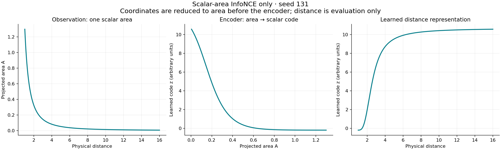
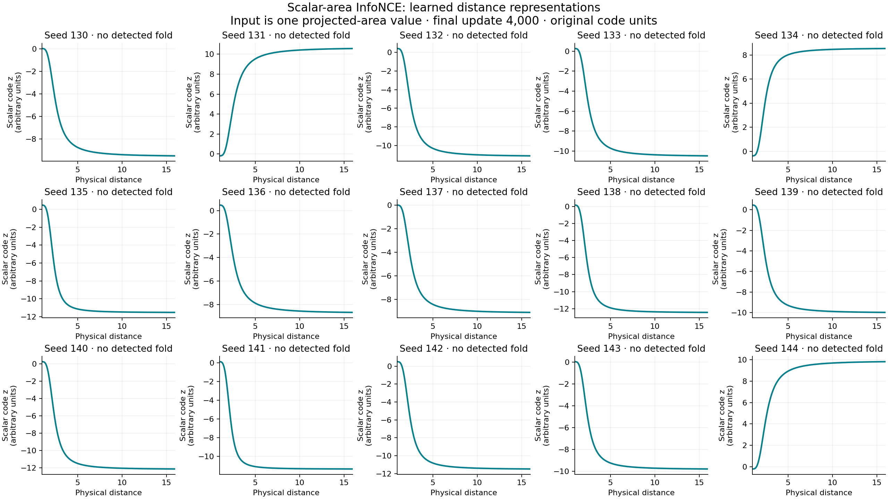
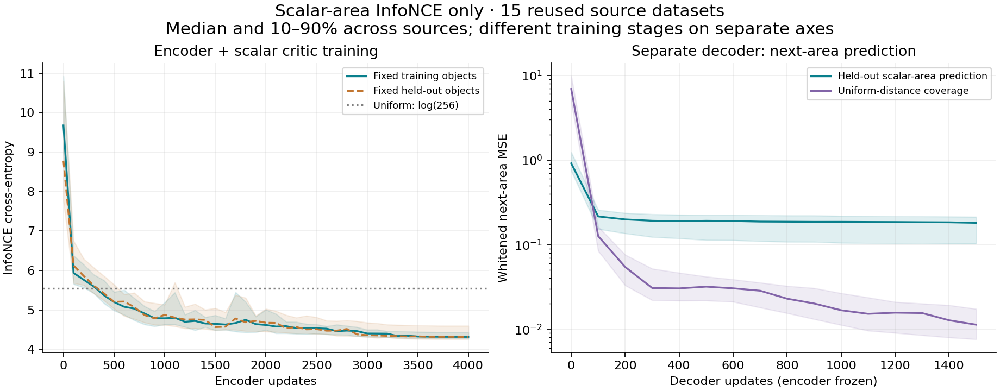

# Scalar projected-area InfoNCE results

Completed November 19, 2026. All 15 runs: 4,000 encoder/critic updates and 1,500 separate decoder updates.

Detected final folds: **0/15**. Minimum output standard deviation: 3.468461.
Mean held-out next-area MSE: 0.162994; uniform-distance coverage MSE: 0.012023.

These target scalar area whitened using training-successor statistics. They are not directly comparable with the earlier six-coordinate target MSEs.
The observation is area computed from projected vertices, not the coordinates themselves. Sources/actors are reused from coordinate-trained ICM; no scalar-observation actor retraining was performed.
Independent checkpoint reloads verify source/batch plans, scalar inputs, initialization/statistics, analytic inverse-square area geometry, finite-difference derivatives, InfoNCE and decoder errors.
The fixed-shape area is strictly monotone in distance, but the unconstrained learned encoder has no injectivity guarantee. Finite-grid no-fold checks do not certify the entire interval.

| Seed | Fold | Output std | Log-distance R² | Held-out InfoNCE | Held-out next-area MSE | Coverage MSE | Action-only held-out MSE |
|---|---:|---:|---:|---:|---:|---:|---:|
| 130 | 0 | 3.7006 | 0.8630 | 4.5720 | 0.186368 | 0.010122 | 0.546035 |
| 131 | 0 | 4.1739 | 0.8802 | 4.2926 | 0.101258 | 0.006924 | 1.273036 |
| 132 | 0 | 4.4857 | 0.8537 | 4.3569 | 0.122864 | 0.008669 | 0.699624 |
| 133 | 0 | 4.1748 | 0.8546 | 4.2783 | 0.132091 | 0.010393 | 1.262329 |
| 134 | 0 | 3.4685 | 0.8399 | 4.6541 | 0.216822 | 0.015228 | 0.548085 |
| 135 | 0 | 4.6580 | 0.7961 | 4.4338 | 0.207108 | 0.012236 | 0.612410 |
| 136 | 0 | 3.5476 | 0.8705 | 4.2279 | 0.064245 | 0.004184 | 0.884871 |
| 137 | 0 | 3.5276 | 0.8590 | 4.4465 | 0.193514 | 0.014577 | 0.577211 |
| 138 | 0 | 4.8853 | 0.8150 | 4.2419 | 0.197919 | 0.013938 | 0.851331 |
| 139 | 0 | 4.0624 | 0.8491 | 4.3080 | 0.129243 | 0.011325 | 0.811262 |
| 140 | 0 | 4.8115 | 0.8295 | 4.2903 | 0.168817 | 0.014760 | 0.910371 |
| 141 | 0 | 4.4225 | 0.7690 | 4.2892 | 0.188956 | 0.018862 | 0.783521 |
| 142 | 0 | 4.6625 | 0.8351 | 4.5993 | 0.249291 | 0.019491 | 0.589510 |
| 143 | 0 | 3.8150 | 0.8352 | 4.3163 | 0.105571 | 0.009119 | 0.780904 |
| 144 | 0 | 3.9062 | 0.8735 | 4.5918 | 0.180846 | 0.010522 | 0.498011 |

