# Gradients for fold repair, explained with concrete training graphs

[Open the graph gallery](output/index.html) · [All measured results](output/RESULTS.md) · [Protocol](PROTOCOL.md)

## Measured result

**All five existing folds were removed by the stronger order-based gradient**, including the control using only stored observations. Mean log-distance readout R² after that stored-observation repair is 0.9900, with no detected turns on the 10,001-point final grid. Output standard deviation stays above 0.875, so this is not a constant-code collapse.

| Continuing the five already folded models | Final folded runs |
| --- | ---: |
| Original loss | 5/5 |
| Switch to inverse-occupancy-weighted moments | 5/5 |
| Switch weights and reset Adam | 5/5 |
| Weights plus weak order penalty | 5/5 |
| Weights plus strong order penalty | 0/5 |
| Strong penalty using only stored observations | 0/5 |

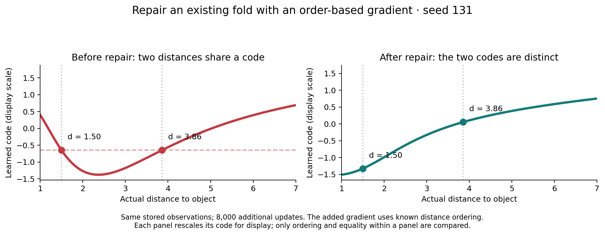

Prevention and repair differ. At the usual input gain 4, full inverse weights and capped inverse weights each prevent final folds in 10/10 runs; square-root weights leave 9/10 folded. At the harder input gain 8, original SIGReg folds in 9/10 and full occupancy correction in 7/10. The stronger order penalty leaves 4/10 with tiny residual turns: mean backward travel is 0.00424%, versus 6.26296% for occupancy correction alone. These residual turns still count as failures under the strict fold diagnostic. Thus the new repair succeeds on the five established gain-4 folds but is not a universal no-fold guarantee.

## What “inverse-occupancy-weighted moments” means

It means **give crowded distance ranges less weight when measuring the distribution of learned codes**.

Imagine collecting 900 observations from one distance range and 100 from another. An ordinary average gives the crowded range 90% of the averaging weight and the rare range 10%. Give each crowded observation weight 1/900 and each rare observation weight 1/100 instead. Each range now has total weight 1; after normalization, each contributes half of the average. No observations are deleted.

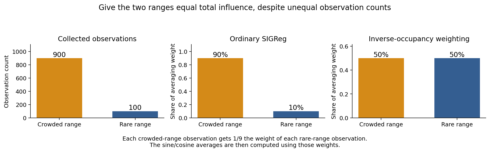

SIGReg does not use only the familiar mean and variance. It summarizes the distribution by averaging **cos(t × code)** and **sin(t × code)** at several frequencies t. These averages are the “moments” in that phrase. For a standard Gaussian, their desired values are exp(−t²/2) and zero. We replace the ordinary sine/cosine averages by the weighted averages above, then differentiate that corrected Gaussian-matching loss normally.

For a sample i in a bin containing nᵢ observations, the cosine average is

    C(t) = Σᵢ [cos(t hᵢ) / nᵢ] / Σᵢ [1 / nᵢ].

The sine average has the same form. This changes the summary statistics **before** computing gradients. Dividing the old gradients by occupancy leaves the summary statistics uncorrected; that is a different update and performed poorly in the preceding experiments. Equal total averaging weights do not imply equal gradient magnitudes, which also depend on the outputs and the current distribution mismatch.

In these experiments, “equally weighted ranges” means 32 equal **log-distance** bins. It does not mean uniform physical distance. Counts pool both endpoints of stored ICM transitions, are computed from the full stored dataset, and never change with the encoder. Empty bins cannot be filled by reweighting. This uses the known one-dimensional sensor geometry, not a learned density estimator for arbitrary images.

## Make the fold concrete

The original seed-131 model gives distance 1.50 and distance approximately 3.86 the same code. A downstream model that sees only that code cannot tell those observations apart. The corrected model keeps the codes distinct.

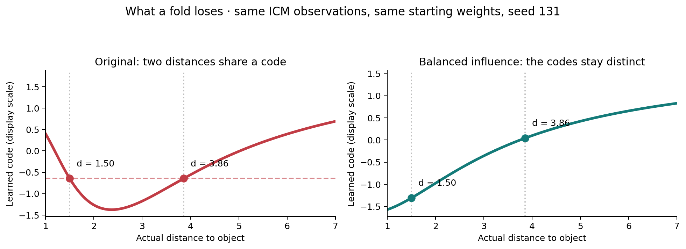

The corresponding four-frame sequence uses one fixed display transformation throughout, so the turn's movement cannot be explained by rescaling the plot:

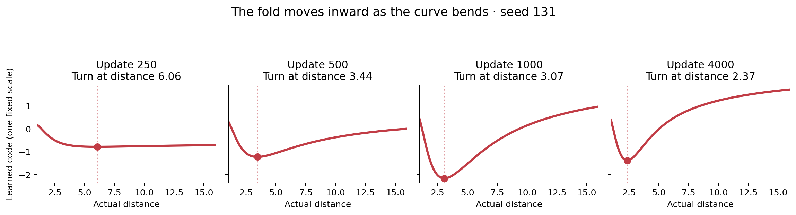

## Which gradient changes were tested

The follow-up adds 102 representation-training runs, plus three extended joint actor/ICM runs and three frozen-target forward-model fits. It reuses the original ten ICM sources (130–139), rather than presenting them as new independent validation data.

From scratch at input gain 4, test inverse square-root occupancy weights, full inverse weights capped at 20 times their dataset mean, full inverse weighting plus an explicit order penalty, and ordinary SIGReg plus that order penalty. The original ordinary and full inverse-weighted models remain controls; seed 131 is retrained with recorded losses and must reproduce its prior weights exactly.

At the harder input gain 8, compare original models with full inverse-weighted moments, a weak order penalty, and a stronger order penalty. Doubling the gain changes the fixed tanh input transform and increases saturation; this is a known stress condition, not a newly discovered policy effect.

For **late repair**, start all cells from each of the five already folded gain-4 ordinary models: seeds 131, 132, 133, 136 and 139. Continue for another 8,000 updates at rate 0.0001 with matched draws. Compare ordinary continuation, corrected moments with Adam retained, corrected moments with Adam reset, and corrected moments with weak or strong order penalties. Reinitializing the model is not counted as repairing it.

The weak order penalty discourages negative oriented code slopes on 65 log-distance probes, at coefficient 1. Its orientation is fixed from the starting curve. The stronger follow-up allows either output orientation, adds a positive slope margin 0.1, and uses coefficient 100. It was specified after the first hard-case failures; all ten hard seeds and all five repair starts are retained. It is an exploratory combined intervention, not an ablation of strength, orientation choice and margin.

**The order penalties add knowledge that physical distances should remain ordered.** They are not an occupancy-only correction or evidence that SIGReg alone identifies physical distance. Their parameter gradients can change the network outside the probe points, and a finite soft penalty is not a monotonicity guarantee. Final fold detection uses 10,001 points, including for the original comparison models; all observed turns count, including very small ones.

The first order-penalty tests use renderer-generated probes at 65 uniform log-distances, adding observations as well as an ordering prior. A final five-run late-repair control selects the closest **stored** endpoints to those same probe locations instead, drops duplicate selections, and uses their actual log-distance gaps. That control adds no observations; the ordering prior remains. All five initially folded models are included, not only successful earlier examples.

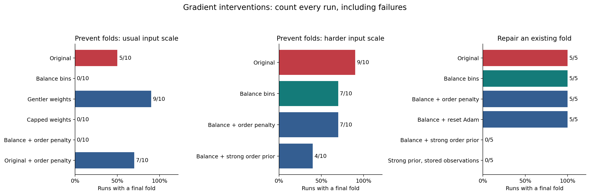

The training graphs report both turns and a measure of backtracking: add up how much the curve travels upward and downward, then divide the smaller amount by total travel. A monotone curve scores 0%, regardless of its arbitrary output sign. This measures fold severity; it does not replace the stricter turn count. Readout R² and output standard deviation are also retained, so a collapsed constant code cannot qualify as a successful representation.

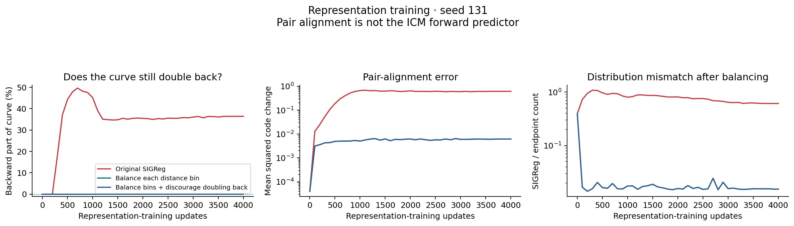

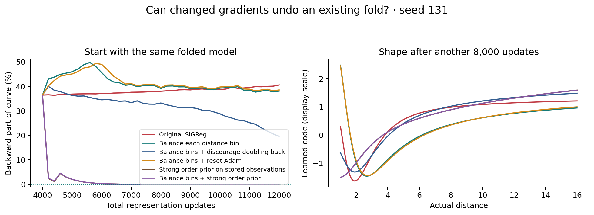

The representation experiment has pair alignment and SIGReg. It has **no learned action-conditioned forward predictor**. Its alignment loss measures how different the two encoded endpoints are. The predictor error below belongs to the separate ICM module that trained the actor before these representation experiments.

## Does ICM predictor error go to zero?

**It does not approach zero in the observed joint-training runs.** All ten original training curves are plotted, and the three diagnostic runs continue to 1,800 actor/ICM updates, three times the original budget. Training-batch error and held-out error are shown separately. The original update-600 actor and ICM weights reproduce exactly in all three extensions, with optimizers continuing intact.

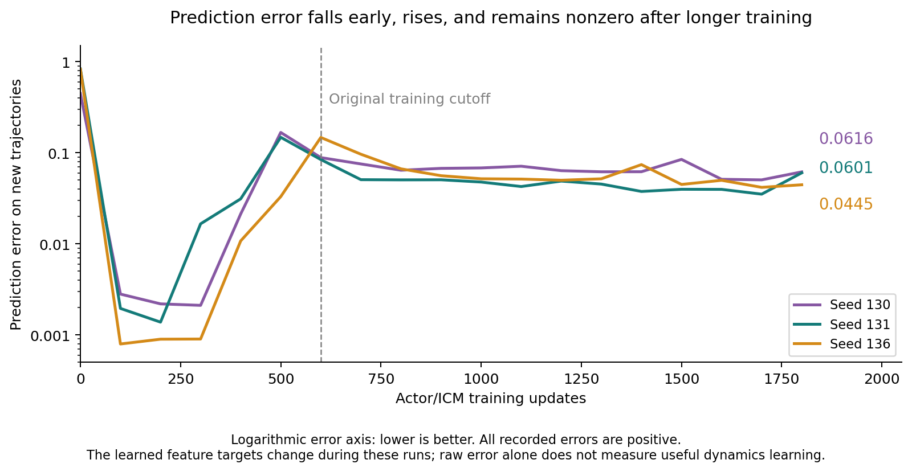

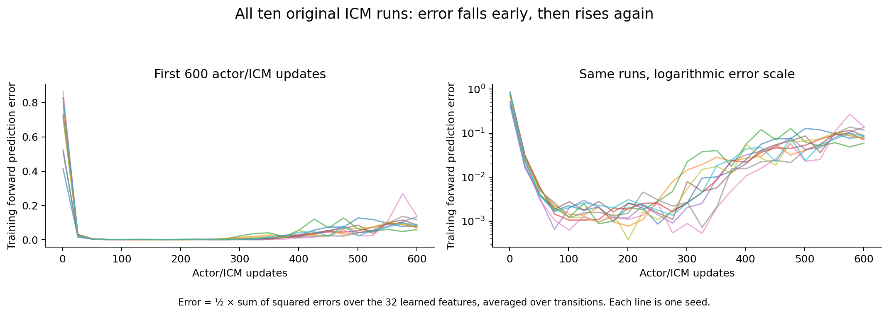

At update 1,800, held-out on-policy forward errors are approximately 0.0616, 0.0601 and 0.0445 for seeds 130, 131 and 136. These units are **half the sum of squared errors across 32 learned features**, averaged over transitions. They are not physical-distance errors or per-coordinate MSEs. The raw error falls early, rises, then fluctuates; the finite observations establish nonzero measured residuals, not an asymptotic lower bound.

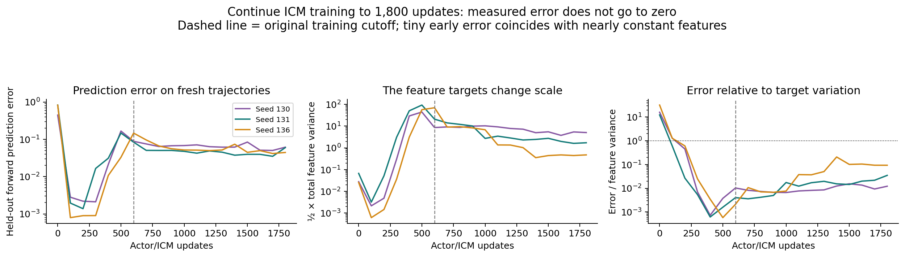

Why can the early error look almost solved? At update 100, the half-total feature variances are only about 0.00216, 0.00321 and 0.00062. Corresponding held-out errors are 0.00280, 0.00195 and 0.00079: approximately 1.30, 0.61 and 1.28 times the feature variance. Two predictors are worse than the evaluation set's constant mean-feature reference despite their tiny raw error. The features barely vary at that point, so a small prediction error is not enough to show useful dynamics learning.

By update 600, feature variance is much larger (roughly 8.62, 20.95 and 70.01); errors of 0.0884, 0.0841 and 0.1471 are a much smaller fraction of that variation. Thus raw prediction error, feature scale and relative accuracy tell different stories. The actor and feature encoder keep learning, so the predictor's input distribution and target function are moving. The relative-error graph uses half-total target variance as a diagnostic constant-mean reference; it is not an independently fitted predictive model.

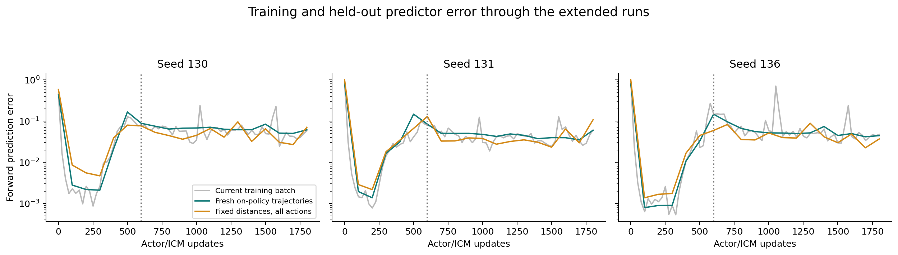

The fixed-distance/all-action probe further separates changing behavior coverage from error on the same physical inputs. Its feature targets still change because the ICM encoder is trained. Held-out trajectories use fixed diagnostic seeds that are disjoint from training; they are matched across checkpoints, not independent of one another across time. Diagnostic collection preserves the trainer's RNG state.

## Freeze the targets and fit only the predictor

Starting from each original update-600 ICM, freeze the feature encoder and actor. Train only the forward model for another 6,000 batches on stored transitions, and evaluate separate trajectories from the same frozen actor. Held-out error changes as follows:

| Seed | Before fitting | After 6,000 updates |
| ---: | ---: | ---: |
| 130 | 0.079599 | 0.027789 |
| 131 | 0.087716 | 0.002423 |
| 136 | 0.136379 | 0.003318 |

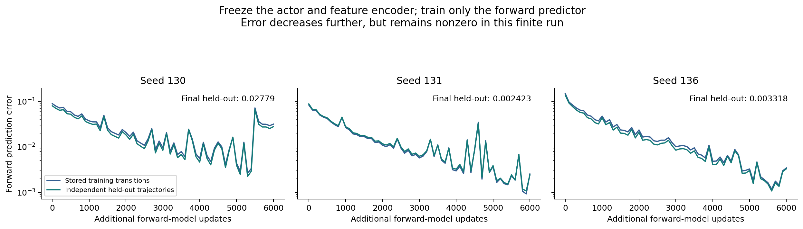

The predictor can fit these fixed targets further, especially in seeds 131 and 136, but measured error is still nonzero. This intervention removes both policy changes and feature-target changes and adds fitting steps with a new optimizer; it does not uniquely isolate which of those factors caused the joint-training residual. It does not prove that a longer or differently optimized fixed-target fit cannot approach zero.

## Reproduce and inspect

From the workspace root:

```sh
OPENBLAS_NUM_THREADS=1 python3 explanations/occupancy-folding/gradient-followup/train_gradients.py
OPENBLAS_NUM_THREADS=1 python3 explanations/occupancy-folding/gradient-followup/train_gradients.py --strong-only
OPENBLAS_NUM_THREADS=1 python3 explanations/occupancy-folding/gradient-followup/train_gradients.py --stored-only
OPENBLAS_NUM_THREADS=1 python3 explanations/occupancy-folding/gradient-followup/predictor_training.py
OPENBLAS_NUM_THREADS=1 python3 explanations/occupancy-folding/gradient-followup/report_followup.py
```

Completed run files are reused. The gradient trainer supports independent `--shard N --shards K` processes. The report recomputes final curves, slopes and 10,001-point roots from saved weights, checks the same late-repair starts, verifies a nonzero order-penalty gradient by finite differences, recomputes saved held-out predictor measurements, and checks that frozen features did not change. Checkpoints, numerical metrics, source hashes, PNG/PDF figures and the offline HTML gallery are retained in `output/`.
