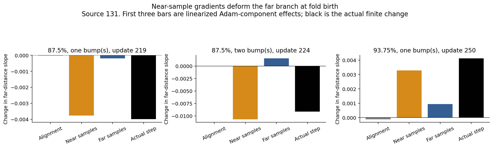
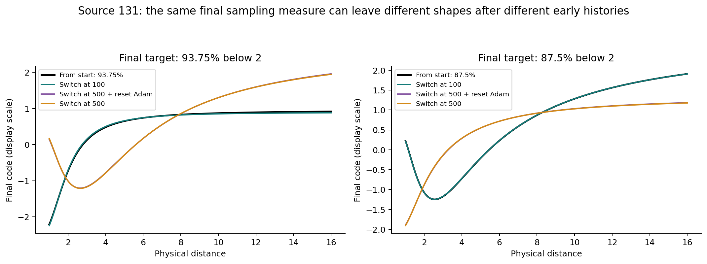
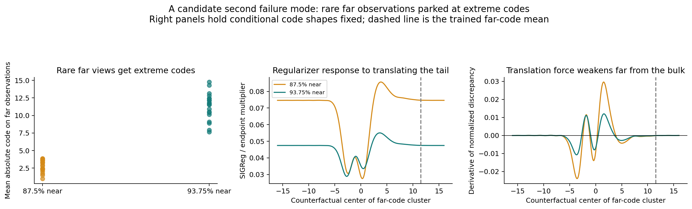
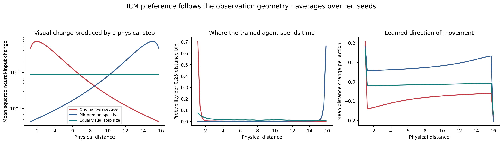
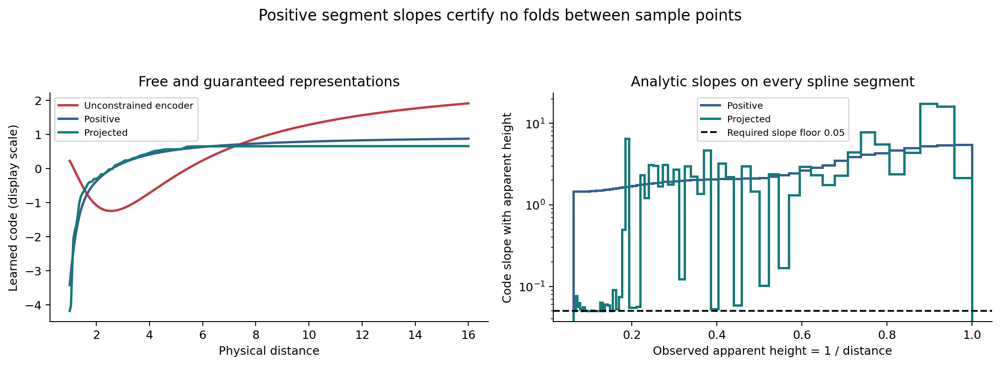
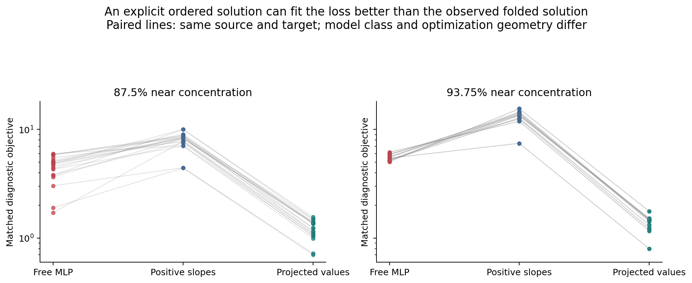

# A working mechanism and a mathematical no-fold guarantee

[Graph gallery](output/index.html) · [Measured tables](output/RESULTS.md) · [Protocol and sequential diagnostics](PROTOCOL.md) · [Verification](output/verification.json)

The best supported working hypothesis is **early branch selection under competing global distribution forces**, with rare-tail escape as a candidate contributing mechanism. The reduction in folds at 93.75% does not show that its loss enforces ordering or that its representations are better. A hard no-fold guarantee is available in this one-dimensional simulator by using the known ordering of apparent size; it requires more than reweighting SIGReg gradients.

## 1. Why can 87.5% fold while 93.75% stays ordered?

SIGReg's forces depend on its global sine/cosine errors, not just the number of visits to one region. Increasing near mass changes those errors, all sample forces, the learned weights, and Adam history. Near observations can consequently change a far-distance slope through shared parameters. The same observations can supply a restoring force later along a different trajectory.

We reproduced four source-131 histories exactly: one/two far bumps, each at 87.5% or 93.75% near mass. For the 87.5% one-bump run, the far-end slope crosses zero at update **219**; for two bumps it crosses at **224**. The 93.75% runs have no observed endpoint-slope reversal during the full 4,000 updates.

At update 219, the actual far-slope change is approximately −0.00399. The linearized contributions from the actual Adam moments are:

| Component | Contribution to far-slope change |
| --- | ---: |
| Alignment | −0.0000146 |
| SIGReg observations below distance 2 | **−0.003773** |
| SIGReg far observations | −0.000194 |

The near-observation component supplies most of the change creating the reversal. At update 224 in the two-bump case, near observations push by −0.010663 while far observations oppose with +0.001548. By contrast, on the 93.75% trajectory at update 250, the near component is **restoring**, +0.003284, and the far component adds +0.000938; the actual far slope increases from about 0.07884 to 0.08297.



These comparisons use each run's own learned weights at the stated times; they are not a same-weight intervention isolating concentration alone. They support the proposed dynamical mechanism in this diagnostic source rather than deriving the ten-seed fold rates from first principles. The first moment is split into alignment/near/far contributions with the actual shared Adam denominator. Linearized effects need not sum to the exact finite function change. Float32 reduction/EMA roundoff is reconciled into the far component and recorded; the real optimizer updates are untouched. Final encoder weights reproduce exactly. Scaled finite component probes limit the maximum coordinate change to 0.0001 because individual opposing contributions can be much larger than their sum.

### Changing the final measure does not erase the history

For source 131 and one far bump, keep the original total budget and switch only the target concentration:

| Switch | At update 100 | At update 500 | At 500, also reset Adam |
| --- | --- | --- | --- |
| 87.5% → 93.75% | Ordered | Folded | Folded |
| 93.75% → 87.5% | Folded | Ordered | Ordered |



Thus the same final sampling measure can produce either shape. Early switching follows the new measure in this example; late switching largely preserves the already learned branch. Resetting Adam leaves that result unchanged, so persistence is not solely inherited optimizer moments. The test establishes finite-budget path dependence, not a proof of permanent trapping or asymptotic local minima. The cosine learning rate still reaches zero at update 4,000.

The loss does not universally favor the ordered branch. At final target 93.75%, the folded late-switch MLP has fixed-batch diagnostic objective **4.845**, lower than the from-start ordered MLP's **6.182**. At final target 87.5%, the late-switch ordered MLP has objective **7.925**, higher than the from-start folded MLP's **4.308**. Both population and fixed-batch comparisons show the same ordering. Thus one cannot call the native MLP folds unnecessary merely by observing an ordered MLP on another history. The guaranteed spline below supplies a lower-loss ordered witness in a different model class.

### Candidate contributing mechanism: sacrificing the rare far tail

In all twenty free-encoder cases at 93.75% concentration, far observations have codes outside [-3,3]. Their mean absolute code is **11.32**, compared with **2.79** at 87.5%. This is not good Gaussian calibration. Fewer folds can coexist with extreme codes and poor use of the rare part of the state space.



SIGReg is a squared discrepancy of characteristic-function averages. Write a near/far mixture as a P_near + b P_far, with b=1−a. Its expanded discrepancy includes a far–far self-interaction proportional to **b²**. Halving far mass from 12.5% to 6.25% reduces that term's coefficient fourfold, if conditional output shapes are held fixed.

In the ideal continuous-frequency Gaussian-weighted version, this is a Gaussian-kernel discrepancy: interactions with a distant cluster decay with separation. For a narrow remote cluster, translating the whole cluster does not change its self-interaction; only its interactions with the near distribution and Gaussian target pull its center. The actual finite-frequency implementation can also have small oscillatory forces. The new output-space diagnostic holds trained conditional code shapes fixed and translates the far cluster. At its source-131 trained center near **11.53**, the implemented normalized discrepancy has a weak outward derivative of about **−0.000046** at near mass 93.75%; there is no strong inward correction at that location. The far self-dispersion derivative scales exactly fourfold between the two mixture masses, as the expansion predicts.

This suggests a plausible route: with less far mass, the optimizer can leave rare far views at extreme, weakly corrected codes, instead of bending that branch back through the represented range. At the larger far mass the pressure to handle that tail is stronger, and the finite shared MLP may enter the folded branch. This is a **candidate contribution**, not a proven sole cause: some 93.75% models still fold, and the translation experiment is an output-distribution diagnostic rather than a realizable smooth encoder update. A direct next test would add explicit moment/tail control and ask whether the concentration contrast changes; that intervention has not been trained here. Such control would still not guarantee ordering.

There is no special mathematical threshold at 87.5%. At fixed weights, characteristic-function averages are linear in the mixture mass and their squared-loss gradients are quadratic. Along training, the weights change too. Neither the scalar concentration nor the abstract count of peaks is sufficient to predict the entire trajectory.

## 2. Why does ICM prefer the near-object region?

Distance 2 is our reporting cutoff. Across the original ten actors, the typical median distance is approximately **1.19**, close to the reflecting boundary at 1. The mean distance is 1.70. The agent keeps moving with inward-biased actions; it is not stationary at distance 2.

The visual signal is x(d)=V/d and the networks receive z(d)=tanh(4V/d). For one coordinate with k=4V_i,

    |dz_i/dd| = |k| d⁻² sech²(k/d).

Without saturation, the squared response to a small fixed physical step scales like d⁻⁴. Saturation reduces the closest-view sensitivity. For one nonzero coordinate, the maximum of the differential response satisfies u tanh(u)=1 for u=|k|/d. The combined six-coordinate **finite-step** response in this renderer peaks near **distance 1.95**. That gives a concrete scale for a near-side visual-learning bias; it is not a theorem that curiosity reward must peak at exactly the same distance.

ICM rewards learned feature prediction error, not raw visual motion or coverage. Large motion can be perfectly predictable. In this finite model, however, inverse-action learning, changing feature targets and imperfect forward fitting can convert the geometry into persistent near-side prediction-error rewards. Earlier update audits show those objectives can conflict. This is a model-learning explanation, not irreducible environmental noise.

### Sensor interventions

Train the same actor/ICM setup for 600 updates in ten seeds with either mirrored perspective or equalized visual step size. The mirror sensor is original_sensor(17−d). Equalization linearly interpolates the original two endpoint vectors at the actual post-tanh neural input; it preserves their endpoint values and makes interior visual displacement constant per physical step.

| Sensor | Mean physical distance | Fraction below 2 | Fraction above 15 |
| --- | ---: | ---: | ---: |
| Original perspective | 1.70 | 88.35% | 0.02% |
| Mirrored perspective | **15.05** | 0.02% | **84.88%** |
| Equalized visual step size | **6.70** | **21.27%** | 3.82% |



The preferred side follows the observation geometry. Equalization greatly weakens the inward preference but does not remove it; uniform physical occupancy would place only 6.67% below 2. These controls support geometry as a contributor, rather than a universal ICM target at distance 2.

The equalized sensor also changes observation-curve curvature, prediction difficulty and reward scale. Its mean final training reward is 0.00646 versus 0.01859 natively. Therefore this test does not uniquely attribute the reduction to spatial amplitude rather than easier prediction or weaker reward relative to entropy. Reflection dynamics, feature learning and policy history may explain the residual preference. The mirrored control, whose reward scale is similar to native, independently shows that the preferred side is not built into the physical distance label.

All distance measurements use the simulator's true physical labels from z. Inverse apparent height would be invalid for the altered sensors. Diagnostics preserve training RNG state; the source-131 native reproduction is exact. These new actor controls concern ICM's own feature encoder and policy, separate from the later scalar SIGReg encoder that folds.

## 3. A mathematical guarantee against folding

### Required assumption

In this toy world, one observed landmark height is **s(d)=1/d**, so s is a known strictly ordered sufficient coordinate. The guarantee explicitly uses that physics. It does not discover semantic distance ordering from arbitrary images. No new training observations or supervised distance targets are introduced, but the encoder class and ordering prior change.

### Positive-derivative construction

Define

    H_theta(s) = b + integral_(s0)^s [m + softplus(g_theta(u))] du,    m > 0.

Then H′(s)>=m for every finite parameter setting. Gradient training can change theta arbitrarily without leaving the ordered class. This positive-integrand approach is established in [Unconstrained Monotonic Neural Networks, Wehenkel and Louppe, NeurIPS 2019](https://proceedings.neurips.cc/paper/2019/hash/2a084e55c87b1ebcdaad1f62fdbbac8e-Abstract.html). Our implementation uses a piecewise-constant positive integrand, so its integral is exactly piecewise linear and needs no approximate quadrature.

For d₂>d₁>0,

    H(1/d₁) − H(1/d₂)
      >= m (1/d₁ − 1/d₂)
       = m (d₂−d₁)/(d₁ d₂) > 0.

Thus h(d)=H(1/d) is strictly decreasing and injective. This proof covers every intermediate distance, not just tested points. At knots the derivative can have a jump, but the integrated inequality still holds. Extending with the same positive end slopes preserves order outside the knot interval too. The code's overall sign can be reversed globally without affecting this guarantee.

### Projected-gradient construction

Let z_j be code values at increasing apparent-height knots s_j. Require

    z_(j+1) − z_j >= m (s_(j+1) − s_j).

After any finite unconstrained Adam proposal z_tilde, set

    z_new = m*s + Projection_Isotonic(z_tilde − m*s),

where the isotonic cone consists of nondecreasing vectors. Pool-adjacent-violators computes the Euclidean projection. The shifted values are nondecreasing, so every interpolated segment has slope at least m. This guarantees no folds after every projected update, regardless of the proposed gradients, learning rate or occupancy. It guarantees feasibility, not convergence of the nonconvex training loss.

This is fundamentally different from checking a neural network at 65 points: **the represented function is defined to be linear between those points**. A general MLP could wiggle between ordered probes; this spline cannot.



### What was verified experimentally

Two methods × ten sources × five native/concentration/tail conditions = **100 trained fits**. Every fit has no detected turn and a positive analytic slope certificate over all spline intervals. The m=0.05 margin was checked after each of 4,000 updates. Final values, slopes, physical-distance derivatives and diagnostic losses were independently recomputed. Projection was additionally tested against the isotonic KKT conditions on 100 random vectors.

Both methods guarantee order, but they do not fit equally well. With 87.5% concentration:

| Method | Folded models | Mean fixed-batch objective |
| --- | ---: | ---: |
| Original free MLP | 20/20 | 4.501 |
| Positive-slope parameterization | 0/20 | 7.973 |
| Projected knot values | **0/20** | **1.217** |

The projected fit has lower fixed-batch and population losses than its paired free model in all twenty 87.5% cases and all twenty 93.75% cases. This is an explicit ordered witness in a different model class, not a proof that the original fixed-width MLP has an accessible lower-loss ordered minimum. The positive-slope fit's worse optimization shows that an order guarantee alone is not a guarantee of fitting the data well.



No-fold does not imply an affine log-distance code: the projected models have mean affine readout R² around 0.58 at 87.5%. They retain ordering and information while allowing substantial nonlinear warping to fit the chosen output distribution. The guarantee also does not fix ICM coverage, force its predictor error to zero, or prove physical identifiability outside the known one-dimensional sensor relation.

### If the original MLP must be retained

A soft penalty on negative derivatives is not a guarantee. A sufficient certified-grid condition would require a proven bound |h″(q)|<=L on the whole interval, grid spacing at most delta, and a single orientation sigma with

    sigma h′(q_i) >= m + L*delta/2

at every grid point, including endpoints. Every q is within delta/2 of a probe, so the derivative bound gives sigma h′(q)>=m>0 everywhere. A training step could be accepted only after certifying this condition or an equivalent interval bound. Linearized gradient projections alone do not certify a finite nonlinear step. Obtaining useful bounds and a feasible starting network can be difficult; the positive spline is the simpler implemented guarantee here.

## Evidence, limitations and reproduction

The new work comprises 100 guaranteed fits, 20 actor-geometry controls, one native actor reproduction, four exact encoder reproductions with optimizer attribution, six distribution switches, and output-space diagnostics. The switch and force audit use one diagnostic source; the guarantees are analytic conditional on the sensor/order assumption, while the hypotheses remain empirical and testable.

Gradient components can oppose and nearly cancel. Their absolute float32 reduction errors are recorded, and relative errors are below 10⁻⁵. Moment sums are reconciled to the actual stored first moment in double precision. Parameter steps reconstruct to below 10⁻⁶ and original final weights reproduce exactly. Finite component probes use a shared small fraction, explicitly stored, rather than treating large opposing directions as independently trained steps.

The predictor/actor remain separate from the posthoc scalar representation. “Below 2” refers to physical distance, “87.5%” to the target measure supplied to SIGReg, and both must be kept separate from the actual Gaussianity of learned codes. Counts are descriptive for historical sources and finite budgets; no new confirmatory significance claim is made.

```sh
OPENBLAS_NUM_THREADS=1 python3 explanations/occupancy-folding/hypothesis-guarantee/guaranteed_models.py --audit-only
OPENBLAS_NUM_THREADS=1 python3 explanations/occupancy-folding/hypothesis-guarantee/guaranteed_models.py
OPENBLAS_NUM_THREADS=1 python3 explanations/occupancy-folding/hypothesis-guarantee/actor_geometry.py --audit-only
OPENBLAS_NUM_THREADS=1 python3 explanations/occupancy-folding/hypothesis-guarantee/actor_geometry.py
OPENBLAS_NUM_THREADS=1 python3 explanations/occupancy-folding/hypothesis-guarantee/encoder_paths.py
OPENBLAS_NUM_THREADS=1 python3 explanations/occupancy-folding/hypothesis-guarantee/encoder_paths.py --switches
OPENBLAS_NUM_THREADS=1 python3 explanations/occupancy-folding/hypothesis-guarantee/encoder_paths.py --switches --reset
OPENBLAS_NUM_THREADS=1 python3 explanations/occupancy-folding/hypothesis-guarantee/tail_codes.py
OPENBLAS_NUM_THREADS=1 python3 explanations/occupancy-folding/hypothesis-guarantee/report.py
```

Completed fit files are reused. All data remain local; checkpoints, source hashes, analytic certificates, numerical summaries and PNG/PDF figures are retained in `output/`.
