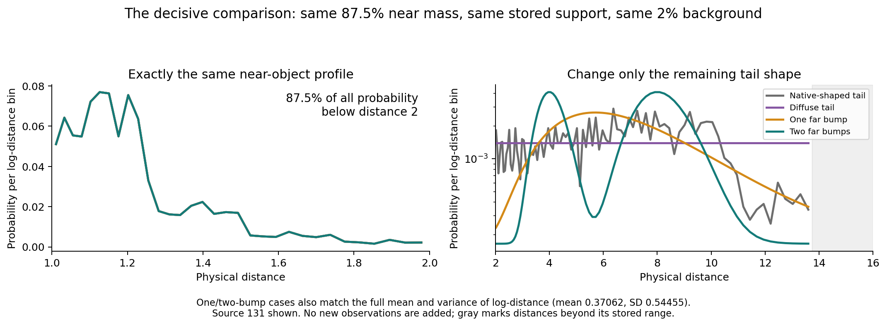
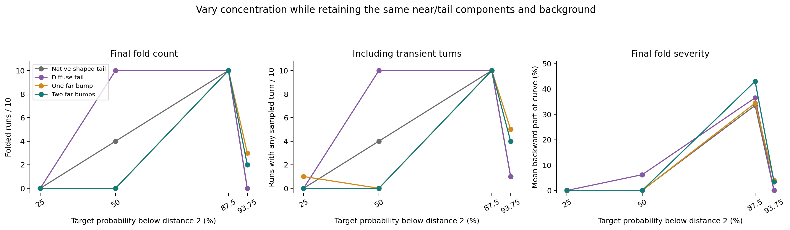
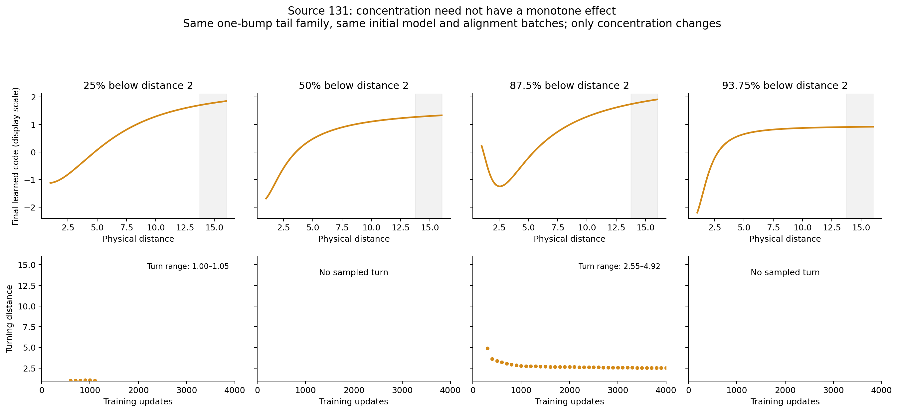
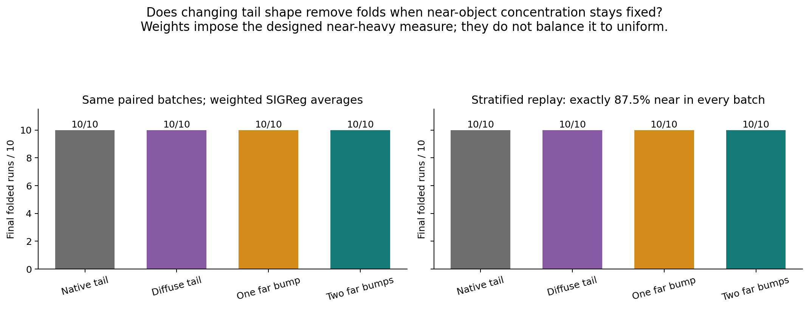
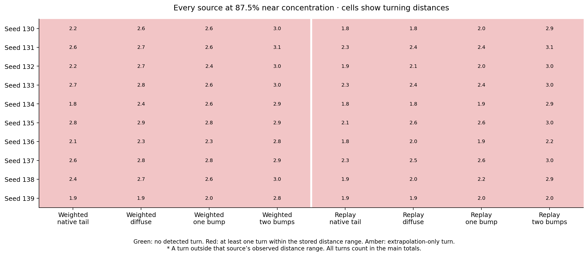
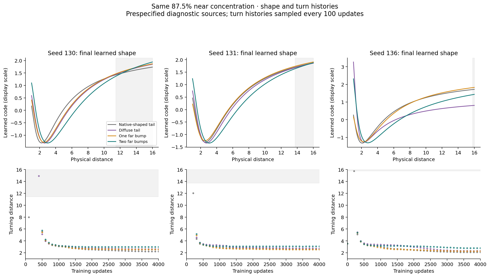
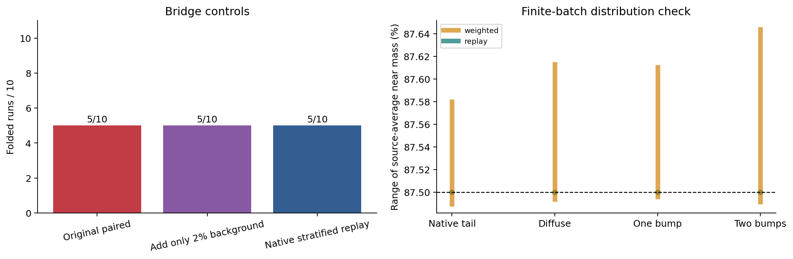
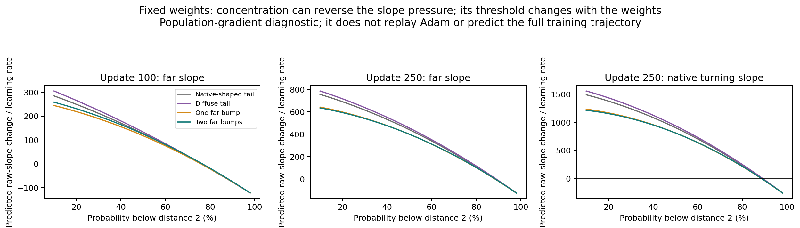

# Does extreme near-object occupancy explain folding?

[Graph gallery](output/index.html) · [All result tables](output/RESULTS.md) · [Machine-readable results](output/summary.json) · [Original protocol](INITIAL_PROTOCOL.md) · [Protocol with sequential mechanism audit](PROTOCOL.md)

This comparison removes the key confound in the earlier synthetic bimodal/trimodal tests. Those distributions placed only 25% and 17.5% of their probability below distance 2, whereas native ICM averaged 88.5%. Here the decisive concentration is **87.5% below 2**, with exactly matched near profiles, the same stored-point support, and the same background.

## Measured findings

**With concentration matched at 87.5%, both the one-far-bump and two-far-bump conditions fold in 10/10 sources.** This holds both for weighted SIGReg averages and for stratified replay with exactly 87.5% near observations in every batch. All of these final turns are within the stored distance range. The native-shaped and diffuse tails also fold in 10/10 under both estimators. Thus secondary peaks do not prevent folding when this near-heavy measure is retained, and far peaks are not required for the failure.

The one/two-bump concentration sweep, using the same components and primary estimator:

| Target probability below distance 2 | One far bump | Two far bumps |
| ---: | ---: | ---: |
| 25% | 0/10 folded | 0/10 folded |
| 50% | 0/10 folded | 0/10 folded |
| 87.5% | 10/10 folded | 10/10 folded |
| 93.75% | 3/10 folded | 2/10 folded |

This rejects a monotone “more near-object concentration always means more folding” account at the tested training budget. The regularizer measure has a causal effect in the matched protocol, but its effect depends on the complete distribution and optimization path. The tests do not establish a universal concentration threshold or a convergence theorem.

At 87.5%, every one/two comparison has one detected in-range turn in each model. Splitting the far bump moves the final turn outward by a median factor **1.159** with weighted averages and **1.258** with replay. It also reduces mean affine log-distance readout R² (weighted: 0.4950 to 0.2050; replay: 0.5927 to 0.1514). Adding a peak changes the fold's position and representation quality here, rather than adding a separate fold for each peak.

The original native, background-only, and native-replay controls each fold in the **same five sources**: 131, 132, 133, 136 and 139. All native-paired final weights reproduce the earlier models exactly. Hence adding the 2% background or switching to replay alone does not account for the decisive 10/10 result.

Weighted finite-batch near masses in the critical conditions average between **87.489% and 87.644%** across all sources/tails; replay is exactly **87.5%**. The estimator agreement therefore does not depend on an unreported large shift in effective concentration. At low target mass the self-normalization bias is larger, documented in the full tables and checkpoint data.

These results make the earlier absence of folds under loosely matched synthetic modes much less informative: multiple peaks are compatible with either ordered or folded solutions. The new comparison demonstrates that both structured tail profiles can fold with extreme near occupancy held fixed; it does not uniquely attribute every difference from the older synthetic family to concentration, since those older families also differed in near shape, background and support.

## What is held fixed

Every source supplies the same original ICM alignment pairs and the same starting encoder. The architecture, input gain 4, optimizer, 4,000-step schedule, loss weight, and minibatch index streams remain fixed. All ten previously inspected sources, 130–139, are retained. There is no new ICM actor training or OU phase.

Only the distribution used by SIGReg changes. No new observations are rendered for training. Each target has the same population support: all actual endpoints stored for that source. A fixed 2% component gives equal mass to every occupied log-distance bin. The native conditional near profile is the same component in every intervention. At fixed concentration, all resulting below-2 point probabilities are identical across tail conditions.



The four tails are native-shaped, diffuse, one broad far bump, or two narrower far bumps near distances 4 and 8. The **one/two-bump pair is also matched in mean and variance of log-distance**, integrating over the actual stored endpoint coordinates. The single-bump envelope is log-concave, rather than secretly containing two broad peaks. Small empirical histogram fluctuations and missing bins mean these names describe the designed envelopes, not an exact count of every local maximum.

Consequently the one/two-bump contrast cannot be explained by changing near concentration, near profile, support, background, or the first two log-distance moments. It does change higher-order distribution shape, which is the intended intervention. This tests a specific tail structure; it does not identify an abstract universal effect of “number of modes” independent of their shapes.

## Two ways of realizing the same target

The primary comparison evaluates all conditions on the same native paired endpoint minibatches. Each endpoint gets weight equal to target bin mass divided by native bin mass, and SIGReg uses normalized weighted sine/cosine averages. Native weight 1 reproduces the previous ordinary model exactly. Finite self-normalized batches can deviate from the target population mass, so actual average bin masses and effective sample sizes are recorded.

These weights impose the specified **near-heavy target**, rather than making occupancy uniform. The earlier inverse-occupancy repair instead targeted uniform log-bin mass. Both use weighted SIGReg averages, but their target measures are different; there is no contradiction if the uniform target prevents folds while an 87.5%-near target retains them.

For the 87.5% comparison, **stratified replay** provides a separate check: every batch contains exactly 896 near endpoints and 128 far endpoints, then ordinary unweighted SIGReg is applied. Across all four tail conditions, the entire near endpoint sequence is identical. Far draws use common quantiles with different target CDFs. The same target near/far conditionals are used as in the weighted comparison. This fixes near mass exactly in every replay batch while changing finite-batch estimation and endpoint correlations.

Two additional bridge controls matter. The native-paired models must reproduce the preceding weights exactly. Adding only the 2% background measures that intervention alone. A native stratified-replay control measures the effect of the replay estimator itself, with a documented rounding of native near mass by less than 1/1024.

## Concentration is tested separately

The primary estimator repeats all four tails at near masses **25%, 50%, 87.5%, and 93.75%**. The component shapes remain fixed; only their mixture coefficients change. This is a dose comparison, not an assumption that concentration has a monotone effect. Across concentration levels the native near component and background remain fixed, while their relative weights necessarily change.



The comparisons retain final turns, transient turns, output variance, readout R² and fold severity. A model that folds temporarily and later becomes ordered is distinguished from one with no sampled turn. Histories are sampled every 100 updates, so short-lived turns between checkpoints can be missed. Initial turns are recorded separately from the “ever observed after initialization” count.



## How to read the results



Main fold counts evaluate the full physical interval [1,16] using 10,001 analytic-slope probes. Some sources have no stored data all the way to 16. The tables therefore also give **in-support** fold counts, and the per-source figure marks extrapolation-only turns. Both are retained; no turn is silently excluded.

Here “in-support” operationally means within the stored minimum/maximum distance range; it does not assert that every intervening point or bin was observed. ESS is the usual importance-weight ESS, (sum of weights)² / sum of squared weights, rather than a count of statistically independent trajectory observations.



The result tables show paired one-versus-two-bump outcomes for each source, rather than treating the two groups as unrelated runs. For cases where both curves have exactly one in-support turn, the median turning-distance ratio measures whether the tail intervention moves the fold even when it leaves fold presence unchanged. Multiple roots are not forced into a correspondence.



A count of zero sampled turns is not a proof of analytic injectivity. Output standard deviation is retained to distinguish an ordered curve from collapse, and sign-invariant backward variation measures severity without depending on the arbitrary overall code sign. R² uses a dense uniform-log-distance evaluation grid; neither high R² nor a small training loss alone establishes no folding.



## Why occupancy need not have a monotone effect

At fixed encoder parameters, the target measure depends linearly on concentration a. Thus its characteristic-function averages have the form

    C(a) = C0 + a C1,       S(a) = S0 + a S1.

SIGReg differentiates a squared discrepancy. Its parameter gradient contains products such as

    (C(a) − C_target) × ∇C(a),

so that gradient is **quadratic in a** at fixed weights. A simple “twice as much near occupancy means twice as much folding pressure” rule does not follow. During training the weights and Adam moments also change, so a local slope force is not a complete prediction of the final curve.

After the first seed-131 concentration results showed nonmonotone final folding, a sequential diagnostic probes native checkpoints 100 and 250. It projects the full-population alignment and SIGReg gradients onto the parameter derivative of a far-distance slope, and also the native turning slope at update 250. The sampling multiplier is kept at 1,024, matching the minibatch loss strength. All twelve quadratic projection curves are checked against direct reverse-mode autograd.



These particular fixed-state force curves are monotone over the displayed concentration range and reverse sign at different thresholds as the weights change. They do **not** demonstrate that a nonmonotone local quadratic force caused the nonmonotone final training outcomes. They show that concentration changes slope pressure and that the relevant pressure depends on the current representation. They are plain-gradient population probes, not replays of Adam or a global convergence theory.

The near point weights can stay identical while near output forces change: their force depends on the global sine/cosine errors, which include far observations. Matching physical mean and variance also does not make those nonlinear learned-code summaries equal. This is why the complete regularizer measure can change turning locations even when near occupancy is fixed.

## Audit and reproduction

The 230 planned runs comprise 160 concentration/tail weighted cells, 20 native/background bridge controls, 40 decisive-concentration replay cells, and 10 native replay controls. The initial protocol is archived with a hash matching the pre-run manifest. Its later mechanism addendum is explicitly labeled as motivated by an observed result; the primary matrix was not changed.

The report independently integrates the one/two target moments over all actual endpoints, verifies equal near profiles and population support, checks initial weights and minibatch streams, checks replay near-draw hashes, recomputes every final dense curve metric, and reconstructs retained curve checkpoints from model states. All ten native reproductions must match their earlier weights exactly. Code, source-data hashes, distribution audits, actual weighted masses, ESS values, checkpoints, figures and numerical summaries are retained.

From the workspace root:

```sh
OPENBLAS_NUM_THREADS=1 python3 explanations/occupancy-folding/matched-concentration/run_comparison.py --audit-only
OPENBLAS_NUM_THREADS=1 python3 explanations/occupancy-folding/matched-concentration/run_comparison.py
OPENBLAS_NUM_THREADS=1 python3 explanations/occupancy-folding/matched-concentration/force_audit.py
OPENBLAS_NUM_THREADS=1 python3 explanations/occupancy-folding/matched-concentration/report_comparison.py
```

The trainer reuses completed run files and supports `--shard N --shards K` for disjoint parallel processes. Sources are historical diagnostic seeds; counts are descriptive, not an independent confirmatory significance claim. These are regularizer-measure interventions with native alignment dynamics held fixed, not new behavior policies with matched stationary occupancy.
