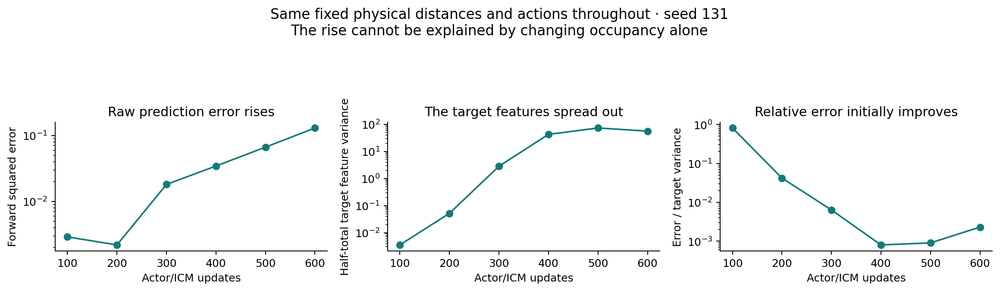
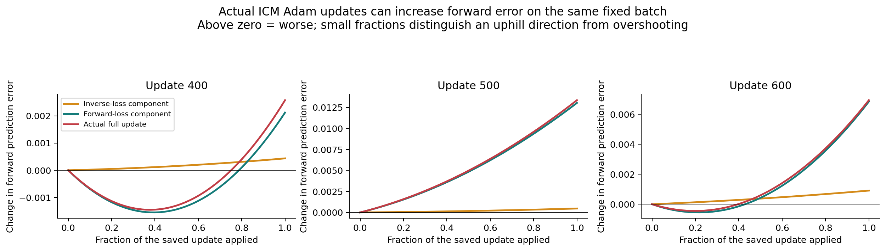
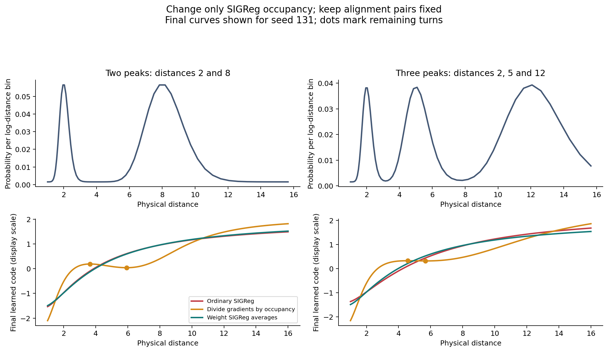

# Mechanistic interpretation: predictor error, occupancy, and fold removal

[Focused graphs](output/index.html) · [Exact optimizer-component audit](output/component-summary.json) · [Directional derivatives](output/directional-derivatives.json)

## First separate the two encoders

The plotted folds are in the scalar SIGReg representation **h**, trained after the ICM policy and curiosity predictor are frozen. ICM's forward predictor instead uses its own 32-dimensional encoder **φ**. There is no gradient or data-collection path from the later h back to the already trained ICM. The observed h-fold therefore cannot cause the earlier ICM prediction-error rise. We have not established whether φ has a separate aliasing problem.

At training time t the ICM error is

    F_t = E_{(x,a,x′) ~ p_{π_t}} [½ ||f_{ψ_t}(φ_{η_t}(x), a) − φ_{η_t}(x′)||²].

The predictor parameters ψ, feature parameters η, and policy-induced pair distribution p all change. The ICM optimizer minimizes **0.8 I + 0.2 F**, where I is inverse-action cross entropy, not F alone. Both feature branches receive forward-loss gradients. The actor learns separately from detached forward-error rewards.

## Why the raw error rises

### 1. The feature targets change dramatically

On the **same fixed physical distances and all three actions** in diagnostic seed 131:

| Actor/ICM update | Forward error F | Half-total target feature variance V | F/V |
| ---: | ---: | ---: | ---: |
| 100 | 0.002883 | 0.003545 | 0.8133 |
| 400 | 0.034397 | 43.001705 | 0.000800 |
| 600 | 0.130151 | 56.707733 | 0.002295 |



The raw error is 45.15 times larger at 600 than at 100, but target variance is roughly 15,998 times larger and error relative to that variance is about 354 times smaller. Early tiny raw error partly reflects features that barely distinguish inputs. A constant mean-feature prediction has squared error V on this evaluation distribution; F/V is a diagnostic comparison to that reference.

The identity F = V × (F/V) is an exact scale accounting, **not a claim that the actual features change only by uniform scaling**. As an illustrative special case, multiplying both targets and predictions by c multiplies squared error by c² without worsening relative accuracy.

Nor does scale explain everything. From 400 to 600, F/V worsens by about 2.87 times. There is genuine relative degradation in that interval, as well as continued target-scale change. Because these probes keep physical states/actions fixed, changing occupancy alone cannot explain this measured rise. The feature representation is still changing.

### 2. The inverse objective can oppose the forward objective

For plain SGD on the combined objective, a local illustration is

    ΔF ≈ −α [0.2 ||∇F||² + 0.8 ⟨∇F, ∇I⟩].

Only shared feature parameters contribute to the cross-objective inner product. If that inner product is sufficiently negative, reducing inverse loss can increase forward loss. This equation is an SGD illustration; the experiment actually uses Adam, including momentum and gradient clipping.

We therefore instrumented the real seed-131 trainer. At every update we separately accumulated the inverse-loss and forward-loss contributions to Adam's first moment, after applying the actual common clipping factor. At six saved updates, both components use the **same actual Adam denominator**. Their parameter directions reconstruct the actual combined step to within 10⁻⁶, and the complete run reproduces the original final actor and ICM weights exactly.

At updates 100, 200, 300 and 400, the isolated inverse-moment component lowers inverse cross entropy while raising forward error on that same fixed training batch. For example, at update 400 it changes inverse cross entropy by **−0.028414** and forward error by **+0.000436**. That is a direct local tradeoff, rather than an inference from two plotted curves. The inverse component also increases target variance at five of the six snapshots.

### 3. Some Adam steps overshoot; some momentum directions are uphill



Each panel starts from one saved ICM state and holds its current training batch fixed. We apply fractions of the saved inverse component, forward component, or full update, then measure F. These are finite parameter interventions, not separately trained histories.

At update 500, the accumulated forward-loss component is itself locally uphill on the current F:

    ∇F · Δθ_forward = +0.006319,

and the full-strength component increases F by **0.013033**. A momentum direction reflects earlier gradients; it need not descend the current changing loss.

At updates 400 and 600, that component has a downhill directional derivative (−0.007883 and −0.005087), yet its full finite step raises F (+0.002120 and +0.006840). Small fractions decrease F in the plot: this is finite-step overshoot. At updates 500 and 600 the complete ICM step even increases the combined 0.8 I + 0.2 F on the current batch. Thus this configuration also has measurable optimization instability; it is not correct to explain away the whole rise as harmless rescaling.

The components contain accumulated moment history and share a denominator. Their finite loss changes need not add, because the network and loss are nonlinear. Six one-step interventions in one seed establish these local effects; they do not fully attribute the complete multi-seed learning curve or establish a unique global cause. The earlier frozen-feature fitting experiment shows that the forward model can fit further with fixed targets, but does not isolate target drift from extra fitting or optimizer changes.

## The bimodal and trimodal experiments

Only the observations sent to SIGReg change. Each seed retains the same ICM alignment pairs, initialization and training schedule. The controlled distributions have equal peaks at 2 and 8, or at 2, 5 and 12, plus a 10% uniform-log-distance background. These are controlled regularizer distributions, not newly trained multimodal policies.



| SIGReg intervention | Bimodal: final folds | Trimodal: final folds |
| --- | ---: | ---: |
| Ordinary SIGReg | 0/3 | 0/3 |
| Divide its output gradients by occupancy | 3/3 | 1/3 |
| Inverse-occupancy-weighted sine/cosine averages | 0/3 | 0/3 |

The displayed curves use seed 131; the table includes diagnostic seeds 130, 131 and 136. Multiple occupancy peaks do not require multiple folds, or any fold. Ordinary multimodal training remained ordered in these trials. The gradient-only intervention introduced reversals. The controlled shapes/background differ from the boundary-concentrated native data, so this is not an exact recreation of native occupancy.

## Math of weighting: correct the distribution before differentiating

Write q = log d. Let p(q) be the collected endpoint distribution and r(q) the desired reference distribution. Provided p is positive wherever r is positive, the population importance weight is

    w(q) = r(q)/p(q),
    E_p[w(q) g(h(q))] = E_r[g(h(q))].

For uniform log-distance r, this is proportional to inverse log-distance density. With bins, each observation gets reciprocal bin count. A bin with 900 observations then contributes the same total averaging weight as a bin with 100: each crowded-bin observation gets one ninth the weight of each rare-bin observation. Counts are fixed data quantities, not differentiated model outputs. Empty regions cannot be recovered by weighting.

SIGReg uses normalized weights vᵢ = wᵢ/Σⱼwⱼ to compute

    C_k = Σᵢ vᵢ cos(t_k hᵢ),     S_k = Σᵢ vᵢ sin(t_k hᵢ),
    R = B Σ_k a_k [(C_k − exp(−t_k²/2))² + S_k²].

Here B is endpoint count and a_k are integration weights. “Moments” means these trigonometric averages, not only mean and variance. For fixed data weights,

    ∂R/∂hᵢ = 2B vᵢ Σ_k a_k t_k [−(C_k − exp(−t_k²/2)) sin(t_k hᵢ) + S_k cos(t_k hᵢ)].

Weighting changes **both** the global C/S errors and each sample's contribution. Multiplying the old output gradient by 1/p changes the latter while retaining the old concentrated C/S errors. It is not the gradient of the corrected SIGReg objective. Self-normalized finite batches approximate the population correction; they do not make it exact.

### Why weighting alone cannot guarantee no folds

If U = F_p(q) is uniform on (0,1), an ordered Gaussianizing map is

    h_ordered(q) = Φ⁻¹(U).

But T(U) = 2U for U ≤ 1/2 and 2(1−U) otherwise is also uniform. Consequently

    h_folded(q) = Φ⁻¹(T(F_p(q)))

also has a standard-Gaussian output distribution, while doubling back. The ideal quantile maps are defined almost everywhere; their infinite tail values at isolated boundary/turn points have zero probability. Smooth bounded networks only approximate such ideal distributions. The construction shows why a marginal-distribution regularizer alone cannot certify ordering, not that this folded map minimizes the complete alignment objective.

Changing the sampling measure can favor a better optimization path, as the experiments show. It does not supply an injectivity theorem.

## Math of the ordering penalty: directly oppose backward slopes

For ordered probes q₁ < … < q_M, let yᵢ = h(qᵢ), Δqᵢ = qᵢ₊₁−qᵢ, and sᵢ = (yᵢ₊₁−yᵢ)/Δqᵢ. Since the output's overall sign is arbitrary, choose one **global** orientation σ ∈ {−1,+1}. The strong penalty is

    L_order = γ min_{σ ∈ {−1,+1}} [1/(M−1)] Σᵢ [m − σ sᵢ]₊²,

with γ = 100 and m = 0.1 in the tested intervention. The minimum is **outside the sum**: the entire curve must choose the same orientation. Choosing a different sign for every pair would allow a fold to escape the penalty.

For a violating pair, put rᵢ = m−σsᵢ > 0 and N = M−1. Its output derivatives are

    ∂Lᵢ/∂yᵢ     = +2γσrᵢ/(N Δqᵢ),
    ∂Lᵢ/∂yᵢ₊₁ = −2γσrᵢ/(N Δqᵢ).

For σ = +1, gradient descent therefore pushes the left code down and the right code up. It directly increases their ordered separation. Neighboring-pair terms add, and actual neural-network updates obey

    ∇_θ L = Jᵀ ∇_y L,       Δy ≈ −α J Jᵀ ∇_y L

for plain SGD, where J is the output-to-parameter Jacobian. Shared parameters couple distant inputs; Adam further changes the parameter update. Thus the output forces describe the intent, while actual finite model interventions and dense slope checks test whether training achieved it.

### What is guaranteed, and what was only measured

For a differentiable scalar function on the whole interval, the continuum condition

    σ h′(q) ≥ m > 0 for every q

implies σ[h(q₂)−h(q₁)] ≥ m(q₂−q₁) > 0 whenever q₂ > q₁. This is strict ordering and therefore no folds. A zero continuum hinge integral enforces the corresponding derivative condition almost everywhere for an absolutely continuous h, which gives the same integral inequality.

On a finite probe grid, zero penalty guarantees ordered **probe values**, not ordering between probes. If ℓ = L_order/γ, the fraction of backward sampled intervals is at most ℓ/m²; a small penalty can still leave a small number of violations. A finite soft penalty at nonzero optimum is therefore weaker than a hard constraint. This explains why we retain tiny reversals as failures in the hard gain-8 tests.

In the five established gain-4 folds, the strong penalty removed all detected turns, including when its probes were selected only from stored observations. Those experiments add a known one-dimensional ordering prior; they do not demonstrate unsupervised recovery without that information. In seed 131, the saved repair's turn moves from 2.368 initially to 1.465 after 200 additional updates and 1.155 after 2,000. The motion is not monotone at every checkpoint. A simple turn at q* obeys the local relation

    Δq* ≈ −Δh′(q*)/h″(q*).

The fold disappears only when its turning structure is removed, such as a turn exiting the interval; moving a turn inward is not itself a no-fold guarantee. Final 10,001-point checks establish the reported finite-grid outcomes, not a global analytic certificate.

## Reproduce

```sh
OPENBLAS_NUM_THREADS=1 python3 explanations/occupancy-folding/mech-interp/analyze.py
OPENBLAS_NUM_THREADS=1 python3 explanations/occupancy-folding/mech-interp/figures.py
```

The new audit is one complete 600-update reproduction, with six saved actual-update component interventions and three step-size sweeps. Earlier occupancy and repair runs are reused, not rerun. Checkpoints retain the inputs, actions, before/after weights and component directions needed to independently inspect the finite interventions. The component summary records final reproduction error, gradient decomposition error and Adam moment reconstruction error. All numerical claims above are conditional on this toy implementation and the stated diagnostic samples.
