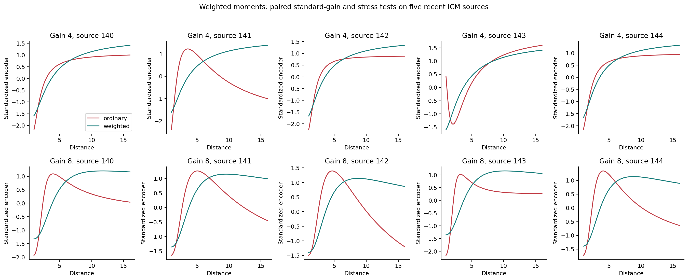
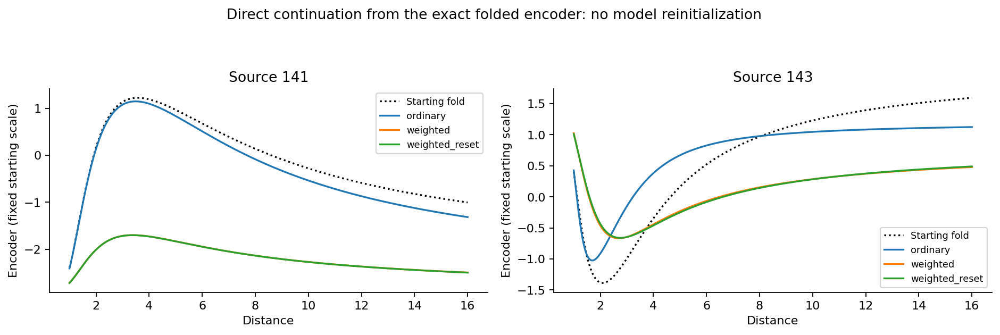

# Can weighted moments consistently remove folding?

[Fixed protocol](PROTOCOL.md) · [Training](run.py) · [Independent report](report.py)

Five ICM policy datasets, seeds 140–144, were generated in the recent original-MLP study. This study tests weighted moments on those sources for the first time, keeping all hyperparameters fixed. It separates prevention from random initialization at gains 4 and 8 from direct continuation of every new gain-4 ordinary fold, with Adam retained or reset. The frozen actor and original scalar MLP are unchanged. Weight estimation uses known sensor distance; this is not an ordering-free method for arbitrary observations.

Run from the workspace/repository root:

```sh
OPENBLAS_NUM_THREADS=1 python3 icm-folding/weighted-moments-validation/run.py
OPENBLAS_NUM_THREADS=1 python3 icm-folding/weighted-moments-validation/report.py
```

Checkpoints are reused. Independent gain-4 and gain-8 training can be run with `--gain 4` and `--gain 8`. The report requires both stages and every prespecified continuation. The original historical checkpoint re-audit is retained separately so portable checkouts can distinguish stored evidence from locally recomputed results.

## Completed findings

All 26 fits completed: 20 paired prevention/stress runs and six direct continuations from the two new ordinary gain-4 folds. At gain 4, ordinary training folds in 2/5 and weighted moments in 0/5. At gain 8, both methods fold in 5/5. Both existing folds remain folded after weighted-moment continuation, whether Adam is retained or reset. Prevention in the standard configuration does not establish a consistent repair.

[Measured results](output/RESULTS.md) · [Summary](output/summary.json) · [New-checkpoint verification](output/verification.json) · [Historical geometry re-audit](output/historical-reaudit.json) · [Environment](output/environment.json)




