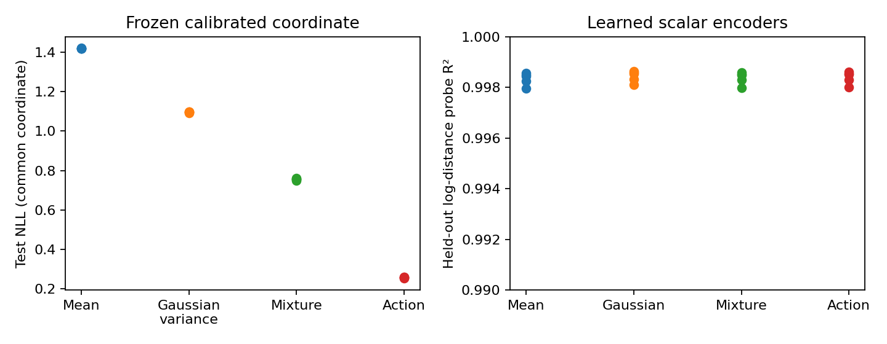

# Predictive Closure in a one-distance triangle world

[Results](RESULTS.md) · [Fixed protocol](PROTOCOL.md) · [What ran](RUN_STATUS.md)

We tested whether predicting only the conditional mean misses useful dependence, and whether action side information or distributional prediction changes learned distance recovery. We also fitted independent-noise drift models and tested local physical planning. All experiments preserve the same inverse-distance triangle sensor and one scalar physical state. The sign is current action side information; there is no extra hidden state or policy memory.

A subsequent explicit same-world check confirms that Gaussianized magnitude predicts its own future better while confusing distances d and 16/d. Ideal continuous predictive information ties; finite-resolution information differs. This uses known geometry and does not describe the trained neural encoders.

The exact signed-OU control has more predictive information than an ordinary AR example despite worse mean prediction. This compares two laws outside the conditional Gaussian assumptions; it is not an encoder-selection counterexample. In the learned experiment, **all four objectives retained distance**. The drift experiment also kept negative results: short-interval extrapolation increased error at this sample budget.



## Run on CPU

Python 3.12. Use an isolated environment; NumPy 1.26.4 is needed by the recorded Torch version.

```bash
python -m venv .venv
source .venv/bin/activate
python -m pip install torch==2.2.2 --index-url https://download.pytorch.org/whl/cpu
python -m pip install -r predictive-closure-extensions/requirements-cpu.txt
```

From repository root:

```bash
export OPENBLAS_NUM_THREADS=1
python predictive-closure-extensions/closure_controls.py
python predictive-closure-extensions/check_explicit_encoders.py
python predictive-closure-extensions/run_learned.py
python predictive-closure-extensions/run_drift.py
python predictive-closure-extensions/run_drift.py --weighted-followup
python predictive-closure-extensions/recheck_checkpoints.py
python predictive-closure-extensions/verify_trajectories.py
python predictive-closure-extensions/summarize.py
python -m pytest predictive-closure-extensions -q
```

The first command verifies stable mixture densities/moments and fits common-coordinate predictor controls. Neural training saves 20 checkpoints. A small smoke run can use `run_learned.py --steps 10 --seeds 999 --output /tmp/closure-smoke`; do not overwrite full results with smoke outputs. Drift outputs include coefficients, every task/action path and all settings. `recheck_checkpoints.py` evaluates the trusted checkpoints created by this study without retraining. Float-level differences can occur across platforms.

## Scope and sources

Paper: [Mosh Levy, Aly Lidayan and Yoav Goldberg, Predictive Closure, v1](https://arxiv.org/abs/2610.27364v1). Read Appendix A.1–A.2 and A.6 before interpreting MSE as information. Exact equivalence requires the shared finite-precision Gaussian marginal, fixed dimension/precision, representable mean, and conditional isotropic Gaussian with state-independent scalar variance. Otherwise the paper states a lower bound. Finite-frequency SIGReg and continuous density diagnostics do not certify these assumptions.

[Upstream](https://github.com/Mosh0110/predictive-closure) inspected at **2964fa8f737fa43871d47928edc9aac16fa9298f**, MIT license, copyright 2026 Predictive Closure contributors. Inspected README, LICENSE, requirements, `jepa/losses.py`, `jepa/four_image/models.py` and `side_model.py`. Upstream uses CIFAR collages, convolutional encoders, SIGReg and predictor side inputs. No upstream source was copied or adapted here. This is a toy extension, not a reproduction of its experiments. The encoder and scalar SIGReg implementation are included locally in `models.py` and `sigreg.py`; attribution is in the root THIRD_PARTY_NOTICES.md. No other experimental branch is needed.

Public PDF fetched as arXiv:2610.27364v1; SHA-256 `b114d69a751120780e1f27b5531e6628a57c57d70ef0fe4f250974f9c7b52f22`. The PDF/upstream checkout were inspection inputs and are not vendored. All output artifacts and checkpoints here are committed; no paid infrastructure was used.
